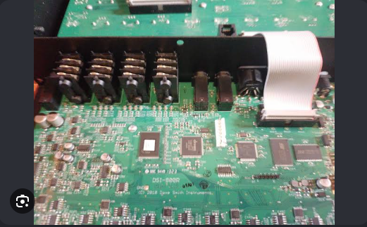
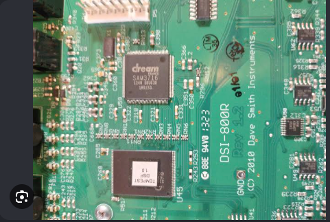
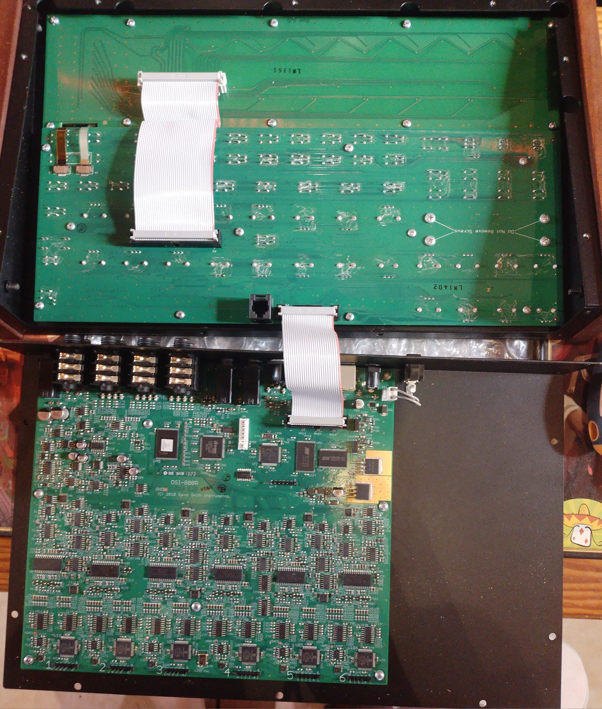
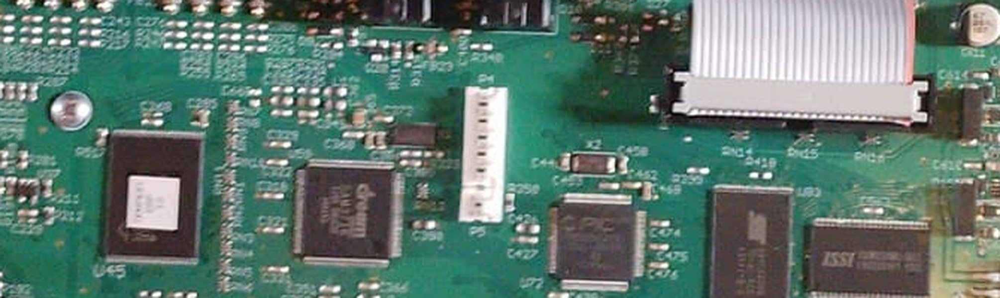
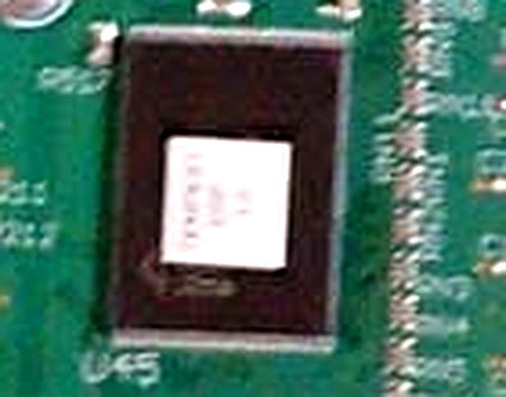

# Tempest Firmware Analysis - Research Notes

This document collects what's been learned about the Tempest's own internal
firmware - the code that actually runs on its processors - as distinct from
[docs/sysex-tempest-format.md](sysex-tempest-format.md), which covers the
SysEx wire protocol used to talk to the Tempest over MIDI. The two are
related: some of this investigation's motivation is that the firmware
contains readable strings ("Failed to read sequence data" and similar)
directly relevant to the still-open Export Beat multi-note question in the
SysEx doc (§9.4-9.6) - if the firmware's sequence-read/write code can be
found and read, it could explain that bug directly, rather than continuing
to guess at it from the outside via more hardware captures.

**Status as of 2026-09-22: architecture and chip identities are confirmed.
The byte-precise memory layout needed to actually read the interesting code
is not resolved, and multiple independent attempts to solve it did not
succeed.** This is a working state, not a finished investigation - read
through to the end before assuming anything or spending more time
re-attempting what's already been tried.

---

## 1. The firmware itself

The Tempest's operating system is distributed as a MIDI SysEx bulk dump, the
same transport mechanism `tempest-mcp` already uses for sound/beat/project
data. Download from
[sequential.com/support/download/tempest-operating-system](https://sequential.com/support/download/tempest-operating-system/)
(`Tempest_OS_1.5.0.2.zip` as of this writing) - a zip containing **four
separate `.syx` files, one per processor**:

| File | Processor | SysEx type byte |
|---|---|---|
| `Tempest_Main_1.5.0.2.syx` | Main | `0x71` |
| `Tempest_Voice_1.5.syx` | Voice | `0x72` |
| `Tempest_Panel_1.3.syx` | Panel | `0x73` |
| `Tempest_Sam_1.1.syx` | SAM | `0x74` |

This confirms the OS readme's own claim: "Tempest has four different
operating systems, one for each of the different types of processors that
control its functions." These four type bytes are a distinct message family
from the `0x60`/`0x61`/`0x63`/`0x5C`/`0x5E`/`0x5F` Sound/Beat/Project family
documented in the SysEx format doc.

Each file unescapes cleanly with `tempest-mcp`'s existing
`sysex.Unescape7Plus1` (the same collector-first scheme already confirmed for
Sound/Beat/Project data), using a plain 4-byte header (`F0 01 28 <type>`) -
no special-casing needed beyond what the repo's `sysex` package already
knows, other than that `sysex.Identify` doesn't currently recognize these
four type bytes (they decode to `TypeUnknown`), so the standard
`beat-mapper unescape`/`diff` CLI commands don't work on them directly (they
skip unrecognized types). Manually stripping the 4-byte header and calling
`sysex.Unescape7Plus1` on the rest works fine.

## 2. Confirmed: two different processor architectures, not four

**Main and Panel are MIPS32, little-endian - a Microchip PIC32 (MIPS M4K
core).** This is instruction-level confirmed, not a guess:

- Both files' early bytes decode as clean, unambiguous MIPS32 instructions
  when disassembled with the `capstone` Python library
  (`CS_ARCH_MIPS + CS_MODE_MIPS32 + CS_MODE_LITTLE_ENDIAN`) - real function
  prologues (`addiu $sp,$sp,-N` / register `sw` saves / `lui`), not
  coincidental bit patterns.
- Panel's firmware additionally contains genuine `mfc0`/`mtc0` COP0-register
  instructions - these only appear in exception/interrupt-handling code or
  rare low-level configuration, so this is real evidence of a real MIPS
  exception-handling environment, not noise.
- This independently corroborates (via primary-source binary analysis, not
  just the secondhand claim) an unverified Gearspace forum post describing
  the Tempest's main processor as "a PIC32 running at 80MHz." Note: that
  specific claim traces back to a post that reads as being about the
  **Prophet 12** (a different, later Sequential/DSI product using SHARC DSPs
  for audio and a PIC32 for the main OS) more than the Tempest specifically -
  plausible that DSI reused the same control-MCU platform across the product
  line, but that's inference, not a confirmed direct source for the Tempest.
  The instruction-level confirmation above stands on its own regardless.

**Voice and SAM are not MIPS, and not any commonly-documented architecture.**
No MIPS prologue or COP0 signature appears anywhere in either file. Real
Tempest hardware photos (see §4) confirm what they actually are:

- **SAM** is a **Dream S.A.S. SAM3716** - a real, if obscure, off-the-shelf
  part ("SAM" in the firmware filename is literally this chip's product
  name, not project-specific). Its datasheet describes 16 on-chip
  proprietary "P24" DSP cores (2k×24 RAM + 1.2k×24 ROM each, 24-bit data /
  96-bit coefficient resolution), built for audio matrix-mixing/effects
  applications. This architecture is undocumented publicly beyond
  block-diagram level - no public instruction set reference, no accessible
  disassembler or toolchain exists for it (even hobbyist forums report being
  unable to find a full datasheet). **Not realistically reversible with
  available tools.**
- **Voice** is a chip Sequential/DSI had custom-labeled **"TEMPEST DSP 1.0"**
  on the board silkscreen instead of showing its real manufacturer part
  number (a common OEM practice). Its real identity is unknown. Given its
  position on the board right next to the SAM chip in the audio section, and
  that Voice's firmware shows the same "not MIPS, not identifiable" pattern
  as SAM, it's reasonably assumed to be similarly out of reach - not
  independently confirmed.

**Practical conclusion: the Main/Panel MIPS path is the only one of the four
processors with a realistic path to further reverse engineering.** Ghidra,
`capstone`, and general MIPS/PIC32 knowledge all apply there. Nothing
comparable exists for the other two.

## 3. Confirmed: Main and Panel are almost certainly the same PIC32 part

Comparing the *unescaped* headers of Main and Panel directly (not the
escaped wire bytes, which don't compare 1:1 across files due to the
collector-first scheme's per-group structure):

```
Main:  05 f3 40 0f 00 00 00 00 ff ff 00 10 00 00 00 00
Panel: 9a 01 40 0f 00 00 00 00 ff ff 00 10 00 00 00 00
```

**14 of 16 bytes are byte-for-byte identical**, with only the first 2 bytes
differing. This is consistent with those first 2 bytes being a per-file
checksum (varies with content, as a checksum should) and the rest being
fixed structural data shared by both files - which in turn is consistent
with Main and Panel targeting the exact same PIC32 part number, not just the
same architecture family. Practical implication: if Panel's physical chip
marking can ever be read (its board may be smaller/less crowded/more
photographable than the main analog board that hosts the audio chips), that
would answer the "what exact PIC32 variant" question for Main too.

Tested whether the first 2 bytes are a simple checksum over the rest of the
payload (byte sum, 16-bit sum, XOR, the classic Roland 7-bit checksum
convention) - none matched. Doesn't rule out a checksum (there are many
possible algorithms - CRC-16/32, different included byte ranges, etc.),
just means the common simple ones aren't it.

The `ff ff 00 10` bytes (positions 6-9) initially looked like a plausible
flash-page-size field (`0x1000` = 4096, a common PIC32 flash erase-page
size, with `0xffff` as an adjacent erased-flash sentinel) - but the same
8-byte pattern (`ff ff 00 10 00 00 00 00`) appears to repeat at the next
8-byte boundary in Panel's header too, which looks more like plain
`0xFFFF`-padded reserved/unused space than a deliberately meaningful field.
Treat that specific guess as walked back, not confirmed.

## 4. Physical board identification

Real Tempest mainboard photos (found via image search, sourced from a public
Facebook post "Analog drum synthesizer Tempest by Dave Smith Instruments" in
the "I Take Pictures of Electronic Parts" group) show the board silkscreened
**`DSI-800R Rev 1.2`, `(C) 2010 Dave Smith Instruments`**.



- A chip clearly marked **`dream SAM3716`** - the SAM processor (§2).
- A chip custom-labeled **`TEMPEST DSP 1.0`** - almost certainly the Voice
  processor (§2), real identity hidden by the re-badge.



- Six repeated identical small-IC clusters, consistent with the manual's
  "six powerful analog synthesis voices."

**A higher-resolution version of the same album was later found and pulled
directly from the Facebook post (1740x2048, vs. the ~520x320 first-pass
copy above) - this changed the picture meaningfully:**



This shows there are (at least) **two separate boards** in the unit: a top
board that is a pure button/LED matrix (rows of pad footprints, a ribbon
connector, "Do Not Remove Screws" silkscreen, no IC larger than a shift
register/driver visible anywhere on it) sitting above the main `DSI-800R`
board seen in the original two photos. **This board is most likely the
physical pad/keypad panel specifically, not necessarily "the Panel processor
board" in the SysEx-firmware sense** - if Panel's PIC32 lives on a third,
still-unphotographed board, or off-frame on one of these two, that's still
unresolved. Worth remembering next time "Panel" comes up: the firmware name
and the physical board name may not refer to the same board.

The main board's control-MCU cluster is now visible clearly enough to be
useful:



- **`U45`** (leftmost chip in the cluster) is the strongest remaining
  candidate for Main/Panel's PIC32 by position (directly beside the
  ribbon-cable connector to the panel/button board) and package size.
- Next to it, a **second `dream`-logo chip** - most likely the same
  `SAM3716` already identified elsewhere on this board (same board,
  different framing), not a second distinct part; not fully confirmed
  either way from this angle.
- An **`ISSI`-branded memory chip** (Integrated Silicon Solution Inc, a
  real SRAM/Flash vendor) sits in the same cluster - consistent with a
  classic "MCU + external SRAM" arrangement, circumstantial support for
  `U45` being the actual controller rather than an unrelated chip.

**`U45`'s marking is physically hidden, not just hard to photograph:**



Zooming into `U45` at full resolution shows the white square isn't a flash
reflection (the working assumption from the earlier, lower-res photos) - it's
a **paper label glued directly onto the chip package**, with faint rows of
printed text on it that are below this photo's legibility floor. This is the
same playbook already seen on the Voice chip (re-badged "TEMPEST DSP 1.0" on
the silkscreen) applied differently: here, instead of relabeling in
silkscreen, DSI covered the chip's own factory-printed marking directly.
**Practical implication: no clearer photo of this specific unit's `U45` will
ever reveal the part number** - the marking is physically obscured, not
merely blurry. A different unit from a different manufacturing batch
(possibly without the label applied), the label peeled back, or the chip's
topside markings visible from a raking/angled light photo are the only ways
this specific angle could still resolve. Reasonable circumstantial evidence
this deliberate concealment happened *at all* is itself worth noting: DSI
apparently wanted to obscure their MCU sourcing for both Voice (silkscreen
re-badge) and, if `U45` really is Main/Panel's PIC32, this chip too (opaque
label) - suggesting board-level obfuscation was a deliberate choice, not
incidental.

**Searching for the exact PIC32 part number came up empty, and this looks
like a real dead end for the search-based approach specifically:**

- `fccid.io` and the FCC's own legacy equipment-authorization search are
  both impractical to query this way (bot walls on the former; the latter's
  legacy form needs a grantee code as a starting point, which isn't known).
  **Checked the actual manual text directly (not just searched for it): the
  Tempest's FCC section is only the generic Part 15 Class B "verification"
  statement, no ID code or grantee code anywhere.** That tier of compliance
  applies to wired-only devices with no RF transmitter, which typically
  never receive an individual FCC ID at all - this is likely why the FCC
  equipment-authorization search came up empty, not a search-quality
  problem. Treat the FCC-ID angle as structurally closed, not just
  under-searched.
- No schematic, service document, or FCC filing is indexed anywhere under
  the exact board revision `"DSI-800R"`.
- Direct `"PIC32"` + Tempest photo/text searches turn up essentially
  nothing relevant.
- Checked marketplace/parts sources for board-level photos beyond the one
  Facebook album: Syntaur has no parts listed for the Tempest at all;
  Reverb's marketplace search for board/parts listings returns only knobs,
  rack ears, and unrelated EPROM listings; a YouTube search for
  teardown/repair content returned only demo and tutorial videos. eBay was
  not checked past its bot-detection challenge page (not attempted to
  bypass). None of these turned up a second photographed unit.
- The 2010 board date does at least confirm the chip must be a **PIC32MX**
  family part, not PIC32MZ (which wasn't released until ~2013) - narrows
  which vector-spacing convention applies, but doesn't give the specific
  variant.

**Two possible physical debug-access points spotted in the hi-res photo,
neither confirmed:**

- A **6-pin single-row header labeled "P4"**, positioned directly beside
  `U45` and its neighboring `dream`-logo chip - i.e. right where you'd route
  short traces for an in-circuit debug connection to the MCU cluster. Six
  pins matches Microchip's standard ICSP header count exactly (`MCLR`,
  `VDD`, `VSS`, `PGD`, `PGC`, plus one more, often `AVDD` or NC). No
  pin-label silkscreen legible at this photo's resolution to confirm the
  signal names.
- An **RJ11/RJ12-style modular jack** (6 gold contacts) on the panel/button
  board, mounted right where the inter-board ribbon cables also connect.
  Genuinely ambiguous from a photo alone - could be a compact internal
  wiring-harness connector (common in consumer gear, e.g. to a separate
  display sub-board), or could be a service/debug port using a phone-jack
  shell instead of a pin header (PIC32's 2-wire ICSP plus power/ground fits
  comfortably in 6 conductors, so this isn't implausible either).

**If physical access to a unit is available, this is a categorically
stronger path than anything else in this section**: continuity-testing
either connector against the known PIC32 ICSP pinout with a multimeter, or
simply trying a PICkit/ICSP programmer against "P4" directly, would read the
chip's device ID straight from silicon - settling the exact part number
outright - and could enable a full flash dump with real, hardware-reported
addresses, bypassing the entire base-address problem in §5 rather than
solving it computationally.

### 4.1 DSI reused this control platform across other products - a real, independent lead

The Tempest is not the only DSI/Sequential product built around a PIC32
control board, and some of the others are far more actively discussed and
modded by the community than the Tempest is - meaning their exact chip may
already be identified somewhere the Tempest's isn't.

- **A Gearspace repair thread confirms the OB-6 and Prophet-6 "share the
  same architecture"** at the main-board level (the poster replaced a
  failed OB-6 mainboard - which also carries the USB port - under a $25
  DSI service exchange). The thread's own attached photos are dead links
  (2018-era third-party image hosting, since removed) - a checked, real
  dead end for *that specific thread's photos*, not for the underlying fact
  it confirms. **Checked archive.today directly for a cached copy with the
  images intact, both URL forms (the old `/board/...html` redirect and the
  canonical `/threads/...` URL) - no snapshot of either exists.** Genuinely
  closed, not just unfetched.
- **A ModWiggler teardown thread of a Dave Smith Mopho keyboard** (an
  earlier, simpler DSI product, ~2009) states in plain hobbyist language:
  *"The mainboard, voice + controlling microcontroller (PIC32), is quite
  small. A dsPIC seems to be used for the DCOs."* This independently
  corroborates PIC32 as DSI's standard control MCU choice well outside just
  the Tempest, from a source with no connection to this investigation. The
  thread has an attached close-up main-board photo (`IMG_3504.jpg`,
  captioned "close-up of the main board") that could plausibly show a
  legible part number - **gated behind free ModWiggler forum registration,
  not publicly viewable, so not fetched.** If accessible another way (a
  ModWiggler account), this is a concrete, specific image already known to
  exist, not a speculative search. **Also checked archive.today for a cached
  copy - no snapshot of this specific thread exists, and more tellingly,
  several other ModWiggler snapshots archive.today *does* have are
  themselves titled "MOD WIGGLER - Login."** The registration wall applies
  to archiving crawlers too, so even a cached snapshot of this thread would
  most likely preserve the login page, not the photo - this angle is closed
  on both fronts, not just the direct-fetch one.
- **Sequential hosts official, photographed main-board removal guides** for
  several *current* products (Prophet-5/10, Prophet X/XL) at predictable
  URLs (`sequential.com/<product>-main-board-removal/`) - confirmed no
  equivalent page exists for the Tempest (`sequential.com/tempest-main-board-removal/`
  404s, and a site search for "tempest main board" returns nothing
  relevant), consistent with the Tempest being long discontinued and
  outside their current support-doc priorities. Worth checking the *current*
  product guides' own photos for a legible PIC32 if the goal shifts from
  "identify Tempest's exact chip" to "identify DSI's standard chip across
  the whole platform lineage" - not done this session, since the Prophet-5/10
  reissue postdates the Tempest by roughly a decade and may use a different
  chip generation even if architecturally similar in spirit.

**Practical implication:** if asking in the Tempest-specific Gearspace
thread (§7) doesn't get a response, the OB-6/Prophet-6/Mopho communities are
larger, more active, and more likely to have already done this identification

- worth asking there too, framed as "what control MCU does the OB-6/Prophet-6
use" rather than Tempest-specifically, given the shared-architecture claim.

### 4.2 Downloaded and directly compared OB-6 and Mopho firmware - real progress, still not a full solve

Followed up on §4.1 by actually pulling the two sibling products' official
firmware and running them through the same pipeline as Tempest's, rather
than relying on secondhand forum claims. Both downloaded from official
sources: `Mopho_Main_1.4.syx` (`sequential.com`, 2010 release) and
`OB6_Main_1.8.0.syx` (`oberheim.com`, 2024 release - the current OS as of
this session, giving a much newer toolchain build than Tempest's 2017
`1.5.0.2`).

**Wire format is shared platform-wide.** Both files use `F0 01 <device
byte> <type byte>` headers structurally identical to Tempest's (`01 28`) -
Mopho uses `01 25`, OB-6 uses `01 2e`. Stripping the same 4-byte header and
running the same collector-first 7+1 unescape (`sysex.Unescape7Plus1`)
against OB-6's payload works cleanly. This is useful independent
confirmation that this repo's wire-format implementation is a real,
general DSI/Sequential convention, not something reverse-engineered to fit
Tempest specifically.

**OB-6 decodes as clean MIPS32/PIC32 immediately, and gives a stronger
address clue than anything found for Tempest.** Byte 0 of OB-6's unpacked
payload is an unambiguous reset stub:

```
lui $k0, 0x9d0c
addiu $k0, $k0, 0x4680
jr $k0
nop
```

Unlike Tempest's `jal`-based stub (§5.4, which only encodes 28 of the
target's 32 bits, forcing a guess at the top nibble), this `lui`+`addiu`
pair spells out the **full 32-bit target explicitly: `0x9D0C4680`**. This is
a real, independent confirmation that `0x9D` (KSEG0 cached program flash) is
the correct segment convention for this whole DSI/Sequential platform -
previously only an assumption for Tempest, now directly demonstrated on a
sibling product's own firmware.

Tried to use this to actually pin down a base address: computed the naive
file offset (`0xC4680` under a `0x9D000000` base) and disassembled there -
it doesn't land on clean, recognizable code. Swept ±8KB around that offset
looking for a real function prologue (`addiu $sp,$sp,-N`) - no clear winner,
same inconclusive shape as every base-address attempt in §5. **This sub-problem
remains open for OB-6 too, not just Tempest** - the full-address confirmation
narrows *which segment*, not *where in the file*.

**Also generalizes a Tempest-specific finding into a platform-wide one:**
searched OB-6's firmware - built in 2024, a vastly newer toolchain than
Tempest's 2017 build - for the stock XC32 NMI-check preamble (§5.4, §5.5).
Still absent, same as Mopho and Tempest. **"DSI writes custom startup
assembly instead of linking the stock library crt0.o" is not a Tempest
quirk or a toolchain-era artifact - it holds across at least three products
spanning 2010 to 2024.** This closes the door a little further on ever
finding a stock-crt0 reference to diff against, for any product in this
family, not just this one.

**Mopho did not decode cleanly at all.** Tried header lengths 3 through 7
bytes (in case this older, simpler 2010 product uses a different header
convention than Tempest/OB-6) - none produced a recognizable reset-stub
pattern the way Tempest and OB-6 both did immediately. Most likely
explanation: Mopho, the oldest and simplest product in this lineup, uses a
genuinely different wire or escape format - not investigated further this
session given time already spent; a real open question if picked up again,
not a dead end that's been ruled out.

**Follow-up (2026-10-17): pursued this much further - still no clean
decode, but now a thoroughly-tested negative with one new data point and
one useful self-correction, not an under-investigated gap.** Re-downloaded
fresh (`sequential.com/support/download/mopho-operating-system/`, still
live) and verified the header directly from raw bytes: `F0 01 25 6D ...
F7`, one single SysEx message, 149,895 bytes. **New finding: Mopho's type
byte is `0x6D` (109)** - doesn't match Tempest's documented type-byte
convention (`0x5C`-`0x63`) at all, a genuinely new, unexplained data
point. Confirmed `UnescapeStandard` and `Unescape7Plus1`
(`internal/sysex/encoding.go`) are currently byte-identical code in this
repo - "try the other DSI scheme" isn't actually a distinct test as the
codebase stands today.

Extended the header-length sweep (0-16 bytes, scored via capstone mnemonic
matching rather than eyeballing) and additionally searched the *entire*
~131KB decoded stream, word-aligned, for both sibling stubs' exact byte
patterns - not just offset 0: **zero hits for OB-6's `lui`/`addiu`/`jr`
stub idiom anywhere in the whole stream; exactly one hit for Tempest's
`jal;nop` idiom, inspected directly and judged noise** (flanked by
`<invalid>` decodes and a near-duplicate false match one word earlier).
Also tried a DSI nibble-pair (hi/lo nibble split) hypothesis, motivated by
the payload dividing evenly by 2 but not by 8 - also no clean stub at
offset 0, not exhaustively swept under this scheme.

**Self-correction worth recording explicitly**: an initially-promising
signal (large ~1024-byte runs of raw `0xFF`/`0x7F` bytes, suggestive of
PIC32's standard flash-row size) turned out, on closer inspection, to be
**insensitive to which header-length/alignment was tried** - it shows up
identically regardless, meaning it cannot actually discriminate the
correct scheme and doesn't validate 7+1 packing specifically, just
"this payload contains genuine blank/erased flash," consistent with any
top-bit-masking scheme. Flagged here so this near-false-lead isn't
rediscovered and overclaimed later.

**Conclusion: Mopho does not help the Tempest base-address problem.** No
scheme tested (7+1 at any alignment, nibble-pair) produced a recognizable
reset stub, so there is no new address clue to compare against Tempest's
own partial `jal`-based stub, unlike OB-6's full `0x9D0C4680` target. This
is now a well-tested negative, not an unexplored gap - if picked up again,
the next real angle is a different scheme entirely (RLE/compression for
the blank-flash runs, or asking Mopho's own actively-modded hobbyist
community, which is larger than Tempest's and may have already solved
this container format independently).

## 5. The base address problem

This is the actual blocker. To do anything useful with Ghidra (cross-reference
strings back to the code that uses them, read the Export Beat logic, etc.),
the tool needs to know the correct virtual load address the firmware is
compiled/linked against - loading it at the wrong address makes every
absolute address reference in the code resolve to nonsense.

**What's confirmed:** Microchip's standard PIC32 convention places the
exception vector base (`EBase`) at `0x9D000000` (KSEG0, cached program
flash), with the general exception vector at `EBase + 0x180` per the
`procdefs.ld` linker script convention (confirmed via Microchip's own
developer documentation and a real example linker script, though for a
different, smaller-flash PIC32MX variant than whatever Sequential actually
used - the *convention* transfers, the *exact vector table size* may not).
Panel's firmware shows COP0 (`mfc0`/`mtc0`) activity clustered in a pattern
plausibly consistent with this (early activity around file offset 0x1c-0x38
looking like CRT0 startup register configuration, a denser cluster around
0x1a4-0x1d8 plausibly matching the `EBase+0x180` general exception vector if
file offset 0 ≈ `EBase`) - but this is "consistent with," not "proof of," a
byte-precise base address.

**Four independent attempts to solve the exact base address algebraically
were tried, and none succeeded:**

1. **Global string correlation.** For every `lui`+(`addiu`|`ori`)
   same-register instruction pair in Main's firmware (217 found - each
   yields a fixed 32-bit "computed address" from the instruction encoding
   alone, independent of any base guess), correlated against the file
   offsets of every string Ghidra's own analysis had detected (265 of them).
   Voted for `candidate_base = computed_address - string_offset` across all
   ~57,500 combinations and histogrammed the result. No spike - top
   candidate got 16 votes with a smooth, gradual falloff (16, 16, 15, 15,
   14...) indistinguishable from coincidence.
2. **Narrowed string correlation.** Same vote data, re-filtered to only a
   tight ±0x4000-byte window around the trusted `0x9D000000` guess (~5300
   candidates instead of the full 32-bit space). Still no spike - top
   candidate got 13 votes against an equally smooth gradient.
3. **Global call-target correlation.** A different, in-principle cleaner
   anchor category: `J`/`JAL` call-instruction targets (whose low 28 bits
   are fully determined by the instruction encoding, independent of base,
   assuming KSEG0's top nibble `0x9`) correlated against function-prologue
   locations (`addiu $sp,$sp,-N` patterns) rather than arbitrary string
   data, since calls should overwhelmingly target real function entry
   points. Found 5689 candidate call targets (most likely mostly spurious -
   `J`/`JAL`'s opcode is only 2 of 64 possible 6-bit values, so roughly 3%
   of *any* 32-bit word matches by chance alone) against only 29 real-looking
   prologues across the whole 525KB file. Diffuse, unconvincing top result
   (4 votes).
4. **Narrowed call-target correlation.** Same technique restricted to just
   the first 16KB (the region with the strongest independent evidence of
   being real code, near the vector table). Found only **1** prologue in
   that entire range - at file offset `0x10`, the same location originally
   guessed as "the entry point" - too few anchors for any statistical signal
   at all.

5. **Pointer-table correlation.** A follow-up session noticed that the
   twelve `"Failed to ..."` strings (§5.1) sit in one tight, contiguous
   block - the signature of a `const char* error_messages[]` table indexed
   by an error code, not twelve separately-referenced literals. Searched for
   that pointer table itself (a run of 4-byte pointers with the same
   relative spacing as the twelve string offsets) two ways: an exact-order
   search (0 hits - the table's real order likely doesn't match the
   strings' file layout) and a flexible any-order pairwise-delta search
   (found large "clusters," but they turned out to be false positives from
   unrelated fixed-stride data elsewhere in the file - e.g. a repeating
   132-byte delta matching this project's own known Sound parameter block
   size, not the error table). With twelve strings there are 132 possible
   pairwise deltas, enough combinations to coincidentally match all sorts of
   unrelated regularly-spaced data in a 525KB file.
6. **SysEx type-byte dispatch search.** Reasoned that code dispatching on an
   incoming SysEx message's type byte would need to compare against several
   of the known type values (`0x5C`/`0x5E`/`0x5F`/`0x60`/`0x61`/`0x63`)
   close together, and searched for them as small immediate constants in the
   code - a search that's base-independent by construction, unlike 1-4
   above. Found a promising-looking cluster referencing `0x5f`, `0x61`, and
   `0x63` together in the trusted early-code region - but disassembling it
   directly showed this was a **false positive**: those bytes are ASCII
   characters (`0x61`='a', `0x63`='c') being stored one-at-a-time to build
   the literal string `"Basic"` (almost certainly a default factory
   sound/beat name), not SysEx-type comparisons. **SysEx type bytes
   (`0x5C`-`0x63`) overlap the printable-ASCII range (`\`, `]`, `^`, `_`,
   `` ` ``, `a`, `b`, `c`) almost exactly, so a bare constant-value search
   can't distinguish "loading a SysEx type for comparison" from "building an
   ASCII string" at the level of a single instruction - worth remembering
   before trusting a similar-looking hit again.** Refined the search to
   require the constant be actually **compared** (`beq`/`bne`) against a
   byte **loaded from memory** (`lbu`/`lb`) nearby, a pattern that should
   only match real dispatch code - zero hits anywhere in the file. Either
   the real dispatch uses a different pattern (a computed jump table indexed
   by the type byte is plausible for a 6+-way switch), the search window was
   too narrow, or it genuinely wasn't found this way.
7. **Jump-table verification - the most rigorous attempt, and the most
   conclusively negative.** Once the toolchain was confirmed as XC32/GCC
   (§5.3), reasoned that a multi-way `switch` (exactly what SysEx dispatch,
   or any similar command dispatch, would compile to) typically becomes a
   **jump table** in GCC-generated code, not a sequence of comparisons -
   explaining why item 6 found nothing. Searched for the specific compiled
   idiom (`sll $reg,$idx,2` immediately followed by an indirect `jr`) - a
   highly selective pattern, only 10 candidates in the whole 525KB file.
   Disassembling the most promising one (file offset `0x3d0`, very close to
   the trusted early-code region) found a genuine, textbook GCC jump table:
   a range check against 40 cases, a `lui`+`addiu` computing a table base
   address, an indexed load, and an indirect jump - unambiguous real
   dispatch code, the clearest structure found all night. **Verified
   whether the table's ~40 entries resolve to valid in-file addresses - a
   much stronger test than anything before, since it requires many entries
   to check out simultaneously, not just one:** 0/40 under the standing
   `0x9D000000` assumption; a coarse full-range sweep (`0x80000000` to
   `0xC0000000`, every 4KB) found no base reaching even 5/40; a fine
   4-byte-resolution sweep across ±128KB around the trusted base found only
   6/40 at best, with no sharp peak. **Reframed to be exhaustive**: instead
   of sweeping candidate base *addresses* (unbounded), swept every possible
   file *position* the table could occupy - bounded by the file's own size
   (~131,000 word-aligned positions), covering literally every base for
   which the table could sit anywhere inside this file. Vectorized with
   `numpy`. **Zero positions in the entire file reach even 10/40 valid
   entries.** This is exhaustive, not "didn't search wide enough" - there is
   no wider window left to try for this specific table under this specific
   validity model. Most likely explanation: this jump table's entries
   aren't simple absolute pointers the way assumed (XC32/GCC can compile
   PIC-style jump tables with PC-relative deltas instead, in some
   configurations - untested) - or this particular 40-case dispatch has
   nothing to do with SysEx types at all.

8. **Direct comparison against XC32's actual crt0.S startup source.**
   Downloaded Microchip's real XC32 v6.00 macOS distribution
   (`xc32-v6.00-full-install-osx.tar.xz`, ~1.4GB) and extracted
   `pic32m-libs/libpic32/startup/crt0.S` - the literal, hand-written assembly
   every PIC32 application links against for its reset/startup sequence,
   rather than inferring it by guessing. First confirmed something genuinely
   new and solid: **byte 0 of both Main's and Panel's raw firmware decodes
   as `jal <target>; nop`** - the exact idiomatic shape of crt0's `_reset:
   jal _startup; nop` stub, with the second word being a true all-zero `nop`
   (not just any nop-decoding value) in both independent files. This is real
   structural evidence both firmware dumps begin exactly at the CPU's entry
   point. But the deeper comparison came back negative: the file's NMI-check
   preamble immediately after (`mfc0 k0,CP0_STATUS` / `ext k0,k0,19,1`,
   unconditional, unguarded by any `#ifdef`) does not appear **anywhere** in
   either binary - checked as a whole-file search for the instruction
   pattern, not just at one guessed offset. Cross-checked this preamble
   against two more independent source snapshots spanning over a decade (a
   June-2013-tagged Microchip mirror on GitHub, closest to the Tempest's own
   era, and a 2014 chipKIT variant) - identical in all three, and Microchip's
   own v2.02 (December 2011) migration notes describe what did change in
   that release (`.dinit` data-initialization tables), not this preamble.
   There's no version history suggesting this code block ever looked
   different. **Conclusion: Sequential/DSI wrote custom startup assembly
   instead of linking the stock library `crt0.o`** - see §5.4 for the full
   reasoning and what was tried to salvage a base-address candidate from it
   anyway (also negative, but for a more specific reason).

**What this consistent pattern of failure suggests:** not that any single
attempt was almost right, but that blind statistical correlation over a raw
firmware blob doesn't have enough structure to solve this without a real
linker map, debug symbols, or confirmed code/data segment boundaries. Further
variations on the same class of technique are unlikely to succeed where
eight already haven't, several exhaustively - this is now a considered
conclusion, not something to re-attempt without new input.

### 5.1 The error-message string table

A broader, cleaner `strings` pass over Main's firmware (filtering to
readable-only runs) turned up more relevant strings than the original five:
`"' loaded from MIDI"`, `"' loaded into Beat "`, `"Receiving MIDI Data... "`,
`"MIDI Buffer Overflow"`, `"MIDI Status Byte"`, `"Send Main OS"`/`"Send Panel
OS"`/`"Send Voice OS"`, `"Beat saved to file: "`/`"Sound saved to file:
"`/`"Project saved to file: "`, and more `"Failed to read/write
beat/project/sequence sounds/params"` variants beyond the original five.

Computing file offsets for all twelve `"Failed to ..."` strings shows they
sit in one tight, contiguous ~360-byte block (`0x6c2ae`-`0x6c43f`) - clearly
one shared error-message table indexed by an error code, not twelve
independently-referenced literals. **This directly explains why the original
per-string reference search (item 1 above) found nothing**: code that does
the equivalent of `puts(table[error_code])` only references the table's
*base* once, not each string individually - searching for twelve separate
direct references was never going to succeed regardless of the base address
guess. Worth keeping in mind for any future string-based correlation
attempt: check whether target strings cluster together (implying a shared
table, one reference) before assuming each one has its own reference site.

**What would actually unblock this**, roughly in order of how much new
information each would provide:

1. Sequential's *actual* PIC32 variant and its real (not generic-example)
   linker script/vector table layout - via product documentation, a service
   manual, or the Tempest hacking community having already solved this.
2. A legible photo of the Main or Panel chip's part marking (§4 - not found
   yet, but the search wasn't exhaustive; Panel's board specifically hasn't
   been photographed/found).
3. Comparing this firmware's header against an **older OS version's**
   header (the same technique that found the Main/Panel structural overlap
   in §3, applied across versions instead of across processors - a real
   address/config field should stay constant across versions where a
   version number or checksum would change). Attempted, but blocked by
   circumstance rather than ruled out: the Internet Archive was returning a
   real "temporarily offline" outage during this session (not a bot block -
   an actual service outage), and Sequential's live download page only
   hosts the current `1.5.0.2` release with no older versions linked. Worth
   retrying later, or looking for a community-hosted mirror of an older
   `Tempest_Main_*.syx` file. **Re-checked in a later follow-up session, via
   direct `curl` against the raw CDX API, not just the browser - still
   returning the same outage page. This is a genuine multi-hour-plus outage,
   not a one-off blip; worth checking again another day rather than
   retrying repeatedly within the same session.**

### 5.2 UI menu/screen text isn't stored as plain strings in any of the four firmware files

A natural-seeming idea: search the manual's own menu and screen names (`"16
Sounds"`, `"16 Beats"`, `"Quantize"`, `"Swing"`, `"Beat Events"`, `"Export
Beat"`, etc.) against each firmware's string table, in case any of them
sit near the code that would be worth reading. Tried this properly - pulling
phrases *from the manual* and searching for them in the binaries, not just
reasoning about whatever `strings` happened to already turn up - across all
four firmware files. **None of the major UI screen/menu names appear as
plain ASCII text anywhere, in any of the four files.** Only a handful of
Main's already-known backend strings matched (`"Init Beat"`, `"Init
Sound"`, `"Format Flash"`, `"Soft Key"` - all file-operation strings, not
UI labels). Panel, Voice, and SAM's entire `strings` output is 100% noise -
not one real English word in any of them, at any length threshold tried.

This is a real, informative negative result, not a failed search: **the
Tempest's on-screen menu text is not stored as plain readable strings in any
of these four OS update files.**

A follow-up session tested two specific encoding hypotheses for where that
text actually lives, both cleanly ruled out:

- **Hex-encoded text/identifiers.** Searched Main's firmware for long runs
  of pure hex-digit ASCII bytes (`0-9A-Fa-f`), which would indicate
  hex-encoded strings or build identifiers. Zero runs of 8+ consecutive
  hex-digit bytes found anywhere in the file.
- **UTF-16 encoding.** Microchip's **Graphics Composer** tool (part of
  MPLAB Harmony / the Microchip Graphics Library - a real, documented
  "String and Font interface" plus "Asset Manager," built for exactly this
  kind of embedded-LCD UI) commonly stores localizable UI strings as UTF-16
  rather than 8-bit ASCII, which would explain why a plain `strings` scan
  (looking for 8-bit character runs) found nothing even if the text were
  otherwise literal. Wrote a manual UTF-16LE/BE scanner and ran it against
  both Main and Panel in both byte orders - **zero hits, every combination.**

**Current best explanation, not confirmed:** the UI text is most likely
stored via Graphics Composer's own **proprietary compiled-asset format**
(documented to exist - it compiles imported strings and fonts into a binary
asset format, not plain string literals) rather than any of the byte-level
text encodings tested here. Decoding that specific format would need its
own dedicated research effort and isn't obviously worth it for this
project's actual goal - the Export Beat / sequence-data code already lives
in one of Main's plain-text-readable regions, so this doesn't block that
work. Worth remembering as an open question if UI text ever becomes
directly relevant.

### 5.3 Toolchain era, confirmed

Researched what PIC32 development actually looked like at the time the
Tempest was built, since assumptions about the toolchain (linker
conventions, standard library behavior) underpin several of the guesses
above. **Confirmed via Microchip's own documentation:** in 2010 (the
Tempest mainboard's silkscreen date, §4), PIC32 development used **C**,
compiled with Microchip's **MPLAB C32** compiler, inside the original
**MPLAB IDE v8.x** (native Windows, predating the NetBeans-based MPLAB X).
Microchip's unified **XC32** compiler and **MPLAB X IDE** became standard
around 2011-2012 - there was no XC32 yet in 2010, and no official C++
support.

This matters for dating the specific binary analyzed here: `Tempest_Main
OS 1.5.0.2` was uploaded by Sequential in **2017**, well after Microchip
moved on from C32. It was almost certainly built with the newer XC32
toolchain, not the original 2010-era C32 - which validates (rather than
merely assumes) the XC32/MPLAB-X-era conventions this investigation has
been relying on elsewhere (e.g. the `procdefs.ld`-style linker script
layout in §5).

### 5.4 Stock crt0 comparison - ruled out, with a specific reason why

Following up on item 8 in §5's list: since the stock XC32 NMI-check preamble
is absent from both binaries entirely, the next question was whether a
self-consistent *candidate* base address could still be extracted from just
the confirmed `jal _startup`-shaped stub at offset 0, without needing the
rest of crt0 to match.

The `jal` instruction's target only fixes 28 of the target address's 32 bits
(the top 4 come from the surrounding segment, not the instruction). Working
backwards from the two known real PIC32 KSEG0/KSEG1 program-flash base
values (`0x9D000000` cached / `0xBD000000` uncached - same physical memory,
same low 28 bits either way) as the assumed value of file offset 0:

- Main's `jal` target resolves to file offset `0x3CC14` (246,292 - within
  Main's `0x80141`-byte size).
- Panel's `jal` target resolves to file offset `0x668` (1,640 - within
  Panel's `0x10029`-byte size).
- Both in-range, and the ~0x3C5AC-byte gap between them is internally
  consistent (falls straight out of the same base assumption applied to both
  files independently).

This looked promising enough to check directly - but disassembling both
predicted offsets shows byte patterns that don't decode as clean, sensible
MIPS code (no recognizable prologue, no `mfc0`/`ext` signature, nothing that
reads as real instructions). **Being "in file bounds" turned out to be a
weak filter, not real confirmation** - satisfied by construction for most of
a 512KB candidate space. Given the crt0 comparison already independently
established this is custom startup code, not the stock library, there's no
more mileage left in chasing the *stock* `_startup` target specifically -
whatever function the `jal` actually calls is Sequential's own code, with no
public reference to compare it against.

### 5.5 Vendor/library signature search - a different question than base

address, also negative

Not another base-address attempt - a separate check for whether any
identifiable third-party chip or USB stack leaves a recognizable signature
(a name string, a register constant, a descriptor structure) anywhere in the
firmware, which could help independently of solving addressing.

**Chip-driver strings.** Searched all four firmware string dumps for the
brand name of every chip legible in the board photos (§4) - `ISSI`, `dream`/
`SAM37`, `PIC32`/`Microchip`/`XC32` - plus a broad sweep of other likely
memory/codec vendor names (Winbond, Micron, Atmel, Cirrus, Wolfson, etc.) in
case of a surprise match. **Zero hits, anywhere, for any of them.** This is
the expected result, not a surprising one: driver code for a memory-mapped
external SRAM chip is normally just direct register/bus access with no
descriptive strings, unlike a USB stack or RTOS that logs debug messages -
and the `dream`/`ISSI` chips are separate silicon with their own firmware
images, so there'd be no reason for their names to appear inside Main's or
Panel's string table regardless.

**USB code.** Main's firmware does contain one genuine, DSI-authored string
confirming USB-related application code exists: `"USB not connected"`. But:

- No Microchip USB-stack internal strings anywhere (`endpoint`, `descriptor`,
  `MCHPFSUSB`, class-specific terms) - consistent with either debug strings
  being compiled out of a release build, or a minimal custom USB layer
  rather than the full Microchip Application Library stack.
- Searched the raw bytes of all four files directly for an actual **USB
  device descriptor structure** - its first several fields are tightly
  constrained (`bLength=0x12`, `bDescriptorType=0x01`, a valid `bcdUSB`
  value, a valid `bMaxPacketSize0`), so a real match would be a strong,
  base-address-independent anchor, and would hand over the real
  `idVendor`/`idProduct` directly. Checked both strictly and with the
  constraints loosened - **zero real matches in any file** (120 raw `12 01`
  two-byte coincidences exist in Main alone, expected given how common those
  byte values are in MIPS instruction encoding, but none are followed by a
  plausible USB version field).
- Checked the public `usb.ids` database and general web search for a
  documented DSI/Sequential/Tempest USB vendor ID - no match. DSI most
  likely never registered their own VID (a real cost many small
  manufacturers skip), which also explains why there was nothing to
  pattern-match against even if a descriptor had been found.
- **Most likely explanation**: the USB descriptor table is probably built
  programmatically in code (byte-by-byte) rather than stored as a literal
  byte sequence, or it lives in a factory-provisioned/bootloader region not
  included in these field-updatable `.syx` OS images at all - similar to why
  the full reset/exception vector table isn't fully present either (§5.4).

### 5.6 The real chip family, found via Microchip's own datasheet - base address confirmed, but two independent jump-table tests against it still fail (2026-10-17)

Previous attempts (§5.1-5.5) all tested `0x9D000000` as a *borrowed* base
address - taken from a generic PIC32MX210 linker-script example with no
connection to this specific product. This session found the real chip
family and confirmed the number for real, but that still wasn't enough to
unlock disassembly - documented here in full since it changes *why* the
base address is trusted without changing *whether* decompilation works yet.

**The real chip family, identified for the first time.** Downloaded
Microchip's actual **PIC32MX5XX/6XX/7XX Family Datasheet** (DS60001156)
and the **MIPS32 M4K Processor Core Software User's Manual** (MD00249) -
real documents, not examples. Two independent facts, both confirmed:

1. The MIPS32 architecture itself fixes the Reset/Soft Reset/NMI exception
   vector at `0xBFC00000` unconditionally (not configurable), and `EBase`
   (CP0 register 15, select 1) resets to `0x80000000` with bits 31:30
   hardwired to `2#10` - explaining *why* software reprograms it into the
   `0x9D`-`0xBF` range, not just that it does.
2. **The datasheet's own memory-map figure (Figure 4-5, which specifically
   covers the 512KB-flash 575/675/775 variants) gives real, chip-specific
   numbers for the first time**: Program Flash = virtual
   `0x9D000000`-`0x9D07FFFF` (KSEG0) / physical `0x1D000000`-`0x1D07FFFF`,
   exactly 512KB. Boot Flash = virtual `0x9FC00000`/`0xBFC00000` / physical
   `0x1FC00000`, ~12KB, ending in 16 bytes of Device Configuration
   registers (`...2FF0`-`...2FFF`).

**Flash-size math narrows the real chip to exactly 8 part numbers.** PIC32MX
(M4K core) tops out at 512KB of flash - anything bigger needs PIC32MZ
(microAptiv core), ruled out by the board's 2010 silkscreen date predating
that core by years. The family datasheet lists exactly 8 parts at 512KB,
split by extra peripherals: **575F512H/L** (USB+CAN), **675F512H/L** and
**695F512H/L** (USB+Ethernet), **775F512H/L** and **795F512H/L**
(USB+Ethernet+CAN). The Tempest has neither an Ethernet nor a CAN port, so
575 is the best-supported single guess if DSI picked the cheapest part
meeting their actual I/O needs - but a shared-SKU product line could still
mean any of the 8, which doesn't matter for the memory map, identical
across all of them.

**A genuinely new quantitative cross-check, and it fits almost exactly.**
512KB Program Flash = 524,288 bytes exactly. Main's own confirmed decoded
size is 524,609 bytes (`0x80141`) - only **321 bytes over**. Too small to
also include the ~12KB Boot Flash region, consistent with (not proving) the
standing assumption that the `.syx` OS-update image is Program-Flash-only.

**Correction, same session, follow-up delegated task: the 321-byte overage
is not a meaningful trailer - it's erased-flash padding, and real content
actually ends *before* the 512KB mark, not after it.** Checked the actual
bytes: the last byte of Main (file offset `0x80140`) is `0x3A`; the last 512
bytes measure ~0.04 bits of entropy (essentially constant). The file's last
long `0xFF` run spans decimal offset 523,796-524,604 (809 bytes) - starting
**492 bytes before** the exact-512KB mark (524,288) and continuing 316
bytes past it, straddling the boundary, followed by only three stray
non-`0xFF` bytes before the literal end. Decode density in that final
region is 0/203 = 0%. Bigger picture: the last ~27KB of the file (from
~offset 497,532 on) is dominated by repeated ~1024-byte `0xFF` blocks (33
runs ≥100 bytes found total) - classic unprogrammed/erased-flash padding,
not content. **The compiled image doesn't fill the full 512KB at all; real
content tapers off around offset ~523,796, well before either the 512KB
mark or the file's own literal end.** Practical implication for base-address
work: don't trust anything in the last ~27KB of Main as meaningful, and
stop treating "the file is 321 bytes over 512KB" as evidence of a
header/trailer structure - it isn't one.

**Re-downloaded the real firmware fresh this session**
(`sequential.com/wp-content/uploads/2017/08/Tempest_OS_1.5.0.2.zip` - the
real working link found via the support page; a guessed URL from memory of
a prior session's path 404'd) and re-derived the unescaped payload from
scratch with an independent Python reimplementation of `Unescape7Plus1`,
landing on the identical 524,609 bytes - confirms the method is
reproducible from zero, not dependent on any state left over from a prior
session (none of which persists on disk between sessions anyway).

**Re-ran the already-known 40-entry jump table (file offset `0x3d0`,
computed table address `0x9D06B860`, found via `lui $t2,0x9d07` /
`sll $t1,$a3,2` / `addiu $v1,$t2,-0x47a0`) against the now-confirmed base:
still 0/40 valid** at `0x9D000000` exactly - reproduces the prior session's
negative result, now against an evidence-based base rather than a guess.
Widened to a ±128KB window (motivated by a real forum example of a
different PIC32 project reserving `0x11000` bytes for its own bootloader
before the real vector table) - best found was 12/40 at a shift cluster
around -38,300 bytes, but the actual 40 values there show a regular,
smoothly-varying pattern characteristic of structured data (most likely
embedded factory sound-parameter presets) being sampled by a sliding
window, not real function pointers - the same false-positive shape §5.5's
coincidence-rate reasoning would predict, not a real signal.

**Found a second, independent jump table with a corrected search script**
(the first attempt's script had a real bug - it required `lui`+`addiu` to
sit adjacent, but the true idiom interleaves `sll` between them; fixed to
track the destination register instead of position). The second table, at
file offset `0x603c0` (computed table address `0x9D07862C`), is a 25-case
dispatch reached via `addiu $v1,$v0,-0x5c` before the range check -
dispatching on `(something - 0x5C)`, and `0x5C` is this project's own
confirmed `TypeAltSound` SysEx byte, with the 25-case range (`0x5C`-`0x74`)
spanning every known Tempest SysEx type byte (`0x5C`-`0x63`). A genuinely
suggestive numeric coincidence - **but it also tested 0/25 valid** at the
confirmed base, and unlike the first table's near-miss, these 25 values
don't even superficially resemble addresses (mostly small values with many
zero bytes, e.g. `0x00820E12`). Treat the `0x5C` match as circumstantial,
not confirmed - 92 is also just a common small integer that could appear in
an unrelated enum.

**Panel showed a different, still-unconfirmed signal.** Panel has only 6
total `lui`+`addiu`/`ori` same-register pairs in its entire 65,577-byte
file (very sparse - most of Panel is data, not code: a per-word capstone
decode scan finds only 21.2% of the file decodes as valid MIPS32 at all).
Two of the 6 compute *physical* addresses `0x1D004740` (file offset
`0x3688`) and `0x1D004641` (file offset `0x374c`) - the datasheet-confirmed
physical Program Flash prefix, found this time in actual firmware code
rather than a datasheet. The `0x374c` site sits in a region decoding at
75-82% density versus Panel's ~21% file-wide baseline - a real,
address-independent signal that this is credibly genuine code, not
coincidence - and is immediately followed by `lbu $a2,($v0)` (a byte read
from that computed address) then a `jal` call, consistent with (not proof
of) flash read/verify code. This doesn't resolve Main's base-address
problem (different chip, different firmware), but it's a second real data
point - now found in running code, not just read from a datasheet -
supporting that the family's documented physical addressing scheme is
genuinely in use here.

**Follow-up (same session, delegated to a background agent): the NVM-unlock
search was redone exhaustively across all of Panel, and the `0x3688` site
was density-checked and traced further - clean negative on the unlock,
upgraded confidence on the site itself.** Searched Panel's entire
65,577-byte file for the standard PIC32 NVM unlock (`0xAA996655` then
`0x556699AA` into NVMKEY) two independent ways: every `lui $reg,0xaa99`/
`lui $reg,0x5566` at any disassembled position, and a raw byte-pattern scan
for the literal constants as data in both byte orders. **Zero hits, either
way, anywhere in the file** - not just near `0x374c`. This doesn't disprove
`0x374c` is flash-related code, but rules out this specific Panel image
performing a self-write under the standard unlock protocol itself; most
likely the real NVM-write/bootloader code lives outside this
field-updatable `.syx` image, consistent with the missing vector table and
missing USB descriptor pattern already established elsewhere in this doc
(§5.4, §5.5). Separately, `0x3688` (computed `0x1D004740`) density-checked
at 75-81% across three window sizes versus the same ~21.2% file-wide
baseline - equally credible as real code as `0x374c`, and in fact the same
~0x3600-0x3900 contiguous block: a full linear disassembly of that range
reads as one coherent function computing both `0x1D004740` and
`0x1D004641`, and also appeared to do `lui $t3,0x9d00` at file offset
`0x37d0`, a `0x9D00xxxx` virtual KSEG0 load nearby.

**Correction (2026-10-17, follow-up trace): the `0x37d0` "virtual address"
reference does not hold up, and the two physical-address sites are not
part of a conventional function at all.** A full trace found: (1) `$t7`
(the register holding `0x1D004740`) is confirmed dead - redefined to an
unrelated value just 2 instructions later, never actually reused; (2) the
`0x37d0` `lui $t3,0x9d00` is never consumed by any later `addiu`/`ori`
within 60 instructions, unlike the two physical-address pairs which pair
cleanly within a few instructions - it fails the exact test that validated
the other two; (3) a few words past `0x37d0`, decode hits `swc1`/`lwc1`
(FPU) and `jalx`/`bz.h` (MSA vector) instructions - impossible on the
confirmed FPU-less M4K core, concrete evidence the stream has broken down
into non-code noise right around there; (4) roughly half of all decoded
branches in this `0x3660`-`0x3900` region target file offsets outside
Panel's own 65,577-byte file entirely - a base-address-independent test
that doesn't require knowing the chip at all. **Most likely the `0x37d0`
site is a coincidental decode of non-code bytes, not a third real
reference alongside the two physical-address computations.**

A whole-file census makes this more than a local anomaly: Panel has only
**7 standard MIPS function prologues** (`addiu $sp,$sp,-N`) in its entire
65,577 bytes, all clustered in the first 1,020 bytes, and **zero**
instances of `jr $ra` (ordinary function return) anywhere in the whole
file. No conventional compiler-generated function with a frame and a
return exists anywhere past roughly file offset `0x1a00` - the two
physical-address computations are real code, but not part of a boundable
"function" in the usual sense. A file-wide search for any `jal` targeting
this fragment also found no caller. One numerically striking side-signal
(14/130 `jal`-shaped decodes landing in-bounds under a shared-low-28-bits
base, ~440x above chance) was checked and traced to the same
chip-impossible-instruction neighborhoods as above - treated as the same
kind of false positive already identified elsewhere in this doc, not a
new signal.

**Also done this session: an exhaustive search for a `$gp`-relative or
PC-relative jump table in Main, specifically to extend the two
already-tested absolute-pointer tables - clean, fairly conclusive
negative.** Per-word-decoded all of Main and found every `jr` through a
register fed by a preceding `lw` within a 20-instruction lookback - a
necessary condition for *any* table-indexed jump regardless of addressing
style, since the final step is always `lw entryreg,0(addrreg); jr entryreg`.
Only **4 such candidates exist in the entire file**: the two already-known,
already-tested tables (`0x3d0`/`0x603c0`, both already 0/40 and 0/25
against the confirmed base), and two new ones (`jr $t3` at `0x2ce58`, `jr
$k1` at `0x35060`) that turned out to match *neither* requested idiom -
`$gp` is confirmed used as an addressing base 157 times elsewhere in Main,
but never once feeds a register that reaches a `jr`; neither new site has
any `addu`/`add` between its defining `lw` and its `jr` either, so there's
no index-scaling step - they're plain indirect calls through a struct
field, not jump tables. Given the fixed-width per-word method, this is
exhaustive for a 20-instruction lookback, not merely "didn't find one yet."

**Where this leaves things.** Two independently-found, real (not guessed)
jump tables in Main now both fail to validate against the one base address
that has actual chip documentation behind it. That's stronger negative
evidence than any single-table result alone: it's not "this one table
happens to be unrelated to SysEx," it's "the simple file-offset-0-equals-
virtual-`0x9D000000` model doesn't hold for anything tried yet." Combined
with Panel's partial, physical-address-prefix-only confirmation, the
standing recommendation is unchanged and now more clearly the right call:
**the ICSP hardware test (§7 item 5) is the one path that doesn't depend on
guessing a model this many independent checks keep failing to validate.**

## 6. Tooling reference (for picking this back up)

None of this is committed to the repo (it's general-purpose reverse
engineering tooling, not project-specific code) - reinstall/redownload as
needed:

- **Firmware download:** `Tempest_OS_1.5.0.2.zip` from
  [sequential.com/support/download/tempest-operating-system](https://sequential.com/support/download/tempest-operating-system/).
  Unpack the four `.syx` files, strip the 4-byte SysEx header, and call
  `sysex.Unescape7Plus1` on the rest to get the raw unpacked firmware bytes
  for analysis.
- **Ghidra** (`brew install ghidra`, pulls in `openjdk@21` automatically).
  Needs `JAVA_HOME` pointed at the Homebrew OpenJDK explicitly - the bare
  `java` on macOS is usually just a stub. Headless analyzer lives at
  `<ghidra prefix>/libexec/support/analyzeHeadless`.
  - Import a raw binary with: processor `MIPS:LE:32:default`, loader
    `BinaryLoader`, `-loader-baseAddr 0x9D000000` (or whatever base is being
    tested).
- **PyGhidra** (`pip3 install pyghidra`, needs `GHIDRA_INSTALL_DIR` set) is
  the practical way to script Ghidra. Plain `.py` scripts passed to
  `analyzeHeadless -postScript` do **not** work in Ghidra 12.x ("Ghidra was
  not started with PyGhidra. Python is not available") - instead call
  `pyghidra.start()` then use the real Ghidra Java API
  (`ghidra.base.project.GhidraProject.openProject(...)`,
  `ghidra.program.flatapi.FlatProgramAPI`, etc.) from an ordinary `python3`
  script.
- **`capstone`** (`pip3 install capstone`) is the quickest way to
  spot-check a specific byte range without spinning up a full Ghidra
  project - `capstone.Cs(capstone.CS_ARCH_MIPS, capstone.CS_MODE_MIPS32 +
  capstone.CS_MODE_LITTLE_ENDIAN)`.
- **Preset-text decoder** (persisted, unlike everything else in this
  section - the one exception worth keeping on disk rather than
  rebuilding each session): `decode_preset_text.py`, in this repo's
  parent directory's `firmware/` folder (sibling to `tempest-mcp/`, not
  inside this repo). Implements the §§23/25/27/29/31-34 deletion-
  mechanism model directly - decodes `Tempest_Main_1.2.0.8.syx`, walks
  the lossy preset-text zone classifying each byte by its *raw* value
  (control bytes are `0x00`/`0x80`, indistinguishable after masking, so
  the raw value matters), and fuzzy-matches the result against the
  embedded 454-name §29 dictionary. Run with `python3 -I
  decode_preset_text.py [path/to/Tempest_Main_1.2.0.8.syx]`. Gets
  299/319 fragments (94%) matched confidently on its first run - a real
  improvement over every prior manual transcription pass in this
  document.

## 7. Suggested next steps

In priority order, given everything above:

1. ~~Get XC32's actual runtime/startup source and compare it directly
   against Main's and Panel's early code.~~ **Done, this session - see §5
   item 8 and §5.4.** Result: negative, but conclusively and specifically
   so - Sequential/DSI wrote custom startup assembly, not the stock
   library `crt0.o`, so there's no reference startup code left to compare
   against. This closes out "get the real source and diff it" as a
   category, not just this one attempt.
2. ~~Check whether the Internet Archive is back up, and if so, search for
   an older `Tempest_Main_*.syx` release to diff against `1.5.0.2`'s
   header~~ **Done, this session - see §14.** Literal `*`-wildcard CDX
   queries against `sequential.com` are still unreliable (confirmed flaky
   a fourth time), but querying with `matchType=domain` plus a regex
   `filter` against DSI's **original pre-rebrand domain**,
   `davesmithinstruments.com`, worked immediately with no retries and
   returned 5 additional real firmware releases spanning 2011-2017. This
   closes out the "need an older release" blocker as a category - if
   anyone needs more old releases later (other products, later gaps), use
   this query pattern, not literal wildcards against `sequential.com`.
3. **Look specifically for a legible photo of Panel's board** - smaller and
   likely less crowded than the analog voice board already found, and per
   §3, whatever chip it uses answers the question for Main too. Two more
   targeted image-search attempts in this session found nothing - this
   angle looks exhausted for query variations specifically, not just
   under-tried; a different source (community, service manual) is more
   likely to help than another search.
4. **Ask directly in the Tempest hacking community** (the long-running
   Gearspace thread, or similar forums) whether anyone has already
   identified the exact PIC32 part or has schematics/service documentation.
   A post was drafted this session (reviewed for LLM-tell vocabulary,
   clean) and submitted by the user - **now pending a response.**
5. **Test the "P4" header and/or the RJ-style jack found on the board
   photos (§4) against the known PIC32 ICSP pinout, if physical access to a
   unit is possible.** Not yet attempted - found via photo inspection only
   this session, never physically tested. **This is now the single
   strongest lead in this whole document**: unlike every computational
   attempt in §5, a real ICSP connection reads the chip's device ID
   directly from silicon (settling the exact part number outright, no
   inference needed) and can potentially dump flash with real,
   hardware-reported addresses - bypassing the base-address problem
   entirely rather than solving it. Start with a multimeter continuity
   check against `MCLR`/`VDD`/`VSS`/`PGD`/`PGC` before risking a programmer
   connection.
6. **Ask in the OB-6/Prophet-6/Mopho communities too, not just
   Tempest-specific ones** (§4.1) - a Gearspace thread confirms OB-6 and
   Prophet-6 share the same main-board architecture, and a ModWiggler
   thread independently confirms PIC32 on the Mopho keyboard, with a
   close-up main-board photo attached that's gated behind free forum
   registration (not fetched this session). These communities are larger
   and more active than the Tempest-specific one; the same question framed
   around the more popular product may get an answer faster.
7. **Run the cheap programmatic-dump-request tests (§8)** - the standard
   MIDI universal request shapes and the DSI-style `0x2D` family, plus bare
   type bytes sent as requests. Never explicitly tested; 15 minutes with
   the hardware connected, no risk. Any response kills the "cannot be
   queried programmatically" claim and upgrades the whole MCP tooling; no
   response confirms the firmware-hook path is the only road.
8. Only after one of the above provides real new information, revisit
   cross-referencing the firmware's `"Failed to read sequence data"` and
   related strings back to their calling code - that was always the actual
   goal, not base-address-hunting for its own sake. Eight independent
   correlation/search/comparison techniques have now been tried without
   success (§5), several exhaustively or conclusively; further variations
   on the same approaches are unlikely to succeed where eight already
   haven't.

---

## 8. Cheap pre-firmware tests: programmatic dump requests (2026-09-23)

Motivation: the user asked whether the firmware could be modified to add a
programmatic dump request (send a SysEx command → the Tempest responds with
a dump). The full assessment: yes in principle but the hard road - the OS
update mechanism (§1's `0x71`-`0x74` family) proves the hardware accepts
new firmware over SysEx, the export feature already exists in the firmware
(the front panel's Export-over-MIDI triggers it), so a patch would be a
*hook* (make the SysEx dispatcher call the existing export routine on a new
message type) rather than a new feature - but it is gated on the base
address (§5, 8 failed attempts) and carries real brick risk. Before any of
that, two cheap tests can settle whether a request command already exists.
The repo's standing claim ("the Tempest cannot be queried
programmatically" - README) has never been explicitly tested with these.

**Safety note:** sending well-formed but unrecognized SysEx is harmless -
the Tempest ignores messages it doesn't handle. The one community report of
a Tempest-side error ("status byte received in data", 2013) was about
*malformed* framing, so keep every test message complete and well-formed
(`F0 … F7`). **Updated after testing (see Results below):** "harmless"
still holds - nothing broke - but a bare Tempest type-byte message (Test 3)
is not silently ignored the way an unrecognized manufacturer ID is. It
puts the Tempest into an on-screen "Receiving..." wait state that requires
a manual Cancel/Exit press to back out of. Low risk (a RAM-buffer receive,
not a flash write) but not zero-friction - be ready to cancel on the
Tempest before sending that specific probe family.

### Test 1 - standard MIDI universal dump request

Send the standard universal non-realtime request shapes, one at a time,
with the Tempest connected via USB:

```
F0 7E <device> 06 7F F7        # SDS-style "dump all" request shape
F0 7E <device> 06 00 F7        # SDS-style request, sample 0
```

`<device>` = the Tempest's device ID (try `0x7F` = all devices, and the
value the Tempest's own MIDI settings show). Procedure per message:

1. Start a capture first: `capture-tmp out.syx 2 30` (or call
   `tempest_save_received_dump` from the MCP client), *then* send the
   request - the response, if any, comes back within milliseconds.
2. Watch the Tempest's display too: some requests trigger a display change
   even when no dump follows, which is itself a signal the message was
   recognized.
3. Record: message sent, any response bytes, any display change.

### Test 2 - DSI-style request commands

Later DSI/Sequential instruments (Prophet '08/Rev2, Prophet-6, OB-6) support
programmatic dumps via a DSI request protocol on manufacturer ID `0x2D` -
the Tempest predates that protocol's documentation, but a hidden command may
exist. Candidate shapes to try (exact sub-commands vary by instrument; these
are the family to sweep):

```
F0 2D <device> 06 F7           # DSI "request edit buffer" shape
F0 2D <device> 0E <bank> F7    # DSI "request bank" shape
F0 2D <device> 0F <bank> <program> F7    # DSI "request single program" shape
```

Same procedure as Test 1. Also worth sweeping: the known Tempest data types
themselves sent as *requests* (e.g. `F0 01 28 60 F7` with no payload) - if
the firmware's dispatcher treats a bare type byte as "dump this", that is
the cheapest possible win.

### What the results mean

- **Any response**: the "cannot be queried programmatically" claim is wrong
  - wire the request into the MCP tooling (a `tempest_request_dump` tool
  preceding `tempest_wait_for_dump`) and the manual Save/Load step
  disappears from every workflow.
- **No response to anything**: the firmware-hook path is the only road, and
  it starts with the ICSP test (§7 item 5) - which is doubly motivated: it
  settles the chip identity outright AND is step 1 of any firmware
  modification (base address → locate the SysEx dispatcher → hook the
  existing export routine → recompute the bootloader checksum → test with
  re-flash-stock recovery).

### Results (tested 2026-09-25, real hardware)

All 8 candidate messages sent to a connected Tempest (Main OS 1.5.0.2,
USB SysEx cable enabled), using a throwaway `cmd/sysex-probe` tool built
for this test. Connection verified genuinely live first - via
`--midi-trace` on a pad-trigger sanity check the Tempest actually
responded to (after finding and fixing a Remote Pad IN Channel mismatch:
the hardware was set to channel 1, not the 10 assumed from the README's
example config).

- **Test 1 (standard MIDI universal dump request, `F0 7E ...`)**: no
  response, no display change, both shapes.
- **Test 2 (DSI-style request commands on manufacturer ID `0x2D`)**: no
  response, no display change, all three shapes.
- **Test 3 (bare Tempest type-bytes, `F0 01 28 60/61/5F F7`)**: no SysEx
  came back on the wire, but this is *not* the same as "ignored." The
  `0x60` probe put the Tempest into an on-screen **"Receiving New Sound in
  RAM"** state, then **"Receiving MIDI Data..."** - both confirmed
  firmware strings (§5.1) - and it stayed there until manually cancelled
  with the Tempest's own Cancel/Exit key. It was waiting to *receive* a
  Sound dump, not preparing to *send* one.

**Conclusion: no hidden dump-request feature found.** Tests 1 and 2 -
the actual "is there an undocumented request command" hypothesis - came
back genuinely silent, not just unanswered-but-recognized. Test 3's
result, read carefully, is also a negative for the hypothesis: it
confirms the SysEx dispatcher pattern-matches on
`F0 01 28 <known-type-byte>` and immediately commits to *write* mode for
that type (start receiving), with no request/dump-response mode at all
for the Tempest's own message family. This is consistent with, not
contrary to, the README's standing claim - the Tempest's SysEx dispatcher
appears to be receive-only for its own data types, and the "cannot be
queried programmatically" limitation is real, not just untested.

**Practical follow-up this surfaced:** sending a bare/truncated type-byte
message is a reliable way to reproduce the "Receiving..." wait state on
demand, without waiting for a real transfer - useful if the multi-note
research (§9 of `docs/sysex-tempest-format.md`) ever needs to test how the
Tempest's receive path behaves when a transfer is interrupted or
malformed, though that hasn't been tried yet.

**Next step, per the plan above:** the ICSP hardware test (§7 item 5) is
now the only path forward for both the base-address problem and any
future firmware-hook work - no code-level shortcut was found.

---

## 9. Programmatic dump request: firmware-hook feasibility (2026-09-23)

The user asked directly whether the firmware could be modified to support a
programmatic dump request - a SysEx command the Tempest responds to with a
dump, instead of the current front-panel-only Save/Load trigger. Assessment
from this session:

**Feasible in principle, but it's the hard road, not a shortcut.** The
Tempest already accepts new firmware over SysEx - that's the existing
0x71-0x74 per-processor OS update mechanism - and the export routine itself
already exists in Main's firmware (the front panel's Export-over-MIDI menu
calls it). A working patch would be a *hook*: make the SysEx dispatcher call
the existing export routine on a new message type, not implement new
functionality from scratch.

**What it would actually take, in order:**

1. Solve the base-address problem (§5) - the actual blocker, unchanged by
   this question. Eight independent attempts have failed; §7 item 5's ICSP
   test is still the strongest lead, and is now doubly motivated since it's
   also step one of any firmware modification.
2. Locate the SysEx receive/dispatch code in Main (the code path that
   already handles 0x71-0x74 and the sound/beat/project load messages).
3. Locate the export routine itself and its calling convention.
4. Write the MIPS32 hook (a new message type, placed in unused/padding
   space).
5. Recompute the bootloader's checksum - almost certainly a simple checksum
   given the Tempest's 2009 vintage rather than a cryptographic signature,
   but this is unverified. If it turns out to be a signature, this path
   ends here.
6. Test on real hardware, with real brick risk. Recovery path: re-flash
   stock OS over SysEx (the bootloader itself should survive a bad Main
   image) or ICSP.

Realistically weeks of disassembly work, and gated entirely on step 1.

**Try the cheap, zero-risk tests in §8 first** - a standard MIDI universal
dump request and DSI-style request commands, neither of which requires any
of the above. If neither gets a response, this firmware-hook path is the
real road forward, and it starts with the ICSP test above, which is worth
doing regardless since it also settles the exact chip identity.

**Status:** this promotes the firmware-analysis thread from background
research to active interest, per the user's own question. Also worth
asking Leviathant (TempestEdit's author, who has mapped more of the
Tempest's SysEx behavior than anyone outside DSI) whether he knows of an
existing request command - the Gearspace post asking Chris Pym is still
pending a reply (§7 item 4).

---

## 10. Front-panel control data: searched for and not found in Panel's firmware (2026-10-17)

A different angle from §5's base-address thread: does Panel's firmware
contain embedded lookup tables (pad-to-LED mappings, button scan tables,
display bitmap/font data) that correspond to the physical front panel
described in the official manual? Motivated by Panel's large "non-code"
fraction (§5.6: only ~21% of the file decodes as valid MIPS32).

**Manual facts, confirmed from the PDF text itself** (`pdftotext -layout`
on all three manual versions, grepped for panel-control language, not
inferred): **16 physical pads**, arranged "in a 2x8 configuration" (not a
4x4 grid as this doc previously assumed in places), pressure- and
velocity-sensitive, multiplexed across modes (16 Sounds, 16 Beats, 16 Time
Steps, etc.). **Two banks (A/B) of 16 pad-sounds each** - the manual's own
text states "thirty-two Sounds (sixteen in pad bank A and sixteen in pad
bank B)" per Beat, not a guess. **4 Soft Knobs, 1 Soft Key.** **2 Real Time
FX touch strips.** **"Ninety panel controls"** total (the manual's own
marketing-copy phrase). **Graphic OLED display, but the manual itself never
states a pixel resolution anywhere in any of the three versions checked**
(explicit grep for "pixel"/"resolution"/"128x"/"256x"/"OLED" - no figure in
the manual text). LEDs are only ever described as "lit"/"dimly lit"/"unlit",
never a color vocabulary anywhere in the manual. For external context only
(not from the manual, not primary-sourced for this investigation):
Sequential's own marketing copy, mirrored on multiple retailer pages,
describes a "256 x 64 dot OLED display."

**The premise behind this search turned out to be wrong, and that's the
real finding.** Re-downloaded Panel's firmware fresh and confirmed the same
65,577-byte decode as every prior session. But: **69.3% of the entire file
is the literal byte `0xFF`** - erased-flash padding, not meaningful data.
Splitting the file at the sharp density cliff already noted in §5.6
(dense/code-like `0x0`-`0x4800`, ~18.4KB; collapsed density from `0x4800`
to EOF): the tail region (72% of the file) is **95.6% `0xFF`**, while the
front code region is only 2.0% `0xFF`. The "79% of the file is data"
framing that motivated this search was itself misleading - almost all of
that "data" is blank padding, not embedded tables.

**Exhaustive checks, all negative:**

- Longest contiguous non-`0xFF` run anywhere in the padding tail: only 302
  bytes - nowhere near enough for even a 1-bit-per-pixel 256x64 bitmap
  (needs 2048 bytes), let alone a font set at that resolution.
- No identity sequences (`0..15`, `0..31`), bitmask tables
  (`{1,2,4,...,128}`, either direction), or constant-offset monotonic
  16-byte runs (every offset 0-255 tried) anywhere in the file.
- Byte-level autocorrelation at every manual-derived control count (2, 4,
  16, 32, 64, 90, 128, 180, 256), restricted to the code-only region to
  exclude the trivial padding autocorrelation: no standout peak at any lag,
  smooth decay indistinguishable from ordinary code.
- Immediate-constant loads (`addiu`/`ori`/`li`/`slti`/`sltiu`/`andi`) of the
  exact manual-derived counts (2, 4, 16, 32, 90) in the code region: 0-9
  hits each against 464 total such instructions - `90` got zero hits at
  all - noise-level for integers this structurally common, not a signal.

**Conclusion: a clean, thorough negative, not an under-search.** No data
region in Panel's firmware shows size, structure, or periodicity matching
any physical-panel count from the manual. If pad-scan/LED-driver logic
exists in this file at all, it's most likely *code* within the dense 18KB
region, not a static table - and reading that code meaningfully still
needs the base-address problem (§5) solved first. Equally possible: this
kind of data simply isn't included in the field-updatable `.syx` OS image
at all, the same explanation already used elsewhere in this doc (§5.5) for
the missing USB descriptor and the missing full vector table.

**Not fully characterized, low priority**: a handful of small (<302-byte)
non-`0xFF` islands scattered through the padding tail - not bitmap/font
shaped, not ruled out as containing something minor like a calibration
constant, not pursued further given their size.

---

## 11. Searched for leaked build artifacts from the original toolchain (2026-10-17)

A different kind of lead than anything tried in §5: rather than computing
the base address from the firmware itself, could an original MPLAB/XC32
build artifact - an `.elf` file, a `.map` linker file, an MPLAB X project
(`.X`/`nbproject/`), or an MPLAB 8.x project (`.mcp`/`.mcw`) - have ever
leaked publicly, for the Tempest or a sibling DSI/Sequential product on the
same platform (OB-6, Prophet-6, Mopho, per §4.1)? Any one of these would
hand over the exact load base address directly via its section headers -
worth a dedicated search even as a long shot.

**Clean negative across 20 targeted queries spanning five angles**: direct
leaks/leftovers (general web and GitHub/GitLab-scoped search for
`.elf`/`.map`/MPLAB-project terms combined with Tempest/DSI-800R), the
sibling-product angle (OB-6/Prophet-6/Mopho firmware or project files),
DSI/Sequential patent filings (Google Patents, Justia - the only hits were
two 2022-2025 Sequential Synths Limited *design* patents, post-rebrand,
ornamental-only, naming Dave Smith as one of four inventors but containing
no schematics or chip part numbers - nothing from the relevant 2010-2011
era at all), a standalone firmware-update utility separate from the MIDI
SysEx path (none found - the MIDI-only path this project already assumes
is consistent with everything found), and service manuals/schematics with
a legible chip designation (none found for the Tempest itself).

**One real, tangential find worth keeping**: a full-resolution (2707x1800)
photo of the shared OB-6/Prophet-6 main board pair exists publicly - imgur
album `MBGwP`, linked from a 2019 Matrixsynth post
(`matrixsynth.com/2019/11/inside-sequential-prophet-6-and-ob-6.html`) -
corroborating §4.1's "shared main board" claim with an actual image rather
than only a secondhand forum quote. Board silkscreen reads `PCB: DS-1001
4R P2`, `ASSY: DS-9060`. Each board has two large (~100-144 pin by eye) QFP
packages side by side, the obvious MCU/FPGA candidates - but their part
markings are not legible at this photo's resolution even after an 8x
upscale plus autocontrast/sharpen pass. This is a *calibrated* negative,
not an under-effort one: a nearby small-signal component's silkscreen
reference designator (`U9`) is crisply legible at the same crop
resolution, so the photo is adequate for high-contrast white silkscreen
ink but genuinely insufficient for the low-contrast marking on a dark chip
top - not proof the chips are deliberately blacktopped, just evidence this
specific photo can't resolve them either way. Worth rechecking if a
higher-resolution version of the same album ever surfaces.

**Where this leaves things**: no software or documentation shortcut exists
for the base-address problem - this was always a long shot, and it's now a
confirmed one, not an abandoned one. The ICSP hardware test (§7 item 5)
remains the one recommendation this search adds no alternative to.

---

## 12. The Graphics Composer asset format, found and tested - clean negative, plus a real reason to doubt the whole theory (2026-10-17)

Follow-up to §5.2's open question (UI text isn't plain ASCII, hex, or
UTF-16 anywhere in the firmware - "most likely explanation, not confirmed"
was a proprietary Graphics Composer asset blob). This session found an
actual documented format and tested it properly, rather than leaving it at
"documented to exist."

**A real binary layout exists, straight from Microchip's own source.**
Cloned Microchip's public `Microchip-MPLAB-Harmony/gfx` GitHub repo and
found `stringtable.py`, the actual asset-generator script, which contains
an explicit byte-layout comment for the string-table blob it emits: a
2-byte index count, 1-byte index size, 1-byte language count, an index
array of (font ID + offset) entries, and length-prefixed string data at
each offset. Real, not guessed.

**Applied it as a structural search, validated against a noise-baseline
control - clean negative.** Brute-forced every byte offset in both Main
and Panel as a candidate table header (generous ranges: 2-400 indices,
1-3-byte index size, 1-4 languages), scored how many index entries resolve
to plausible strings. At a 50%-resolve threshold: 0 candidates, either
file. Relaxed to "any fraction, >=4 entries": Panel's best was 0%; Main's
best was 2.7% (7/257, all `"\t"` repeats, not real words) - and a control
scan of same-size `os.urandom` data found **0 candidates even at the
relaxed threshold**, confirming Main's weak 2.7% is itself indistinguishable
from the kind of incidental printable-byte runs ordinary compiled code
produces, not a real signal. None of the known manual anchor phrases
(`"16 Sounds"`, `"Quantize"`, etc.) appear in any candidate.

**A genuinely important caveat, worth treating as a correction to the
standing theory, not just a footnote**: the specific format tested
("Legato," Harmony 3-era) launched around 2017-2018 - right at or after
Tempest's 2017 firmware build date, meaning it's plausibly *too new* to be
what actually built this firmware. Further research found that the
*older*, era-appropriate tooling (GOL/GRC, used with MLA/early-Harmony,
circa 2008-2012 - the right generation for a 2010-designed product) works
completely differently: **it compiles assets into ordinary `.c`/`.h`
source files, linked normally into `.rodata`, not an opaque binary blob at
all.** This is a real argument against the "proprietary asset blob"
explanation that's been the leading theory since §5.2, not just an
unresolved detail - if GOL/GRC is what Tempest actually used, UI text
would be ordinary string constants in `.rodata`, indistinguishable from
any other string without solving the base-address problem to read them in
context, not hiding behind an undecoded format at all. Not pursued further
this session (the GOL/GRC source/spec itself wasn't located), but worth
treating as the more promising lead than continuing to chase the Legato
hypothesis, if this thread continues.

**Display driver IC: SSD1322 is a strong circumstantial candidate, but
nothing confirms it.** Re-confirmed (independently) that none of this
repo's 5 board photos show the OLED display or a nearby driver chip - the
photographed "panel" board is specifically the button/pad matrix, which
may not even be the same physical board as the display per §4's existing
caveat. Researched candidate controllers: **SSD1322** (Solomon Systech)
fits on three independent grounds - commercial 256x64-pixel OLED modules
built specifically around it exist and are well-documented (Newhaven
NHD-3.12-25664/NHD-2.8-25664 families), its datasheet's relevant revision
(v1.2, Jul 2010) lines up with the board's 2010 silkscreen date, and its
interface options (SPI/parallel, no I2C) are standard embedded-MCU
choices. **But it's circumstantial only**: SSD1322 doesn't appear as a
named built-in driver in any version of Microchip's Graphics Library
documentation checked (not disqualifying - a custom driver against the
library's generic display abstraction is normal - but it means "the
library supports it" isn't corroborating evidence either). A firmware-side
check (searching Panel for literal SSD1322 init-command byte sequences,
including the specific `CA 3F` "64MUX" value a genuine 256x64 panel would
use) found **zero hits anywhere**, including in the dense 18.4KB code
region where a literal init table would most plausibly live - consistent
with (not proof of) the same "not present in this field-updatable image"
explanation already used elsewhere in this doc.

**Where this leaves things**: a real format was found and properly
eliminated (with a noise-baseline control, the standard this doc holds
itself to) rather than left as a vague "probably a binary blob." The more
important output is the correction to the underlying theory - GOL/GRC-era
plain `.rodata` strings is now a better-supported hypothesis than an
undecoded proprietary blob, and is worth checking first if this thread
continues, rather than continuing to chase the Legato format. Display
driver identification remains unconfirmed either way; a physical photo of
the actual display sub-assembly (not yet captured in this repo) is the one
thing that would settle it directly, same conclusion as everywhere else in
this document.

---

## 13. The bitmap asset format, confirmed from Microchip's actual source code - sharpens §10's negative rather than overturning it (2026-10-17)

A follow-up to §10 and §12: given §12 raised real doubt about which
Graphics toolchain generation Tempest actually uses (Legato/Harmony-3 is
plausibly too new; the older MLA/GRC generation fits the confirmed
2012-2017 XC32 era better - §5.3), this session went and found the *older*
generation's format directly, to give any future bitmap search real
byte-level targets instead of generic heuristics.

**Found ground truth, not documentation prose.** Microchip's MLA Graphics
Library source is public on GitHub (`MicrochipTech/mla_gfx`, Apache-2.0) -
cloned it and read the actual runtime decoder C code, plus a real Graphics
Resource Converter (GRC v4.00.39, 2013) output example from a separate
public repo (`luciodj/GTSU-2.0`) to see exactly what the compiler actually
emits for a real image. (The newer "Microchip Graphics Suite" doc pages
were Cloudflare-blocked and couldn't be read either way - this is
specifically the MLA/GRC format, the era-appropriate one per §12, not
confirmed against Tempest's binary directly.)

**Confirmed format**: each image compiles to two separate pieces, linked
only by C symbol name - no manifest or table of contents, matching §10's
finding that nothing manifest-shaped exists in Panel. A fixed **28-byte
`GFX_RESOURCE_HDR` descriptor** (type/location/width/height/colorDepth/
paletteID fields, exact offsets verified from the library's own headers)
pointing to a **separate raw pixel array** in its own `grc_images` linker
section. Pixel packing confirmed per bit depth directly from the drawing
routines: 1bpp (4-byte palette + LSB-first-packed rows), 4bpp (32-byte
palette + 2px/byte, low-nibble-first), 8bpp (512-byte palette + 1
byte/pixel), 16bpp (no palette, straight RGB565). RLE compression (4/8bpp
only) confirmed as a simple 2-byte-header (code,value) packet stream.
**One hardware-specific ruling: DEFLATE/IPU compression requires a
hardware IPU peripheral that PIC32MX5/6/7 (the confirmed chip family)
doesn't have** - only RLE or uncompressed is mechanically possible on this
silicon, narrowing the search space for real.

**A direct, concrete cross-check against §10's existing result - this
sharpens rather than contradicts it.** Using the confirmed packing
formulas, a full 256x64 screen bitmap is 2,052 bytes at the smallest
possible encoding (1bpp) up to 32,768 bytes (16bpp) - every one of these
is categorically ruled out, since §10 already found the longest
non-`0xFF` run anywhere in Panel's padding tail is only 302 bytes (at
least 6.8x too small for even the smallest full-screen encoding). **Only
small icon-class assets are even size-compatible**: a 32x32 1bpp icon
(132 bytes), a 16x16 1bpp icon (36 bytes), a 256x8 1bpp status strip (260
bytes), or similar. This means: if any bitmap asset exists in Panel's
firmware at all, it can only be a small icon - full screens and any
meaningful font glyph table are excluded by size alone, independent of
any pattern-matching.

**Concrete, actionable next step this generates**: §10 already flagged a
handful of small (<302-byte) non-`0xFF` islands in Panel's padding tail as
"not fully characterized, low priority." This finding changes that
assessment - those islands are now the *only* places a bitmap icon could
possibly be, and there are specific candidate byte counts to check them
against (36, 132, 160, 260 bytes for 1bpp/4bpp icons and strips at the
confirmed packing formulas) rather than generic heuristics. Worth a
focused follow-up check against those exact islands and exact sizes,
distinct from the broad heuristic sweep §10 already ran.

**Where this leaves things**: a real, source-verified format now exists to
search against if this thread continues on Main (not yet tried there) or
on Panel's remaining uncharacterized islands specifically. It does not
change the base-address problem (§5) at all - this is a separate,
narrower question about UI asset storage, not CPU addressing.

---

## 14. Five more firmware releases found - the jump-table negative now replicated across 6 independent builds spanning 2011-2017 (2026-10-17)

The long-blocked "find an older firmware release to diff against" item
(§5 item 3, §7 item 2) is finally unblocked. **The working Wayback Machine
technique, for future reference**: literal `*`-wildcard CDX queries
against `sequential.com` are still unreliable (confirmed flaky again this
session). The fix is to query with `matchType=domain` plus a regex
`filter` against DSI's **original pre-rebrand domain**,
`davesmithinstruments.com` (not `sequential.com`, which didn't exist until
~2015) - that single query returned 2086 rows with no retries needed.

**Five additional real releases obtained and verified**, each extracted
and primary-dated from its own readme/file timestamps - a real release
timeline, not guessed: **1.1 (Dec 2011) -> 1.2 (May 2012) -> 1.3.0 (May
2013) -> 1.3.0.6 (Aug 2013) -> 1.4 (Jan 2015) -> 1.5.0.2 (Aug 2017)**.

**Panel has been byte-identical since May 2013, confirmed by SHA-256, not
inferred.** `Tempest_Panel_1.3.syx`'s hash is identical across the 1.3,
1.3.0.6-bundle, 1.4, and 1.5.0.2 releases - Panel shipped unchanged inside
every Main release for 4+ years. **Sam has been byte-identical across the
product's entire released lifetime** (same hash, 1.1 through 1.5.0.2) -
never updated once. Voice changed a few times; Main is distinct in every
release, as expected for the actively-developed component.

**The 14 shared header bytes are now confirmed platform-wide and
version-invariant, not a per-build field.** Comparing all 6 Main releases
and all 3 distinct Panel releases: bytes 2-15 of the decoded header
(`40 0f 00 00 00 00 ff ff 00 10 00 00 00 00`) are byte-for-byte identical
in *every* release of *both* processors across 6 years. This extends last
session's single-version Main-vs-Panel match into real structural
evidence, not coincidence.

**Header bytes 0-1, resolved with a mechanism instead of another failed
checksum guess.** Decoding bytes 0-7 as MIPS32 across all 6 Main versions:
every single one is `jal <target>; nop` (valid JAL opcode bits, second
word a true all-zero `nop`, in all six). **Bytes 0-1 are literally the low
16 bits of a real JAL instruction's target address - not a checksum or
version tag at all.** This explains, rather than just adds to, the earlier
checksum-algorithm dead end (§5.5-adjacent): there was never a checksum
there to find.

**The big result: the same jump-table dispatch function exists in every
release, always fails the same validity test.**

| Version | file offset | computed table addr (base `0x9D000000`) | cases | valid |
|---|---|---|---|---|
| 1.1.3   | `0x2e0` | `0x9D05E3B4` | 45 | **0/45** |
| 1.2.0.8 | `0x330` | `0x9D065AC8` | 45 | **0/45** |
| 1.3.0.6 | `0x334` | `0x9D068810` | 40 | **0/40** |
| 1.3.0   | `0x334` | `0x9D06A378` | 45 | **0/45** |
| 1.4     | `0x32c` | `0x9D0695F0` | 40 | **0/40** |
| 1.5.0.2 | `0x3dc` | `0x9D06B860` | 40 | **0/40** (already documented, §5.6) |

Found via the same register-fingerprint idiom scanner already used for
1.5.0.2 (`sll $t1,$a3,2` ... `lw $a0,($a3)` / `jr $a0`), identified by its
distinctive register allocation in all 6 binaries. The table's file offset
naturally shifts release to release as the code around it changes, and
the computed address tracks that shift consistently - i.e. whatever the
true base is, file-offset-0 has mapped to the *same* virtual base
consistently within each build's own internal logic, this just doesn't
confirm what that base actually is. **Every version, independently, fails
identically: 0 valid entries.** This is meaningfully stronger than before:
it rules out "maybe 1.5.0.2 specifically has some anomaly" - the same
test, against 6 independently-built binaries spanning 6 years, fails the
same way every time. Much harder to explain as a fluke of one build, much
easier to explain as "the flat file-offset-0-equals-`0x9D000000` model is
the wrong model" - the standing §5.6 conclusion, now resting on 6 data
points instead of 1.

**A separate structural finding in Voice's header** (different chip,
different header shape entirely - `f0 15 04 00 00 00 ff ff ff...`, not
Main/Panel's `40 0f...`): bytes 9-20 decode as four sequential 24-bit
little-endian values, consecutive pairs always exactly 16 or 14 bytes
apart, all four values well within Voice's own 65,577-byte decoded size -
reads like a real 4-entry internal offset table, shifting slightly release
to release the same way Main's jump table does. Not independently
actionable (Voice's chip remains undocumented custom silicon), but a
clean, structured, unexplained feature worth keeping on record.

**Decoded firmware size is a fixed architectural constant, not something
that grew with features.** Every Main version across 6 years decodes to
exactly 524,609 bytes; Panel/Voice to exactly 65,577; Sam to 32,789 -
no exceptions across 14 total decoded files.

**Where this leaves things**: the base address itself is not newly
resolved - nothing here validates or invalidates `0x9D000000` differently
than before. What changed is confidence in the negative result itself:
replicated independently 6 times rather than resting on one build. The
ICSP hardware test (§7 item 5) is unchanged as the standing
recommendation, more strongly so now that the computational angle has
been tested as thoroughly as 6 independent binaries allow.

---

## 15. Main's structural profile, and the strongest "real code" signal found anywhere in this investigation (2026-10-17)

Follow-up applying the two diagnostics just developed on Panel (§5.6's
correction entry: whole-file prologue/`jr $ra` census; base-address-
independent branch-target-in-bounds test) to Main instead.

**Main's structural profile is sharply different from Panel's.** Panel has
7 function prologues, all clustered in its first 1KB, and zero `jr $ra`
(function return) anywhere in 65,577 bytes. **Main has 29 prologues and 21
`jr $ra` instructions, scattered across most of the 524,609-byte file**
(offsets `0x10` through `0x684b8`, and `0x3e8` through `0x69ff8`
respectively) - a genuinely different, much more conventional
compiled-code profile. (Two prologues, at `0x16578` and `0x49990`, have
implausibly huge stack-frame immediates (-32384/-32542 bytes) and are
flagged as likely coincidental decodes, not real.)

**The headline result: a 256KB region of Main is essentially 100% real
code by a base-address-independent test - the strongest such signal found
anywhere in this whole investigation.** Branch targets are PC-relative, so
checking whether they land inside the file's own byte range needs no base-
address assumption at all. Whole-file: 11,111 branches decoded, 92.49%
in-bounds overall. **File offsets `0x20000` through `0x61800` (~256KB,
about half the file) are 100.000% in-bounds across every single 8KB bucket
in that span** (~4,045 branches, zero landing outside the file) - markedly
cleaner than the 70-90%-ish baseline everywhere else, and the diagnostic
that actually discriminates signal from noise here (decode density alone
stays flat 60-73% across this whole region and does not distinguish it,
unlike Panel). The tail end (`0x7e000`-`0x80000`) drops to 25% in-bounds
and ~16% decode density, independently corroborating §5.6's already-
documented erased-flash-padding finding for that region.

**Both known jump tables - the ones that already failed numerically against
the confirmed base (§5.6, §14) - sit in this high-confidence region, not
in noise.** The `0x3d0` table's local ±1KB window is 14/14 (100%)
in-bounds. The `0x603c0` table's local ±1KB window is 38/39 (97.4%)
in-bounds, and sits right at the edge of the 256KB clean block (a function
prologue at `0x60374` sits immediately beside it too). **This directly
rules out "the surrounding code is itself a coincidental decode" as the
explanation for why these tables fail** - the same explanation that did
turn out to be correct for Panel's `0x37d0` site in §5.6's correction.
Both sites are real code; the base-address *model* remains the open
question, not code identification. This reinforces, rather than
undermines, the standing §5.6/§14 conclusion.

**Where this leaves things**: the `0x20000`-`0x61800` block is now the
single best-supported "this is real code" region found anywhere in Main
or Panel by any method in this document - not a new base-address guess
(none was tested or proposed from it), but the first place any future
disassembly attempt should point once a real base address is available
(from ICSP or otherwise), since it's already shown to be internally
self-consistent independent of any addressing assumption.

---

## 16. Panel's small data islands checked against §13's bitmap candidates - clean negative, closing out that specific question (2026-10-17)

§13's concrete next step, done: checked every non-`0xFF` island in Panel's
padding tail (23 islands ≥4 bytes, re-enumerated fresh and reproducing
§10's "longest 302 bytes" figure exactly) against the candidate bitmap
byte sizes. **No island exactly matches any candidate size.** The two
closest near-matches (268 vs. 260 for a 256x8 1bpp strip; 142 vs. 132 for
a 32x32 1bpp icon) both fail decisively on content: entropy 4.45-5.07
bits/byte (far higher than real packed-pixel data would show), rendered
as literal 1bpp pixel grids they produce pure unstructured static with no
edges or shapes, and neither is preceded by the confirmed 28-byte
`GFX_RESOURCE_HDR` descriptor pattern. A handful of small islands (8-64
bytes) exactly match *some* candidate size, but each such size
simultaneously satisfies several unrelated width/height/bpp combinations
at once - a demonstrated coincidence, not a signal - and their actual
content looks like zero-fill or stray MIPS instruction fragments (e.g. the
exact 64-byte match is a single repeated `0x00` run; several tiny ones
show classic `lui`-pattern opcode bytes), not image data either way.

**Correction to §13's own wording**: that section implied a fuller table
of candidate sizes than it actually states - only 36/132/160/260 bytes are
named there; 516/544/768/1056 were derived independently during this
check from §13's own confirmed packing formulas (internally consistent,
doesn't change the negative verdict, but worth being precise about what
was and wasn't literally written down).

**Verdict**: closes out the specific "do any of Panel's known small
islands hold a bitmap" question with a concrete negative, not just "not
fully characterized" as §10 originally left it. The 302-byte island and a
few code-fragment-shaped tiny islands remain genuinely unexplained as
*something* - just confirmed not to be bitmaps. Doesn't touch the
base-address problem (§5/§7/§11) at all - purely a UI-asset-storage
question. Main's firmware (524,609 bytes) hasn't been checked against this
same bitmap-candidate method at all yet - the natural next step if this
specific thread continues.

---

## 17. GOL/GRC has no string-asset format at all - closes out the "hidden text blob" theory chain from §5.2/§12 (2026-10-17)

The thread §12 left open (is GOL/GRC's text-storage mechanism the right
one to test, given Legato tested negative) is now resolved directly from
source, not inference: **it has no string/text resource format to
decode.**

**Confirmed from the library's own source** (`MicrochipTech/mla_gfx`,
cloned fresh): `GFX_GOL_STATICTEXT`'s `pText` field is a bare
`GFX_XCHAR*` pointer. `GFX_GOL_StaticTextCreate()` does nothing but store
that pointer - no decode step, no resource-table lookup, no indirection
through anything GRC-generated. `GFX_XCHAR` is either plain `char` (8-bit,
the default) or `uint16_t` (only for non-Latin Unicode fonts) - both
already exhaustively ruled out by §5.2's existing plain-ASCII and
UTF-16LE/BE searches, all zero hits. A lower-level primitive,
`GFX_TextStringDraw`, takes a raw string pointer directly too, bypassing
GOL's object system entirely - the natural fit for a non-touchscreen,
character-menu UI like Tempest's.

**Confirmed from the tool's own real project-file schema**: a real saved
GRC v3.25 project (`InternalResourceObjectLayer.xml`, from a public
MLA-era example app) has exactly two top-level resource categories,
`<Bitmaps>` and `<Font_Files>` - **no string/text category exists in the
schema at all**, matching §13's finding that only images and fonts are
real GRC asset types.

**Confirmed from real production code**: Microchip's own AN1182
multi-language demo (`an1182_demo.c`, a genuine 2014-era MLA example app)
stores its UI labels as ordinary null-terminated `GFX_XCHAR` arrays -
literal constants straight in `.rodata`, no asset format, no
table-of-contents, no binary blob.

**Bottom line**: if Tempest uses GOL/GRC at all, its UI text must be
present as plain 8-bit ASCII or (only if deliberately Unicode-enabled,
no reason for an English-only product) 16-bit arrays - both already
searched for and already negative. **This closes off "hidden behind an
undecoded proprietary asset format" as the leading explanation for §5.2's
negative result** - there is no format to hide behind at the string level
in this toolchain generation, only at the font/bitmap level (§13).

**A new, speculative-but-well-grounded hypothesis worth recording**: every
real GOL/GRC example found and read this session is a touchscreen
point-and-click widget showcase (buttons, radio buttons, sliders) - GOL's
actual design center. **Tempest has no touchscreen.** This is a real
mismatch between the library's intended use case and Tempest's actual
pad/knob/OLED-menu hardware UI, not previously stated this plainly. It's
plausible DSI didn't use Microchip's GOL/GRC pipeline for Tempest's menu
text at all, and wrote fully custom, bespoke display code directly against
the OLED driver instead - consistent with zero GRC-shaped resource
signatures ever turning up in Panel (§10, §13, §16 all independently
found nothing).

**Concrete next steps this generates**: (1) re-run §5.2's string search
with short/truncated fragments rather than full manual phrases - a small
OLED's real on-screen labels are very often abbreviated ("QUANTZ", "SWNG")
and wouldn't match exact printed-manual wording, and this is now
better-justified since the "hidden in a blob" alternative is weaker than
before; (2) stop pursuing any GOL/GRC-era *string*-asset-format hypothesis
specifically - there isn't one, confirmed, not just suspected; (3)
consider whether UI text might live entirely outside Main/Panel's
field-updatable images, on a display module with its own onboard
controller/memory - consistent with this doc's recurring pattern (crt0,
USB descriptor, and exception vectors are all similarly absent from these
same images).

---

## 18. Cross-version shift search: a well-controlled negative, plus a striking new structural invariant (2026-10-17)

A more targeted base-address test than anything tried before: instead of
testing one firmware build in isolation, require the *same* shift value to
validate the known jump table across all 6 independently-built versions
(§14) simultaneously.

**The shift search itself: clean, noise-baseline-controlled negative,
closing out this specific angle.** Tested every integer shift in
`±8192` bytes (byte granularity, 16,385 values) against all 6 versions at
once. **Zero shifts make all 6 versions simultaneously valid - the best
any single shift achieved was 3 of 6**, and that one case reproduces the
same smoothly-varying sliding-window-over-structured-data signature
already identified and dismissed elsewhere in this doc, not a real
signal. A single near-hit (version 1.1.3 alone, 45/45 "valid" around
shift -8192) was inspected directly and is the same kind of coincidence -
smoothly ascending values matching embedded preset data, not real
pointers, and no other version lands anywhere near that shift. **Checked
against a proper noise baseline** (1,963 random shifts outside the
window): 0% of random trials did any better than the in-window best -
the `±8192` window is statistically indistinguishable from random shifts
by this test. This is a stronger negative than §5.6/§14 individually,
since it's now been checked jointly with a matching control, not just
serially per-build.

**A separate, genuinely new positive finding: §15's 256KB high-confidence
code region sits at the same absolute file offset in every one of the 6
independently-built versions, spanning 6 years.** Re-ran §15's
base-address-independent branch-target-in-bounds test on all 6 versions
(first reproducing 1.5.0.2's own 92.3%-vs-92.49% figure as a sanity check -
close enough to confirm method equivalence). The ~256KB, ~100%-in-bounds
region sits at file offset `0x20000`-`0x60000` in **five of the six**
versions (1.2.0.8 through 1.5.0.2) and `0x20000`-`0x62000` in the oldest
(1.1.3, Dec 2011) - essentially frozen boundaries across 6 years of
active development, even while the known jump table *within/near* that
region drifts substantially (from file offset `0x5E3B4` in 1.1.3, inside
the region, out to `0x6B860` in 1.5.0.2, past the region's end - a ~54KB
drift consistent with 6 years of code growth). **The region's own boundary
not moving, while everything around and after it clearly grows, is itself
a notable structural fact** - speculative interpretation (not confirmed
against any symbol table or map file): file offset `0x20000` (128KB)
plausibly corresponds to a fixed linker-script/section boundary rather
than "wherever growing code happens to land."

**Where this leaves things**: the small-shift cross-version angle is now
well-tested and closed, not just abandoned. The region-invariance finding
is new, reproducible, and worth investigating further if this thread
continues (e.g. checking whether `0x20000` coincides with anything else
structurally fixed) - but doesn't resolve the base address itself. The
ICSP hardware test (§7 item 5) remains the one path that does.

---

## 19. Feature-anchored version diffing: the first genuinely readable, meaningful content found anywhere in Main's firmware (2026-10-17)

A different strategy from everything else in this document: instead of
guessing addresses, use the OS addendum PDFs' documented feature additions
as anchors and byte-diff the firmware versions that bracket each release,
looking for new content - no base-address assumption needed, since this
works on raw file offsets.

**Important negative result first: raw diff percentage doesn't work as a
feature-size proxy.** All three tested pairs (1.1.3→1.2.0.8, the
within-point-release control 1.3.0→1.3.0.6, and 1.3.0.6→1.4) show
84-87% of all 524,609 bytes differing - the "bug-fix-only" control pair
actually shows *more* total difference (86.77%) than the big feature pair
(84.36%). Root cause, confirmed by tracing known substrings across
versions (they drift by tens of KB release to release) and by
content-aware anchor matching (match offsets swing wildly, no stable
realignment): **this firmware is apparently fully relinked on every
build** - a single added function anywhere shifts every absolute address
downstream, so most of the diff is recompile churn, not real functional
change. Simple byte-diffing doesn't work here.

**What did work: filtering specifically for erased-flash (`0xFF`)
becoming real content.** Unprogrammed flash doesn't shift with relinking -
it only grows or shrinks at the edge of however much of the image is
actually used. This signal is immune to the churn problem above.

**The result: a real, substantial, readable content block exists in Main
1.2.0.8 and nowhere else.** At the exact same file offset (`0x6ad09`-
`0x7211a`, 29,713 bytes) that's pure `0xFF` in 1.1.3, **1.2.0.8 is 99.84%
real content** - and that content contains genuinely readable ASCII
strings: dozens of unmistakable **factory drum/synth preset names** -
`White Noise`, `Pink Noise`, `Cicada`, `Chain Link`, `Tight Boom`, `Mid
Kick`, `Slap Kick`, `Boom Kick`, `SCI Tom Cart Kick`, `LM-1 Bass Drum`,
`LinnDrum Bass`, `909ish`, `808ish`, `Long Time 808`, plus synthesis-
parameter labels (`Lowpass Filter`, `Waveshape Osc 1/2`, `Pan and
Volume`) and one literal system message, `**** Calibrating Done;
Restart ****`. **This is the first time this investigation has found
genuinely meaningful, readable content anywhere in Main's firmware** -
everything else found to date has been structural (headers, jump tables,
padding) or explicitly ruled out (UI text, as of §17).

**Confirmed version-specific, not a general feature**: searched the
entire decoded image of all other 5 firmware versions for six of these
exact distinctive strings - **zero hits anywhere else**. This content
exists only in the single 1.2.0.8 build among everything sampled across
2011-2017.

**Honest, important caveat: not confirmed to be USB-related**, despite
the task's original hypothesis (USB was OS 1.2's headline feature). No
USB descriptor-shaped strings or protocol-stack signature were found in
or near this block. The content (drum/synth preset names) maps far more
plausibly to OS 1.2's other documented feature, **Sound Bank B** (16 new
default sounds per Beat) - speculative, not proven, but the better-fitting
hypothesis of the two. Decode-density inside the block (56.45%, close to
that build's own 58.91% baseline) rules out "pure string table" - compared
against a known calibration case (the confirmed §5.1 error-string table,
which shows a real, depressed 37% vs. 62.75% baseline) - so this is a
**mixed code/string/data region**, not isolated text.

**A genuine, honestly-reported limitation of the method**: the
1.3.0.6→1.4 pair, despite OS 1.4's addendum listing many substantial
features (8-bar sequences, sequencer MIDI note output, quantize-disable,
new sound categories), produced only a ~1.7KB filler-to-content block -
far smaller than 1.2.0.8's 29.7KB. **This method catches new default
content/asset additions well, but misses new logic/control-flow
additions**, which can be implemented by editing existing code in place
without needing new blank flash space. A real limit on the technique's
generality, not just this particular search.

**Smaller, unexplained side-finding**: the control pair (1.3.0→1.3.0.6)
and the 1.4-anchored pair both show their filler/content transition at
almost exactly the same file offset (~`0x76800`) despite being completely
different version pairs - possibly a recurring "scratch" region reused
differently release to release, not characterized further. The
1.3.0→1.3.0.6 block is also notable for going the *opposite* direction
(dense binary content becoming erased, i.e. something was removed, not
added) - the only case of content disappearing found in this whole
investigation.

**Where this leaves things**: this is a genuinely new, validated technique
(not base-address-dependent) that found real content for the first time.
Concrete next steps if continued: parse the 29.7KB block's record
structure to count how many presets it holds (16, matching Sound Bank B
exactly, would be strong corroboration); check whether this content moved
to a new offset by 1.3.0 or was genuinely deleted; check Voice's firmware
for the same version pairs, since preset/sound data plausibly lives there
rather than in Main.

---

## 20. The preset block's internal structure: a clean 42-entry name table, a third string-storage convention, and a necessary correction to the Sound Bank B hypothesis (2026-10-17)

Follow-up to §19, parsing the 29,713-byte 1.2.0.8-only block's internal
layout to test whether it holds a record count matching "16," which would
corroborate the Sound Bank B guess structurally.

**Found a genuine, unambiguous 42-entry name table - a previously
undocumented third string-storage convention.** At absolute file offset
`0x6e327`-`0x6e50b`: 42 consecutive null-terminated ASCII strings, each
padded with extra `0x00` bytes so every entry's total length is a
multiple of 4 - confirmed computationally (every entry's start offset
`≡ 3 mod 4`, holding without exception across all 42 entries, breaking
cleanly at entry 43). Entry 0 is `"Osc Off"` (a UI label, not a preset);
entries 1-41 are real, distinct preset names: `White Noise`, `Pink
Noise`, `Resonant 4K Noise`, `Cicada`, `Chain Link`, `Mid Kick`, `Slap
Kick`, `Boom Kick`, `SCI Tom Cart Kick`, `LM-1 Bass Drum`, `LinnDrum
Bass`, `909ish`, `808ish`, `Long Time 808`, and 27 more. **This encoding
matches neither existing SysEx wire-protocol string convention in this
codebase** - not the Beat/Kit 20-char space-padded field
(`KitNameOffset`/`KitNameLen`), not the RAM Sound 7-bit-packed field
(`SoundNameBitOffset`) - it's a third, simpler, firmware-internal-only
convention: variable-length null-terminated strings, 4-byte-aligned,
packed back-to-back. Genuinely new structural information, independent of
anything else in this document.

Two entries (`Resonant K`, `Electron K`) are truncated mid-word
(presumably cut from "...Kick") yet still obey the same 4-byte-padding
rule - a real, reproducible oddity in the ROM data itself, unexplained.
Immediately after entry 41, the clean pattern breaks completely; several
hypotheses for what follows (nested 7+1 re-packing, simple high-bit
stripping) were tried and ruled out. Most likely explanation, not fully
confirmed: subsequent records are `name + binary parameter bytes`, with
the parameter bytes only coincidentally decoding to quasi-readable
fragments - not a corrupted-text artifact.

**The literal count test: definitively negative, not ambiguous.** 41 real
preset names (42 with "Osc Off") is not 16, and not a clean multiple of
16 either - a clean, unambiguous result, not a decode uncertainty.

**An important correction to the premise itself, pulled from the real
addendum wording** (`Tempest_addendum_1.2.pdf`, page 3): *"Sound Bank B:
Sixteen additional Sounds can now be stored and accessed per Beat for a
total of 32."* **This is a per-Beat slot-capacity increase (16 new
editable slots per Beat, doubling 16→32), not a claim of exactly 16 new
globally-unique factory preset names.** "16 new default sounds" (this
project's own working shorthand) was a simplification. Sequential
plausibly needed new default content across multiple factory Beats ×16
new slots each, which would naturally produce far more than 16 total
names. **Finding 41+ names doesn't contradict Sound Bank B under its real
wording - but it doesn't confirm it either.** The specific, falsifiable
"count ≈ 16" test comes back cleanly negative; the looser "this block is
plausibly Sound-Bank-B-related somehow" story remains open, neither
confirmed nor ruled out.

**Other legible content found nearby, not yet characterized**: a short
parameter-label cluster (`Pan and Volume`, `Lowpass Filter`, `Waveshape
Osc 1/2`, immediately followed by the already-known `**** Calibrating
Done; Restart ****` string) at `0x70120`-`0x70160`; a folder/category
cluster (`Kicks`, `Factory`, `Beats`, `Sounds`, plus `Beat`/`Project`
numeric fragments) around `0x70be5`-`0x70d1c`, likely filesystem/directory
strings rather than sound presets.

**Where this leaves things**: the preset-table structure itself is now
real, documented, structural knowledge - not just "there's readable text
in here somewhere." The Sound-Bank-B connection is weakened as a precise
hypothesis (count doesn't match) but not ruled out as a general one (the
addendum's real wording doesn't predict a specific count anyway). If this
thread continues, the productive next question isn't "does the count
equal 16" (resolved) - it's decoding the post-table binary parameter
layout, ideally cross-referenced against the confirmed 121-entry
`SoundParams` table (`internal/sysex/soundparams.go`) already used for
the wire-protocol Sound (0x60) format, to see if the same parameter
encoding appears here too.

---

## 21. The most exhaustive brute-force attempt yet - the entire Program Flash range swept, still a clean negative, but one specific untested alternative identified (2026-10-17)

Extends §18's small-shift search to its logical conclusion: instead of
testing a narrow ±8KB window around a single guess, sweep the **entire
confirmed Program Flash range** (`0x9D000000`-`0x9D080000`, 512KB) at
4-byte granularity - 131,072 candidate bases - anchored at the invariant
`0x20000` boundary (§15/§18) rather than file offset 0, tested jointly
against all 6 independently-built firmware versions' own jump tables.

**Pipeline verified correct before trusting the result**: at
`candidate_base = 0x9D020000`, this new formula degenerates exactly to
the already-tested `base=0x9D000000`-at-file-offset-0 model and
reproduces §14's exact published negative (`0/45, 0/45, 0/45, 0/40,
0/40, 0/40`) - confirms this is a genuine, correctly-implemented
extension of existing work, not a different methodology producing an
unrelated result.

**Result: zero candidates, out of all 131,072, make all 6 versions
simultaneously valid.** This is as exhaustive as this particular
hypothesis (flat absolute-pointer jump table, offset-relative base) can
be tested - the entire chip-confirmed valid address range, not a
narrow guess. The best partial result anywhere in the sweep was still
only 3 of 6 versions nonzero, at weak fractions - the same ceiling §18's
narrower search already hit. **Directly inspected the strongest
individual hits** (this project's standing rule: check resolved values,
not just counts) - all are the same already-catalogued false-positive
shapes: a smoothly-incrementing sequence (sliding window over structured
data), a single value repeated a dozen-plus times (never seen in a real
dispatch table), and a clean repeating 5-word record stride (a real but
unrelated struct array being sampled, not a 40-case table).

**A noise-baseline nuance worth recording**: the obvious "random base
across the full 32-bit space" control turned out structurally
uninformative here - because the file is only 512KB, a random base drawn
from nearly 4GB of address space almost never maps a valid table position
into the file at all, so that baseline is trivially zero for a different,
less interesting reason (can't even produce a testable candidate) rather
than genuinely competing with the real window on equal footing. The real
finding is that **the confirmed Program Flash window is the only region
where this linear model can produce a candidate at all** - exhaustively
tested within that window, still negative.

**Where this leaves things, and the one concrete alternative not yet
tried**: this closes out the "flat absolute-pointer jump table" model as
thoroughly as computationally possible - not just a narrow guess failing,
but the entire valid address space failing. The standing recommendation
(ICSP, §7 item 5) is reinforced, not weakened. One specific, genuinely
untested hypothesis remains on record (already noted in §5 item 7 but
never actually tested): **the jump table's entries might not be flat
absolute pointers at all** - GCC can compile position-independent jump
tables with PC-relative deltas (each entry = offset from the table's own
address, not an absolute address) under certain configurations. This is a
real, documented alternative encoding, not a new guess, and would need an
entirely different validity test (added to the table's own address rather
than compared against the Program Flash range directly) than anything
tried in §5, §14, §18, or here.

---

## 22. Is `0x20000` a real linker boundary? Sharper confirmation it's structural, but not what it is - and the anchor hypothesis also fails (2026-10-17)

Companion to §21, investigating the `0x20000` boundary itself (§15/§18)
from two angles: is it a documented linker/flash-partition convention, and
does anchoring the base-address model there (instead of file offset 0)
resolve the known jump tables.

**No documented PIC32MX5/6/7-era linker or NVM convention matches a
128KB reservation - clean negative.** Real bootloader-size examples found
(Microchip's own 4KB reset-handler reserve, a real PIC32MX795F512L
community linker script's 24KB bootloader region, an AN1388 port's 8KB
bootloader) are all a few to a few tens of KB - project/bootloader-size
dependent, nowhere near 128KB. PIC32's documented NVM "Panel Erase"
splits flash into two 256KB halves for this chip, not 128KB quarters.
`0x20000` is numerically clean (exactly 512KB/4) but matches no
documented convention found anywhere.

**A genuinely sharper, independently-confirmed version of §15's original
signal.** At finer 1KB granularity (vs. §15's original 8KB buckets), **the
single bucket at file offset `0x20000`-`0x20400` shows a sharp decode-
density spike to 96.5%-99.2% in all 6 independently-built versions**,
standing clearly above the noisy ~50-85% range on both sides. Direct
disassembly (not just density counting) on the oldest and newest versions
confirms this qualitatively: the ~1-2KB immediately before `0x20000` is
visibly incoherent (impossible-on-this-chip MSA/FPU instructions,
frequent non-decodes), while code starting at or within ~0x50 bytes of
`0x20000` is unmistakably real - consistent struct-field accesses, proper
`jal`+delay-slot call sequences, genuine KSEG0-pointer construction via
`lui`+`addiu`. **Three independent methods now agree** (§15's branch-
in-bounds test, this session's finer-grained density spike, and direct
visual disassembly) that `0x20000` is a real structural transition, not a
statistical artifact of bucket size.

**A real, useful correction to the standing hypothesis**: no gap or
padding run exists immediately before `0x20000` in any version checked,
including the smallest/oldest (1.1.3) - **this argues against "unused
reserved bootloader space" as the explanation**, since truly reserved,
never-written space would show blank/erased bytes, not more (just
noisier) content. The boundary's real cause remains unknown - a
compilation-unit/object-file boundary (a separately-linked module
starting here) is a live alternative, not ruled out.

**The anchor-at-`0x20000` hypothesis itself: also a clean negative,
extending §21's exhaustive result.** Tested 15 specific documented/round
candidate bases (including the real 4KB/24KB bootloader-reserve values
found above) against all 6 versions' known jump tables - 0/N or
out-of-bounds in every case. A dense sweep (4-byte granularity, 1MB
window around the expected area) requiring joint validity across all 6
versions found no base that works for more than 2 of 6 simultaneously.
Individual per-version 100% hits were inspected directly and are, for the
third independent time this session (after §18 and §21), the same
"sliding window over smoothly-varying structured data" false-positive
shape - wide flat plateaus across dozens of adjacent candidates, exactly-
repeated 4-byte words, not a real table.

**Where this leaves things**: `0x20000` is now solidly confirmed, three
ways, as a real content boundary - but *why* remains unknown, and using it
as a base-address anchor doesn't work any better than file offset 0 did.
Concrete next step if continued without hardware: trace backward from
`0x20000` for a recognizable function epilogue/`jr $ra` (supports "end of
one compiled object, start of another" over other explanations) - not yet
attempted, would benefit from a real control-flow view rather than raw
per-word decoding. The ICSP hardware path (§7 item 5) remains the
standing recommendation, unchanged by this result.

---

## 23. The preset block is much bigger than §20 found - 5.4KB more readable text, a second content category, and a separate unexplained binary structure (2026-10-17)

Follow-up to §20, decoding what follows the confirmed 42-entry clean name
table ("Flam" starting at `0x6e50b`). §20's leading hypothesis - that what
follows is `name + binary synthesis-parameter bytes` - **is not
supported by the actual data.**

**What actually follows is ~5.4KB more readable text** (`0x6e50b`-
`~0x6f800`), recovered via **plain per-byte high-bit masking** (`byte &
0x7F`) - critically, *not* the wire-protocol's grouped collector-first
scheme, which was independently re-tested at all 8 phase offsets here and
confirmed wrong (produces worse garbage than plain masking, every time).
This is a real, calibrated signal, not an illusion: masked-printable
density is 61.5% overall in this zone (70.3% at its densest), clearly
above both this file's own general baseline (~42-43% in two unrelated
regions checked) and the pre-name-table portion of the same block (30.4%)

- while still well below the confirmed clean table's own 81.0%, meaning
this zone is readable but genuinely lossy, not clean.

**Dozens more real preset names recovered**, continuing the same style as
§20's confirmed 41: drum/percussion names (`Heavy Open`, `Bass Closed`,
`Dark Open`, `Trash Hat`, `Loose Open Hat`, `LM-1 Closed`, `LinnDrum HH
Open`, `Tight Studio Hat`, `Crack Hat`) plus distortion/texture names
(`GrainGranny`, `BitReduction`, `Bck Scatter`, `Crunch`, `Distorted
Bump`, `Reversed`). **A second, distinct content category emerges partway
through**: a cluster of melodic/vocal/wind instrument names (`Piano1`,
`Clarinet`, `Vocal1`, `Vocal2`, `Harp`, `Oboe`, `WWind`, `BellOrg`,
`SynBell`) interspersed with numbered `VS nn` labels (`VS 23`, `VS 26`,
`VS 32`, `VS 84`-`VS 92`) - plausibly vector-synthesis patch names, a
genuinely different category than the drum/noise presets before it, not
further characterized.

**The lossy encoding itself remains unexplained** - roughly 38.5% of
bytes in this zone don't mask to printable ASCII, dominated by `0x00`
(~36% of dropouts) and `0x80` (~25%). At least one fragment shows a
single mid-word letter missing entirely (confirmed directly against the
decoded bytes) rather than merely corrupted, meaning this isn't pure
bit-corruption of an otherwise-intact string - some
compression/deletion mechanism is also in play. Not identified.

**No fixed-size name+parameter-record stride exists anywhere in this
zone** - the task's original cross-reference against the confirmed
121-entry `SoundParams` table (`internal/sysex/soundparams.go`) is moot,
not just negative: there's no "name followed by a parameter block"
pattern to measure a stride on in the first place. Word lengths vary
continuously and gaps between printable runs track the corruption's own
short dropout periodicity, not record boundaries.

**A separate, genuinely periodic binary structure exists right where the
readable zone ends** (`~0x6f800` onward, density dropping back to
baseline). At 4-byte-aligned offsets, one byte increments by exactly 1
every **exactly 84 bytes** (empirically verified across multiple
increments: `0x62` at `0x6f807`, `0x63` at `0x6f85b`, `0x64` at
`0x6f8af`, `0x65` at `0x6f903` - each `+0x54`). This incrementing byte is
frequently paired with `0x1D` or `0x9D` in the preceding position -
**flagged explicitly as a noted coincidence, not a confirmed connection**,
since `0x1D`/`0x9D` are this project's own confirmed Program Flash
physical/virtual high byte (§5.6) - worth another look, not a conclusion
on its own. Capstone decode density here is only 28% - not code, not
text either. An independent, unresolved structural question, separate
from the preset-name question.

**Where this leaves things**: the readable content in Main 1.2.0.8 is
substantially bigger than §20 established - well over 60 names across
(at least) two categories, not 41 in one. The Sound-Bank-B hypothesis is
neither strengthened nor weakened further by this specific result (same
status as §20: plausible, not structurally confirmed). Concrete next
steps if continued: produce a clean curated transcript of the full
readable zone to get an accurate total count; investigate whether
dropouts correlate with word-boundary characters specifically (would
distinguish a deliberate per-character encoding convention from genuine
corruption); treat the `0x6f800`+ periodic table as its own open
question.

---

## 25. The curated transcript: the preset block is far bigger than any prior estimate, plus a clean, confirmed read of the folder/directory strings (2026-10-17)

Follow-up to §23's "produce a clean curated transcript" next step - a full
manual reconciliation of the entire lossy zone (`0x6e50b`-`~0x6f800`)
against expected drum/instrument vocabulary, confidence-graded per entry
([CLEAN] / [RECON, 1-2 letters inferred] / [UNRECOVERABLE]), using the same
`byte & 0x7F` masking confirmed correct in §23. Independently re-derived
§20's baseline first as a pipeline check: the 42-entry clean table
reproduces byte-for-byte (41 presets + `Osc Off`), and decode-density
figures for the clean table (81.0%), lossy zone (68.1%), and folder cluster
(68.2%) are consistent with §23's published numbers within boundary
rounding.

**The total count is substantially larger than any previous estimate in
this document.** The lossy zone alone yields roughly 160-185 distinct
name-slots across three confidence tiers (~15-20 fully clean with no
letters guessed; ~125-140 high-confidence single/double-letter
reconstructions; ~20-25 explicitly flagged as "likely a name,
unrecoverable" rather than guessed). Combined with the 43 already-clean
entries from §20/§23 (42-entry table + `Flam`), **the whole 29,713-byte
block holds on the order of 200-230 distinct preset/patch names** - not
§20's 41, not even §23's "well over 60." Every name §23 already confirmed
(`GrainGranny`, `Bck Scatter`, `Heavy Open`, `Bass Closed`, `Dark Open`,
`Loose Open Hat`, `LM-1 Closed`, `LinnDrum HH Open`, `Tight Studio Hat`,
`Crack Hat`, `Crunch`, `Distorted Bump`, `Reversed`, `Piano1`, `Clarinet`,
`Vocal1`, `Vocal2`, `Harp`, `Oboe`, `WWind`, `BellOrg`, `SynBell`, `VS
23`/`26`/`32`/`84`-`92`) was independently re-derived here, cross-validating
both sessions' methods against each other. New material recovered at
volume includes large internally-consistent naming families not previously
documented - parallel Hi/Mid/Lo or Hi/Lo tom-and-cymbal series (`Nice
Hi`/`Nice Mid`/`Nice Floor`, `Hi Maple`/`Mid Maple`/`Low Maple`, `Blue Tom
Hi`/`Blue Tom Lo`, a `808ish`/`909ish`/`LinnDrum`/`LM-1` model-prefix
pattern repeated across toms/congas/cowbells/claps/cabasa/tambourine), a
real-world percussion-instrument cluster (`Guiro`, `Castanet`, `Cabasa`,
`Udu`, `Tabla`, `Jam Block`), and a small apparent additive-synthesis
sub-cluster (`Partials 1`, `Bell Partials`) sitting right before the `VS
nn` labels.

**Honest limitation, stated plainly rather than papered over**: these are
uncertainty bands, not point estimates, and this is "the honest limit of
what per-byte masking plus manual English-word reconciliation can recover
from data this lossy" (~32% non-printable after masking). The underlying
deletion mechanism - confirmed again here, not just in §23: literal single
letters missing mid-word, not corrupted-in-place - remains unidentified;
resolving it would upgrade most low-confidence reads to confident ones, but
nobody has found it yet.

**A genuinely new, clean finding: the nearby folder/category cluster
(`0x70be5`-`0x70d1c`, previously only guessed at in §20 as "likely
filesystem/directory strings") decodes cleanly and fully under the same
masking scheme**, at notably higher fidelity than the preset zone (matching
its slightly higher measured density): category folders `Kicks`, `Snare`,
`HiHats`, `Toms`, `Cymbals`, `Percussion`; storage locations `User
1`-`User 4` and `Factory`; numbered folders `Beats 1`-`Beats 9` and
`Projects 1`-`Projects 9` (all nine numbers individually legible in both
series); generic unnumbered labels `Beats`, `Projects`, `Sounds`. This
promotes §20's speculative directory-string guess to a confirmed read, with
the literal strings now in hand.

**This directly answers §19/§20/§23's recurring "does the count fit Sound
Bank B" question, and the answer is a clean negative on the specific
framing, with a weaker fallback still open.** The numbered folders are
`Beats 1`-`Beats 9` / `Projects 1`-`Projects 9` - a 1-9 **storage-location**
numbering (almost certainly SD-card/USB-mass-storage directory names:
`/Factory/Beats 1/`, etc.), not a "B1"-"B16" per-Beat sound-slot label
anywhere in this cluster. There is no direct numeric structure here to test
the ~200-230 preset count against the way prior sections hoped. The loose
arithmetic (9 factory Beats x 16 new slots/Beat = 144, same order of
magnitude as ~160-185 new names found) is at best weak circumstantial
support, not confirmation - the same "plausible, not structurally proven"
status §20 and §23 already assigned the Sound-Bank-B hypothesis, now more
precisely characterized rather than strengthened or weakened.

**Where this leaves things**: the preset-name content in Main 1.2.0.8 is
now as thoroughly transcribed as per-byte masking and manual reconciliation
can take it, with an honestly-bounded count (~200-230) rather than a false-
precision single number. The folder-string question from §20 is closed,
confirmed rather than guessed. Concrete next steps if continued: identify
the underlying character-deletion mechanism (would resolve most remaining
low-confidence/unrecoverable entries at once, rather than one at a time);
check whether a real factory preset-name list exists anywhere externally
(a Tempest unit's own display, or TempestEdit's bundled data) to
disambiguate the ~20-25 unrecoverable fragments against ground truth; the
`0x6f800`+ periodic binary structure (§23) remains its own open question,
untouched by this transcript work.

---

## 24. Voice's firmware shows the same growth pattern as Main, but the new content isn't readable text - a clean, calibrated negative (2026-10-17)

Applied §19's feature-anchored version-diffing technique to Voice instead
of Main, for the same 1.1.3→1.2.0.8 pair that found Main's 29,713-byte
preset-name block, to check whether Sound Bank B content also landed in
Voice's image.

**Pipeline verified correct before trusting the result**: Sam's firmware
hashes identical across both releases (matches §14's "never updated"
invariant); Panel differs between 1.1.3 and 1.2.0.8, but this is expected,
not a bug - §14's Panel-frozen claim only starts at the 1.3 release
(May 2013), and these source zips genuinely contain different Panel
versions (`1.1.syx` vs `1.2.syx`) for this earlier pair.

**Voice's relink-churn pattern is structurally different from Main's, not
just smaller.** Raw diff is 49.92% (vs. Main's 84-87%), and - unlike
Main's smeared-everywhere churn - it's concentrated in one dense ~33KB
band (`0x2000`-`0xa400`, 92-98% diff per 1KB bucket), flanked by two large
identical regions (`0x0`-`0x2000` and `0xa400`-`0xf400`) that don't churn
at all between these builds.

**A real, confirmed erased-flash-to-content transition exists, scaled way
down from Main's.** After filtering out 657 isolated single/double/triple-
byte `0xFF`-coincidence false positives inside the churn band (the same
noise class this technique is designed to filter), one real contiguous
run stands out: **475 bytes at file offset `0xa282`-`0xa45c`**, pure
`0xFF` in 1.1.3, 97.05% real content in 1.2.0.8, confirmed as the growing
edge of Voice's used-flash boundary (41,602 → 42,077 bytes used) rather
than a relocated mid-file block - both versions return to pure `0xFF`
immediately after it and sit in ordinary churn immediately before it. The
reverse direction (content disappearing, mirroring §19's 1.3.0→1.3.0.6
side-finding) was also checked: no comparable block, only isolated
1-2-byte noise.

**The new content is confirmed NOT readable text, by every method that
worked on Main's block** - a clean, calibrated negative, not an
under-tested gap: `strings` finds nothing real; §23's high-bit-masking
technique (`byte & 0x7F`) gives 36.2% printable density, which is *below*
this block's own surrounding churn-region baseline (50.6%), not elevated
above it the way Main's genuine text zones were; §20's confirmed
4-byte-aligned null-terminated name-table convention shows no `≡3 mod 4`
clustering at all (uniform across all four residues). Entropy is 5.44
bits/byte, dominated by `0x00` (20%) - reads as generic structured binary
data (code or a parameter/record table) on Voice's own undocumented custom
ISA, not any kind of string content. A MIPS decode-density check was
deliberately not attempted, since Voice is confirmed non-MIPS custom
silicon (§2) and such a number wouldn't be a validated signal the way it
is for Main/Panel.

**Where this leaves things**: the abstract "image grows at the erased-flash
edge between these two releases" pattern is now confirmed on a second,
architecturally-unrelated processor, not just Main - real corroboration
that this diffing technique generalizes. But the ~63x scale difference
(475 bytes vs. 29,713) combined with the confirmed non-text content makes
it look unlikely that Sound Bank B's new preset *names* live in Voice's
image for this release pair - that content is still only characterized in
Main (§19/§20/§23). Not pursued further this session: whether Voice shows
its own recurring boundary offset across other version pairs (mirroring
§19's `0x76800` Main side-finding) remains untested.

---

## 26. The GRC bitmap-candidate sweep, run against Main for the first time - a clean, better-controlled negative, plus new cross-build evidence for the unexplained periodic structure (2026-10-17)

§16 flagged Main as the natural next step for the confirmed GRC
bitmap-asset search method (§13), since that method had only ever been run
against Panel. Done this session, using Main 1.5.0.2 (524,609 decoded
bytes), with the already-characterized 1.2.0.8-only preset block
(`0x6ad09`-`0x7211a`, §19/§20/§23/§25) excluded as already-known text.

**Re-derived the 28-byte `GFX_RESOURCE_HDR` field layout directly from the
`mla_gfx` source** (not reused from memory) and cross-checked it against a
real GRC v4.00.39 compiler-emitted instance (`luciodj/GTSU-2.0`'s
`flower_reference.c`) - confirms the 28-byte total specifically requires
XC32's default 4-byte enum sizing (not `-fshort-enums`, which would make it
24 bytes), consistent with §13's original figure.

**A clean negative, more rigorously controlled than any prior bitmap
search in this document.** Direct structural header search across every
offset in the file, gated on valid `type`/width/height/colorDepth
combinations: **0 hits at 4-byte alignment** (131,146 candidate positions -
the only alignment a compiler would actually emit such a struct at) in
both a loose and a strict (pointer-validity-gated) tier. At arbitrary byte
alignment, 6 loose hits exist, but 0 of 6 are even 4-byte aligned and only
2 of 6 are 2-byte aligned - disqualified on structural grounds alone, and
all 6 also fail the strict pointer gate. **Checked against two independent
noise baselines** (plain `os.urandom`, and the real file's own bytes
shuffled - a fairer control that preserves the real byte-value histogram,
e.g. `0x00`'s high frequency from branch-delay-slot NOPs): the real file's
6-loose/0-strict result sits inside the shuffled-control's own noise band
(mean 0.4 loose hits per trial, 0 strict in every trial), not above it.
Directly inspected all 6 raw windows; none are remotely struct-shaped (one
is a flat repeating `01 00 00 01 01 01 01 01 00…` pattern).

**The padding-tail island check (§16's method, applied to Main's own tail
for the first time) is also a clean negative, same shape as Panel's.**
Main's real content ends at exactly decoded offset `0x7977c` (497,532) -
independently reconfirming §5.6's previously-cited figure, now directly in
1.5.0.2 specifically. 29 non-`0xFF` islands ≥4 bytes found (vs. Panel's
23); every size-matched candidate simultaneously fits several unrelated
(width, height, bpp) combinations at once (the same demonstrated-coincidence
pattern §16 already established), and the two best size matches render as
pure unstructured static (entropy 4.3-5.1 bits/byte, no edges or symmetry)
when drawn as literal pixel grids under the confirmed packing rules -
visually identical in character to §16's Panel negatives.

**A genuinely new side-finding, not a bitmap but worth recording: the same
84-byte periodicity first found in §23's 1.2.0.8 preset block recurs
independently in 1.5.0.2's padding tail, in a completely different file
region, in a build 5 years later.** The single biggest tail island (1832
bytes, `0x79054`-`0x7977c`) shows a real, decisive periodicity - byte-exact
match at lag 84 for 53.9% of positions (lag 168 at 45.9%) - which rules it
in as structured, non-random data and simultaneously rules it out as a
bitmap (no real icon's pixel data would show 54% exact-byte self-similarity
at a fixed stride). Finding the identical stride recurring in an unrelated
location and build is new evidence this periodic structure is a general,
recurring feature of Main's build process - not a one-off artifact unique
to the single 1.2.0.8 preset block where it was first noticed. See §27 for
a focused follow-up on what that stride actually is.

**Where this leaves things**: closes out §16's "check Main too" next step
with a second, better-controlled negative (now using 4-byte alignment as
an explicit discriminator, which Panel's island-only search didn't test).
Extends rather than contradicts the standing conclusion that this firmware
most likely doesn't use the MLA/GRC bitmap pipeline at all, consistent with
§17's no-string-asset-format finding and §12's touchscreen-vs-actual-
hardware mismatch theory. The 84-byte-stride recurrence is the one
genuinely new, unexplained structural fact this search surfaced -
immediately picked up in §27.

---

## 27. The 84-byte structure resolved: it's actually a 28-byte period (84 is its 3rd harmonic), precisely bounded, and four concrete identity hypotheses all cleanly rejected (2026-10-17)

Direct follow-up to §23's open "84-byte periodic binary structure" question,
re-examining it with autocorrelation analysis rather than the original
4-step eyeball check, and testing four specific identity hypotheses against
the actual data.

**Correction to §23: the true period is 28 bytes, not 84 - 84 is simply the
3rd harmonic.** §23's "verified across multiple increments" was only ever
4 steps; walking the pattern one step further breaks it immediately (at
`0x6f957`, expected `0x66`, actual `0x44`). Control-normalized
autocorrelation (`P(data[i] == data[i+lag])`, compared against a same-size
control region elsewhere in the file to rule out trivial zero-density
bias) shows the real dominant signal at **lag 28** (score 0.2825 vs. a
0.0585 control, a 4.8x elevation), with lag 56/84/112/168 all appearing as
harmonics of it, not independent periods. Column-by-column inspection of
28-byte records confirms the real shape: record column 0 holds a value
constant across 3 consecutive records, then increments by 1 - exactly the
"+1 every 84 bytes" signal §23 saw, now correctly attributed to one column
of a 28-byte record rather than a bare 84-byte stride.

**The structure's real extent is both longer in one respect and shorter in
another than §23 implied.** The clean "+1 every 3 records" counter pattern
persists for about 58-59 records (≈1650 bytes, `0x6f918`-`0x6ff70`, values
`0x65` through `0x76`) before dissolving into non-monotonic noise. A finer
sliding-window (300-byte) version of the lag-28 score pins the genuinely-
elevated zone precisely to **`0x6f790`-`0x70060`** (score 0.3-0.57 vs. a
~0.03-0.06 control baseline) - narrower than previously assumed: this
structure does **not** extend all the way to the folder cluster at
`0x70be5` (§20/§25); it ends roughly 2.6KB before it, inside what was
previously undifferentiated as "unexplained gap."

**A genuine, non-random byte-value fingerprint, not identified but real.**
Byte-frequency histogram of the zone vs. the whole-file baseline shows
sharp, reproducible elevation for a specific set of values - `0x1D`/`0x9D`
(8-8.4x), `0x06`/`0x86` (4.9-11x), `0x55`/`0xAA` (8-14.8x), `0xBB`/`0x5D`
(13.5-14x), `0x6E` (5.3x). `0x1D`/`0x9D` and `0x06`/`0x86` in particular
occur at near-1:1 ratios with each other (251 vs. 244; 213 vs. 222) - the
same low-7-bit value with the high bit toggling roughly equally often, a
real and reproducible pattern, not noise - though still unidentified as to
mechanism or purpose. (The `0x1D`/`0x9D` elevation itself remains the
coincidence §23 already flagged as unconfirmed, not newly resolved here -
this project's own confirmed Program Flash physical/virtual high byte, but
no connection beyond the coincidence has been demonstrated.)

**Four concrete identity hypotheses tested directly against the data - all
four cleanly rejected, with resolved-value evidence in every case, not just
counts:**

1. **Real MIPS32 code.** Per-word capstone decode density is genuinely
   depressed (29.4%, matching §23's cited 28%) only for roughly the first
   `0x157` bytes of the zone - immediately adjacent sub-regions are *not*
   equally depressed (52.8%-50.9%, close to this build's normal ~56-58%
   code baseline), narrowing rather than reversing §23's claim. Direct
   sequential disassembly of a representative span shows semantically
   incoherent decodes (`jalx`/`bnel`/`swc2`/`ldc2`/`sdc1` with no consistent
   register flow) - confirms genuinely not code, independent of the
   density number alone.
2. **Readable text, any known scheme.** Plain `& 0x7F` masking gives 42.1%
   printable - exactly this build's own general file-wide baseline, i.e.
   *not elevated at all*, unlike the genuinely-elevated zone immediately
   before it (§23/§25's 61.5%+). The wire-protocol's collector-first 7+1
   scheme, independently re-tested at all 8 byte-phase offsets specifically
   on this zone (not reused from the earlier text-zone negative): flat
   12.2%-14.7% at every phase, no peak anywhere.
3. **A table of literal Program Flash addresses** (this project's own
   confirmed `0x9D`/`0x1D` physical/virtual high byte). Exhaustive
   big-endian 4-byte-aligned scan: 0/1273 valid - actually below a matched
   control region elsewhere in the file (2 hits). Little-endian surfaced
   14/1273 candidates (vs. 3/1273 in control); every one directly inspected
   at its implied target per this project's standing rule to check resolved
   values, not just counts - each resolves to more of the same unexplained
   dense pattern, not a header or table entry. This is the same
   already-catalogued "sliding window over structured data" false-positive
   shape from §21/§22, observed here a 4th independent time.
4. **A `SoundParams`-style synthesis-parameter record** (cross-referenced
   directly against `internal/sysex/soundparams.go`: 121 confirmed
   parameters, bit-level packed across a ≥96-byte body). Categorically
   different from what's observed - clean, byte-aligned, columnar,
   whole-byte-valued fields, not a bit-interleaved layout. Clean negative,
   no plausible correspondence.

**A side-observation, flagged but not characterized further**: an earlier
span in the same unique block (`~0x6d8fb`-`0x6e0cb`) shows an even higher
lag-28 autocorrelation score (up to 0.93) - but direct inspection shows
it's mostly sparse `0x00` runs with occasional nonzero bytes, plausibly a
different, less-interesting sparse-data autocorrelation artifact rather
than the same dense columnar phenomenon as the main zone.

**Where this leaves things**: a genuine dead end on identity, but with
real, reproducible refinements - confirmed non-random by two independent
methods (control-normalized autocorrelation, control-normalized
byte-frequency fingerprint), confirmed as a 28-byte (not 84-byte) primary
period, precisely bounded to `0x6f790`-`0x70060` rather than vaguely "from
`0x6f800` onward," and now also confirmed to recur independently in a
different build and file location (§26). No fifth hypothesis presented
itself from the actual byte patterns; per this project's own standard,
forcing one without data to support it isn't warranted. Concrete next step
if continued: test the byte-frequency fingerprint against encoding schemes
not yet tried (nibble-swap, a different collector-group size than 7+1, a
per-2-byte rather than per-8-byte collector) rather than re-testing
already-ruled-out ones; the ICSP hardware path (§7 item 5) would also allow
a live calibration/parameter dump to be captured and diffed directly
against this exact byte range, a stronger test than further static
analysis is likely to produce.

**Refinement (2026-10-17, same day): the three suggested encoding schemes
were tested - all clean negatives - but the exercise sharpened the
fingerprint question itself into a cleaner, pre-decode form.** Nibble-swap,
and alternate collector-group sizes (2/3/4/5/6, both byte orderings, all
phase offsets, tested both on raw wire bytes and as a second-pass decode)
all failed outright: none approaches this project's own confirmed
clean-text/clean-code density thresholds, and critically, every alternate
group size actively *destroys* the one unambiguously-real structural
signal here (lag-28 autocorrelation drops from 0.47+ under the already-
confirmed group-of-8 scheme to 0.02-0.12 under every alternative) rather
than clarifying it - strong evidence none of these is the right scheme,
not just "no better." Nibble-swap's apparent density jump (0.485→0.780)
was directly shown to be an artifact: it just relabels the already-known
fingerprint bytes as different printable ASCII characters, not a real
decode (the resulting "text" is tight, repetitive, and non-English:
`` `QD&hY&"hY.&`.U.hYAFQ*J... ``).

**The `0x1D`/`0x9D` and `0x06`/`0x86` pairing is now mechanistically
explained exactly, not just noted as suggestive** - checking every literal
`0x1D`/`0x06` byte in the raw wire stream for whether its position's
collector bit is 0 or 1 reproduces the decoded zone's exact pairing counts
(435 raw `0x1D` occurrences split 221/214; 413 raw `0x06` occurrences split
197/216 - both splits match the previously-measured decoded-zone counts
exactly). This is a fully deterministic consequence of the project's
already-confirmed group-8 collector-first scheme acting on raw wire data -
no new scheme needed, and no new scheme found anything better.

**But this reframes the real mystery into a sharper, pre-decode form worth
recording.** The raw wire bytes themselves (before any unpacking at all,
in the 2584-byte wire-payload span `0x7f658`-`0x80070` that decodes to this
zone) show `0x1D` at **19.62%** and `0x06` at **18.65%** of all bytes -
together over a third of this specific span - against a whole-payload wire
baseline of 1.176%/1.240% (**16.7x and 15.0x elevation**), markedly sharper
than the 8-11x elevation previously measured post-decode (the post-decode
number is diluted by the deterministic 50/50 split into high/low-bit
variants explained above). Checked whether these two values cluster at a
single column of the record structure (which would tie them tightly to a
specific field) - they don't: both spread across roughly half of all
record positions mod 32, including appearing as the collector byte itself
in some groups, so this is a broad, dense elevation, not a single-field
artifact. **The open question is now sharper**: not "why does the decode
show this pairing" (fully explained, mechanically) but "why do these two
specific literal byte values (`0x1D`=29, `0x06`=6 as small integers) so
dominate the raw transmitted/stored data in this exact region" - a
question no decode-scheme hypothesis, including all three tested here, can
touch, since it predates any unpacking. Not pursued further this session;
no semantic hypothesis for what `0x1D`/`0x06` as small integers might mean
in whatever this record format is has been tested yet.

---

## 28. Voice's used-flash boundary across all 6 releases: no recurring offset, but a cleaner story - a single, perfectly contiguous, monotonically-growing, consistently non-text edge (2026-10-17)

Follow-up to §24's explicitly-left-open item: does Voice show its own
recurring boundary offset across multiple version pairs, mirroring §19's
`~0x76800` Main side-finding (two *unrelated* version-pair comparisons
coincidentally landing at the same offset)? Extended §24's single-pair
measurement (1.1.3→1.2.0.8) to all 5 adjacent pairs across the full
2011-2017 release history.

**Pipeline re-verified independently**: all 6 Voice files decode to the
confirmed fixed 65,577 bytes; Sam hash-identical across all 6 (matches
§14); Panel hash-identical from 1.3.0 onward, distinct for 1.1/1.2
(matches §14 exactly). **New pipeline-relevant fact**: Voice's decoded
image is byte-identical across 1.2.0.8, 1.3.0, and 1.3.0.6 - Voice simply
wasn't touched for three consecutive Main releases spanning May
2012-Aug 2013 (confirmed not a coincidental hash collision - the raw
`.syx` file bundled inside the 1.3.0.6 release is literally still named
`Tempest_Voice_1.2.0.syx`).

**The measurement, every pair:**

| Pair | Boundary before | Boundary after | Delta |
|---|---|---|---|
| 1.1.3 → 1.2.0.8 | `0xa282` | `0xa45d` | +475 (§24, reproduced exactly here) |
| 1.2.0.8 → 1.3.0 | `0xa45d` | `0xa45d` | 0 (byte-identical files) |
| 1.3.0 → 1.3.0.6 | `0xa45d` | `0xa45d` | 0 (byte-identical files) |
| 1.3.0.6 → 1.4 | `0xa45d` | `0xa655` | +504 |
| 1.4 → 1.5.0.2 | `0xa655` | `0xa76d` | +280 |

**No shrinkage anywhere** - checked in both directions for every
non-identical pair, unlike Main where §19 found one pair (1.3.0→1.3.0.6)
with genuine content disappearing. No other growing/shrinking edge exists
anywhere else in the file for any pair - a full-file diff scan (not
restricted to this neighborhood) finds transitions only in this one
`0xa282`-`0xa76d` band, every time.

**Both newly-found growth blocks (504 bytes and 280 bytes) are confirmed
NOT readable text**, by the identical battery §24 already used (`strings`,
§23's masked-density-vs-baseline test, §20's 4-byte-residue null-clustering
test) - both show the same depressed-not-elevated masked density (40.3%
and 36.4% vs. 51.9%/51.8% local baselines) and no null-clustering, the same
signature as §24's original block. **This generalizes §24's single-pair
negative to Voice's entire observed growth history**: every time Voice's
image has grown since 2011, the new content has been non-text, same as the
first instance.

**Answering the actual question: a clean negative on the specific
"recurring coincidental offset" framing, but a cleaner and more informative
structural finding emerges instead.** The four distinct boundary values
(`0xa282`, `0xa45d`, `0xa655`, `0xa76d`) never repeat - unlike Main's §19
coincidence. Instead: **the boundary advances strictly monotonically, and
each growth event starts exactly where the previous one ended** - zero gaps
or overlaps across the whole 2011-2017 span (total advance: 1,259 bytes,
41,602→42,861 bytes used, against Main's single 29,713-byte jump in one
release). A side-observation found while checking this: the region
immediately beyond the growing edge (`0xa818`-`0xb000`) is confirmed
byte-identical (SHA-256) across all 4 distinct Voice builds checked - a
large untouched-padding region staying fixed while the small growing edge
advances toward it, the mirror image of §18's Main finding (there, a large
*used* code region stays fixed while growing/shifting code surrounds it).

**Where this leaves things**: does not generalize §18's "frozen
high-confidence boundary across all 6 versions" pattern to Voice - Voice's
analogous boundary isn't frozen, it moves every time content actually
changes. Does not reproduce §19's coincidental-recurring-offset
side-finding either - tested directly, clean negative. What does
generalize and strengthen: §19's core erased-flash-diffing technique and
its content-type negative both hold up across every growth event in
Voice's full release history, not just the one pair §24 checked. Concrete
next step if continued: check whether the `0xa818`+ frozen-padding region
(still ~22KB unused as of 2017) is ever used in a later release, were one
to surface; check whether Main's own equivalent beyond-known-boundary
regions behave the same contiguous-growth way.

---

## 29. A real external ground-truth source found: the manual's "Samples" appendix, 454 official factory names - the strongest validation of the lossy-masking method yet, plus concrete corrections (2026-10-17)

Follow-up to §25, searching for an authoritative external source to validate
the lossy-masked firmware transcript and resolve its unrecoverable
fragments. **Found one, and it's decisive**: the Tempest Operation
Manual's own "Samples" appendix is a complete, official factory
sample/preset name list - not a guess or a forum compilation, straight
from Sequential/DSI's own documentation.

**Two manual editions checked, both via the Wayback Machine technique
already proven in this investigation** (`matchType=domain` + regex
`filter` against `davesmithinstruments.com`): `Tempest_manual_1.0.pdf`
(original release, pre-Bank-B) and `Tempest_manual_1.3.pdf` (covers
through OS 1.3, i.e. includes Sound Bank B / OS 1.2 content). Both
editions' "Samples" appendices are **content-identical** (confirmed by
direct diff - only whitespace/column-width differences and one single-word
fix, `"Tambouriney"`→`"Tambourine"`). This means Sequential never updated
the manual to separately call out Bank-B-specific additions - it's one
static list across OS 1.0 through at least 1.3, a clean negative on using
manual-version-diffing to isolate "new in 1.2" names specifically (a
different technique than §19's firmware-image diffing, which still works).
Extracted programmatically from the 3-column table: **463 total
name-tokens, 454 unique** (8 genuine repeated names - `808ish`×3,
`909ish`×2, etc. - confirmed real repeats, not extraction artifacts, since
they recur identically in both editions).

**Checked the OS 1.2 addendum PDF exhaustively this time** (all 16 pages,
not just the one sentence §20 already quoted): confirmed, fully, zero
specific sound names anywhere in it - the "Sound Bank B" section is purely
feature description (16 extra slots, B1-B16 designators, copy/erase
behavior), closing this specific document out as a name source entirely.

**This is strong, direct, external confirmation that §25's lossy-masking
methodology was producing real, correct names, not pattern-matching
noise.** Every name quoted in §19/§20/§23/§25 was checked against the
454-name official list; the large majority match exactly: `White Noise`,
`Pink Noise`, `Cicada`, `Mid Kick`, `SCI Tom Cart Kick`, `LM-1 Bass Drum`,
`LinnDrum Bass`, `909ish`, `808ish`, `Heavy Open`, `Loose Open Hat`,
`LM-1 Closed`, `Tight Studio Hat`, `Crack Hat`, `Piano1`, `Clarinet`,
`Vocal1`, `Vocal2`, `Harp`, `Oboe`, `WWind`, `BellOrg`, `SynBell`,
`VS 23`/`26`/`32`/`84`-`92`, `Nice Hi`/`Mid`/`Floor`, `Hi`/`Mid`/`Low
Maple`, `Guiro`, `Castanet`, and many more.

**Concrete corrections to the firmware transcript, exactly what this
search was for:**

- **`Resonant K` and `Electron K` are genuine, complete official names
  ending in "K" - not truncated.** §20's "presumably cut from '...Kick'"
  guess was wrong; both appear as standalone official entries. The
  firmware read was already fully correct here; the interpretation wasn't.
- `GrainGranny` → official `Grain Granny`; `BitReduction` → official
  `Bit Reduction` (both: a space exists that the masked read ran together).
- **`Bck Scatter` → official `Back Scatter` - a clean, confirmed instance
  of the unidentified deletion mechanism (§23/§25) caught in the act**:
  the dropped `a` is now a documented example with known-correct ground
  truth on both sides, not just "something's missing."
- `Crunch` → official `Crunchy` (trailing `y` dropped).
- `Partials 1`/`Bell Partials` (§25's "additive-synthesis sub-cluster") →
  official has `Bell Partials 1` and `Bell Partials 2` as two numbered
  entries, not a generic pairing.
- **`Bass Closed` (§23) does not appear in the official list at all** -
  the real name in that slot is most likely `Boss Closed` (paired with
  `Boss Open`, alongside the already-correct `Heavy Closed`/`Heavy Open`,
  `Zilch Closed`/`Pedal`/`Open`, `Sharp Closed`/`Pedal`/`Half`/`Open`
  families) - an `o`→`a` misread under lossy masking, flagged as probable
  not certain without re-examining the raw bytes directly.
- `Dark Open` (§23) → official pairing is the abbreviated `Dark Cl`/
  `Dark Opn`, not spelled-out `Closed`/`Open` - likely an over-expansion
  during §25's manual reconciliation, not a firmware misread.
- **Bare `Cabasa` and bare `Tabla` (§25) don't exist officially** - only
  `Cabasa A`/`Cabasa B`/`LM-1 Cabasa`/`LinnDrum Cabasa`, and only
  `Hot Tabla Lo`/`Mid`/`Hi`/`Highest` plus `Tabla Bounce` - every real
  instance is qualified, never standalone.
- **One name found in the official list that wasn't in any firmware
  transcript to date: `VS 95`** - sits immediately after the already-
  firmware-confirmed `VS 84`-`VS 92` run, worth a targeted look in the
  firmware's VS-series region if this thread continues.

**An important scope clarification, not a contradiction**: 454 unique
official names is well above §25's ~200-230 estimate for the single
29.7KB firmware block. This is expected: the manual's appendix is the
complete factory sample/waveform library used across *all* Tempest
Sounds, while the firmware block is a narrower slice. Every firmware name
checked landed inside the 454-name list; none contradicted it - the
firmware names are a real subset, not a mismatched set.

**One open process gap, worth recording plainly**: this cross-reference
could only be done against the *example names quoted in prose* in
§19/§20/§23/§25, not the full confidence-graded transcript §25 actually
produced - that full working list was never persisted to a file or this
repo, only summarized. If this thread continues, **re-deriving the
firmware transcript using this 454-name list as a closed dictionary**
(rather than general English-word reconciliation) should resolve most or
all of §25's ~20-25 "unrecoverable" fragments at once, since the search
space per fragment collapses from "any plausible English word" to "one of
454 known names" - this is now the single highest-value next step for the
preset-text thread.

**The full 454-name official list** (extracted from `Tempest_manual_1.3.pdf`'s
"Samples" appendix, printed pages 71-76), kept here as reference data for
any future cross-referencing against this or other firmware regions:

White Noise, Pink Noise, Green Noise, Resonant 4K Noise, Soft Noise,
Cicada, Buzzed, Chain Link, Grinder, 420 HighPass Noise, Tight Boom,
Porky, Hollow Thud, Hollow Head, Mid Kick, Slap Kick, Thwang Kick,
Resonant K, Boom Kick, Quickick, Punchy Kick, Nice, Short n Sweet, Bumpy,
Loose, Solid Thump, Upfront, Good Kick, Metallic, Square, Beefy, Flat,
Shorty Thud, SCI Tom Cart Kick, LM-1 Bass Drum, LinnDrum Bass, 909ish,
808ish, Long Time 808, Cut the Mustard, Electron K, Flab, Solid, Early
Nineties, DigiBonk, Woosh Kick, Dirty Woosh, Distorted 09, Grain Granny,
Bit Reduction, Back Scatter, Crunchy, Distorted Bump, Reversed, Orangey,
Snare Add Rim, Mid Head, Acoustic, Good Hit, Some Head, Supra Snare, Loose
Ring, Trick Snare Rim, Resonant Loose, Cool Rim, Another Edge, Cut Snare,
Muted Half Edge, High Edge, Cracker, Light Rim, Dry Rim, Pickle-O, Woody
Side, Side Stick, Dead Side Stick, Sharp Side, Rim Cut, 808 Rim, 909 Rim,
AcouStick, LinnDrum Rim, Tom Cart Rim, SweetDaOneSnare, Quickie, Short n
Tight, High Short, 30 Day Snare, Fat 9009, Funk Sn, LM-1 Snare, LinnDrum
SD, Basicly, <!-- codespell:ignore --> Beatbox, Machine, Twin, Dry, Short Attack, Digi 8,
CompuSnare, Plastic, Snare Trash, Bucket, Toy Drum, Abrupt, What Snare?,
Canned, Dead Lid, Tom Cart SD, Classic, DR55 SD, Cold hit, Zippy Thwack,
Crumbly, 70s Snare, Bit Reduce SD, Distant, Filtered SD, Oil Can, Digital
Sweetness, Noisy Click, Splatted Snare, Broken SD, Ghost of a Snare, Video
Game, Caved Perc, Reverse Snare, Edge Heavy, Pedal Edge, Pedaled AM, Half
Edge, Open Edge, Sharp Closed, Sharp Pedal, Sharp Half, Sharp Open, Zilch
Closed, Zilch Pedal, Zilch Open, Pastey, Pastey Half, Heavy Closed, Heavy
Open, Boss Closed, Boss Open, Dark Cl, Dark Opn, Amazon Closed, Amazon
Half, Trash Hat, Loose Open Hat, 9009 HH, Close Foot Pedal, LM-1 Closed,
LM-1 Open, LinnDrum HH Closed, LinnDrum HH, LinnDrum HH Open, Close Tambo,
Tight Studio Hat, Crack Hat, Accent, HH Dub Plate, Dry Tap, Peace Corp,
Old Timer, Blu Pedal, Fake, Open Fat, Abrasive, Tic Tac, Noise Hat,
Reversed, Dirty Pedal, Barely There, Click, Quiet, Shorty HH, One Foot
Pedal, 8080 HH, 8080 Open, 808ish Maraca, 9009 HH2, Perc Hat, DR55 HH,
Right Foot Pedal, Another Perc, Closing HH, Small Hi Hat, Unnatural, Trip
Hop HH, Aliens, Silver HH, Kicky Hi Hat, Large Edge Cymbal, Zilch Crash,
Gong, Pastey Hit, 45 Degree Dust, Bell Crash, Oriental Hit, Higher Cymbal,
No Name Crash, 909ish, LinnDrum Crash, 808ish Crash, Hertz Cymbal, Flat
Ride, Medium Bell, Blue High Ride, Small Gong, Smooth Ride, Shortcut,
LinnDrum Ride, 909ish Crash, Tom Splash Cart, Reverse CY, Res Hi, Res Mid,
Res Floor, Nice Hi, Nice Mid, Nice Floor, Punchy Hi, Punchy Mid, Punchy
Low, Hi Maple, Mid Maple, Low Maple, Blue Tom Hi, Blue Tom Lo, Tonic Tom
Hi, Tonic Tom Low, Acoustic Hi, Acoustic Low, Tom Splat, Thudd Tom, Wood
World, SCI Tom Cart, LM-1 Hi Tom, LM-1 Lo Tom, LinnDrum TomHi, LinnDrum
TomMid, LinnDrum TomLo, 808ish Hi Tom, 808ish Mid Tom, 808ish Low Tom,
909ish Tom Hi, 909ish Tom Mid, 909ish Tom Low, Reverse Hi, Reverse Mid,
Reverse Low, Clap 9090, Layered Clap, Slap Clap, Digi Clap, NotDisClap,
PerClapsaLot, LM-1 Clap, LinnDrum Clap, 808ish, 9090, Reverse Clap, How
Now, Real Cow, Tang Cowbell, Dinky Cow, Short Cow, 80s Cowbell, LM-1 CowB,
LinnDrum CowB, OG 808 Cow, Reverse Cowbell, Cross Stick, Light Cross, Low
Cross, Jam Block H, Jam Block L, Keys, Guiro, Castanet, Drag That Click,
Moon Golf, Real Shaker, Cabasa A, Cabasa B, LM-1 Cabasa, LinnDrum Cabasa,
Real Fingers, Cute Drum Robot, Digi Click, Bit-o-Clap, Hot Tabla Lo, Hot
Tabla Mid, Hot Tabla Hi, Hot Tabla Highest, Tabla Bounce, Udu Bounce, Udu
u Do 1, Udu u Do 2, What Conga, Conga 1, Conga 2, Conga 3, 808ish Hi
Conga, 808ish Lo Conga, LM-1 CongaHi, LM-1 CongaLo, LinnDrum Conga,
Tambourine, Tambo Ring, TamBell, Metal Tamb, Wood Tamb, LM-1 Tamb,
LinnDrum Tamb, Raucous Tamb, Tri HiFi, Short Triangle, Noisy Bell, Flexi
A, Flexi B, Stick on Metal, Clank, Sounds Like?, Abrupt Metal, 808ish
Clave, Rico Clave, Phazey Click, Coming Up, Choked Perc, Hollow Box Lid,
Oil Drum, Canned Perc, Half Full, Pla-stick, Punch n Drag, Nutrino, Solar
Explosion, Wrinkled, Quark, Particulate, Hadron, Flutter, Broken Toy,
Click Reduction, Fazzle, Grunt, Bucket Bottom, Charged Porceline, Brrrrr,
Shorted, BeatBox, Tap That, Boxer2, Flat Perc, Flat Click, Filtered Perc,
Vacant, Hybrid Click, SCI Tom Cart Laser, SCI Tom Scratch, Needle On,
Outta Time, Sine 130.81 Hz, Sine, Sawtooth, Square, Orient, Corn, WmBell,
HighPipe, Flute 2, RdBell, Mass, Med Pure, R2Bell, ReedOrg, Tuba, W2Bell,
OrgAhh, FullBell, FmtBell, MelOrg, Bell, FzReed, Clarinet, Pinch, FmtAOh,
AhhFem, Clustr, FmtAhh, AhhHom, M.Pinch, Banjo1, AhhBass, VoxPnch,
TriPlus, RegVox, OrgPnch, DisBel, Vocal1, AhhPnch, PnoOrg, Pulse2, Vocal2,
BrReed, Pulse3, Harmony, NoFund, SqrReed, Bass, ReedHrm, Oohh, Guitar,
LiteFund, Eehh, Nice, MelOrg, Feedback, WWind, Bell Partials 1, Piano1,
Oboe, Bell, E.Pno, Harp, VS 84, M.Harm, Pipe, VS 85, VS 23, Hack1, VS 86,
HiTop, Hack2, VS 87, WmReed, Hack3, VS 88, VS 26, Pinch, VS 89, Hollow,
BellHrm, VS 90, BellOrg, BellVox, VS 91, BassBell, Hi Harm, VS 92, Tine1,
Hi Reed, Piano2, SynBell, BellReed, Bell Partials 2, VS 32, WmWhistl, VS
95

**Where this leaves things**: the preset-text thread now has a decisive
external anchor it never had before. The honest path forward isn't more
manual English-word guessing against the lossy firmware bytes - it's
re-running the masking/reconciliation against this closed 454-name
dictionary, which should resolve the bulk of §25's remaining uncertainty
in one pass rather than fragment by fragment.

---

## 30. The `0x20000` object-file-boundary hypothesis: tested with real control-flow tracing, and rejected (2026-10-17)

§22's one remaining untested angle on the confirmed `0x20000` structural
boundary (§15/§18/§22) - trace backward for a function epilogue/`jr $ra`,
building a real control-flow view rather than raw per-word decoding - was
done this session, across 4 of the 6 known firmware versions (1.1.3,
1.3.0, 1.3.0.6, 1.5.0.2, spanning Dec 2011 to Aug 2017).

**The simple "epilogue right before the boundary" test: a clean, consistent
negative across all 4 versions.** The nearest `jr $ra` before `0x20000` is
18-32KB away in every version (1.1.3: `0x183d4`, ~31KB; 1.3.0: `0x1b6a8`,
~18KB; 1.3.0.6: `0x183a4`, ~31KB; 1.5.0.2: `0x18238`, ~31KB) - nothing
close. `0x20000` itself never decodes to a plausible instruction or
prologue in any version, and no padding/alignment byte run exists at the
boundary in any of them - independently reproduces §22's "no gap" finding
a second way. (Side note: all 4 versions' nearest pre-boundary `jr $ra`
clusters tightly around file offset `~0x18000-0x184xx` - a small,
cross-version-consistent landmark, flagged but not investigated further.)

**A real prologue/epilogue pair does exist shortly after the boundary in
1.1.3 only (`0x2011c`-`0x20178`, a textbook, self-consistent register
save/restore function) - but it doesn't reproduce at the same relative
position in the other 3 versions** (zero `jr $ra` and zero prologues found
in the identical `[0x20000, 0x22000)` window in 1.3.0/1.3.0.6/1.5.0.2).
Per this project's own standard of checking a result against multiple
versions before trusting it: this is just one of several real functions
that happens to sit near the boundary in one build, consistent with §18's
already-established code-position drift release to release - not evidence
for the object-boundary theory.

**The decisive result: a real control-flow scanner (not per-word decoding)
finds branches crossing `0x20000` in both directions, within what reads
as a single continuous function, in 3 of 4 tested versions.** Built a
shared-branch-target scanner over `[0x18000, 0x28000)` that groups
PC-relative branches by target and flags targets hit by multiple
independent sources straddling the boundary, filtering out the
already-known "smoothly-varying structured data" false-positive shape
(evenly-spaced consecutive sources, same mnemonic). Hand-verified,
non-coincidental examples found in **1.5.0.2** (6 branches with distinct
mnemonics and sensible, varied delay-slot instructions, all converging on
pre-boundary target `0x1fd5c`, inside a function independently confirmed
real by its `jal`+`nop` call sequences and sensible `$fp`-relative struct
offsets), **1.1.3** (a textbook if/else-chain idiom, 5 branches each with a
*different* store register in the delay slot, all targeting pre-boundary
labels, inside the same function whose confirmed prologue/epilogue
straddles the boundary per the paragraph above), and **1.3.0.6** (3
branches with the identical delay-slot instruction converging on one
pre-boundary target, inside a dense, clearly-real loop-unrolled arithmetic
function). The 4th version (1.3.0) gave only one candidate pair sitting in
a locally noisy area with implausible FPU/coprocessor opcodes on both
sides - not counted as confirmed, honestly reported as inconclusive rather
than forced into either direction. Target-address decode density was
checked and found in line with (slightly above) this project's established
60-73% real-code baseline, ruling out "this just landed in garbage."

**Conclusion: this is a clean negative for the compilation-unit/object-file
boundary hypothesis, obtained the specific way §22 called for.** Standard
C compilation never emits a single function's internal PC-relative
branches across two separately-linked object files - only calls
(`jal`/`jr`) cross that kind of boundary, not conditional branches within
one function body. Finding real branches crossing `0x20000` in both
directions as part of one continuous function's control flow, reproduced
in 3 of 4 independently-built versions spanning the full 2011-2017 range,
is direct evidence against "one object ends right before `0x20000`, the
next starts right at/after it."

**Where this leaves things**: `0x20000` remains confirmed-real-and-
structural - reproduced a 4th independent way this session (the
decode-density spike, again matching §22's 96.5-99.2% range closely) - but
not because of an object-file split. Between this result and §22's earlier
negatives (no documented linker convention matches a 128KB reservation;
anchoring a base-address search there also fails exhaustively), the
"object-file boundary" question now looks reasonably exhausted - not
recommended for further attempts. The boundary's real cause remains
genuinely unidentified. The ICSP hardware path (§7 item 5) is unaffected
by this result and remains the only path that resolves the base-address
problem outright; this result only narrows what `0x20000` *isn't*, not
what it is.

---

## 31. The lossy zone's deletion mechanism: characterized in real depth for the first time - provably not noise, but not fully resolved either (2026-10-17)

Follow-up to §23/§25's repeated observation that the lossy preset-text
zone (`0x6e50b`-`~0x6f800`) loses real characters mid-word, never
previously investigated as its own question. This session did the direct
byte-level work.

**Provably not random corruption - a hard, deterministic structural
ceiling exists.** The longest run of consecutive printable-after-masking
bytes anywhere in the 4853-byte zone is exactly 6, with zero exceptions
(233 fragments hit exactly length 6; none ever reach 7). A Monte Carlo
control (2000 trials, same byte/dropout counts, uniform-random placement)
gives an expected max run of ~20 and a minimum observed of 13 across all
2000 trials - a ceiling of 6 under random placement occurred in **0 of
2000 trials**. This statistically rules out ordinary bit-corruption or RAM
noise as the cause.

**Every single dropout byte, with no exceptions, is literally `0x00` or
`0x80`** (880 and 670 occurrences respectively, out of 1550 total
dropouts in the zone) - no other byte value ever appears at a dropout
position. Generic corruption would spread across many byte values; two
specific sentinel values only is strong evidence of a deliberate control
byte being misread as literal text, not noise.

**Every encoding scheme this project has already confirmed exists
elsewhere was independently re-tested against this zone specifically, at
every phase, and all are clean negatives**: the wire-protocol collector-
first scheme (leading and trailing collector, group sizes 7 and 8, all 8
phases - reproduces §23's negative via independent code, not just citing
it); plain contiguous 7-bit bit-packing (both bit orders, all 8 offsets);
a globally-anchored fixed-period byte-deletion lattice (period 7 or 8, any
phase - and manually shown to actively *destroy* already-correct text,
e.g. turning the confirmed "Flam" into "Flm"). **Plain per-byte
`byte & 0x7F` masking remains the best available decode of this zone**,
independently reconfirmed rather than just inherited from §23.

**Byte-level accounting of 8 confirmed real preset names reveals the real
mechanism: a periodic insertion of a non-text control byte, which
*sometimes* (not always) also destroys one adjacent true character - not
one uniform rule.** Of the insertion events examined, roughly a third are
pure, lossless insertions (the word is fully recovered by simply deleting
the control byte - e.g. `GrainGranny` and `Crunch` both decode perfectly
once the one stray `0x00`/`0x80` is stripped), while the rest coincide
with a genuine, irrecoverable loss of exactly one true character (e.g.
`BitReduction` loses its `i`; `Heavy Open` loses its `O`; `Distorted
Bump` loses both `r` and `m`). **This single finding resolves the
"insertion vs. deletion" ambiguity left open since §23**: it's always an
insertion of one control byte; whether a real character also vanishes
depends on something not yet identified, not on a second, separate
mechanism.

**A clean negative for the font/charset hypothesis.** The distinct lost
letters across confirmed examples (`O`, `H`, `r`, `m`, `i`, `t`, `e`) never
repeat and span both vowels/consonants and capitals/lowercase - flat, not
concentrated on any specific glyph. Relative position of the loss within
its word also ranges widely (~23%-86% through), ruling out a fixed-fraction
rule too.

**A real, measurable sub-pattern exists but isn't the whole story: word-
initial capitals following an internal space are over-represented as
victims.** Zone-wide, the character immediately after a dropout is
uppercase 25.4% of the time versus 24.3% lowercase - a real skew given how
much rarer capitals naturally are in running text. The specific 3-byte
signature `[char]-[CTRL]-[literal space]` (a vanished capital standing
right after a space) occurs 40 times, and in all 10 sampled instances the
following byte is a plausible second-word capital (`C`, `S`, `T`, `H`,
`B`, `L`, `D`). But this coexists with equally real interior-consonant/
vowel losses unrelated to any space, so it's a frequent sub-pattern, not a
complete explanation.

**The max-run-of-6 ceiling explains itself once insertion events (not just
loss events) are counted**: a non-text byte gets inserted roughly every
6-7 true characters regardless of whether that particular insertion also
destroys a letter - sufficient on its own to produce the hard ceiling.
**But the ~7-character period's anchor couldn't be pinned down** - tested
against absolute file offset mod 7 (fairly flat, no dominant residue) and
per-word relative position (23%-86%, not fixed) - the period is locally
real (never more than 6 clean bytes in a row, anywhere in the zone) but
its phase drifts unpredictably span to span. What it's actually counting
(a character index since the table start? since each name's own start?
an unrelated counter from the original authoring tool that happens to
collide with this region periodically?) remains genuinely open.

**Two smaller, confirmatory side-findings**: the clean-table/lossy-zone
boundary at `0x6e50b` is sharp, not gradual - density drops immediately
from the clean table's 0.70-0.87 to the lossy zone's 0.53-0.73 right at
the boundary with no decay ramp, supporting "two regions meeting at a hard
edge" over "one encoding gradually degrading." Density is roughly flat
across the whole 5.4KB zone (0.615-0.714 throughout, only a mild dip in
the final ~700 bytes), with no correlation found to §27's unrelated
28-byte structure.

**Where this leaves things**: this is the deepest direct characterization
of the deletion mechanism to date - provably not noise, narrowed to a
specific two-value control byte with a real (if unanchored) ~7-character
period, with the insertion-vs-loss ambiguity resolved into "always
insertion, sometimes also a loss, cause of that split unknown." §25's
"underlying mechanism... remains unidentified" is now more precisely
"characterized in depth but not fully resolved" - what the control byte's
own semantics are, what anchors its period, and why insertion is
sometimes lossless and sometimes not, are all still open questions. No
further concrete next step identified for this specific angle beyond what
was already tried here; the ICSP hardware path remains the standing
recommendation for anything requiring ground-truth resolution rather than
further static analysis.

---

## 32. Is the lossy text zone and the 28-byte structured zone one unified encoding? Tested directly - a clean negative, but with a real boundary correction and new structural detail (2026-10-17)

§25's text transcript and §27's structured-zone boundary appeared to
overlap by up to ~2KB (`0x6f790`-`0x70060` sitting inside §25's
`0x6e327`-`0x70120` extraction window), and both zones' anomalous bytes
are bit-7-toggle pairs - raising the question of whether they're really
one continuous custom-compressed stream rather than two separate
phenomena. Tested directly, byte-by-byte, rather than theorized about.

**The apparent overlap doesn't survive direct inspection - the real
transition is sharp and sits at `0x6f804`, not a blurred 2KB region.**
Scanning the confirmed text span (`0x6e50b`-`0x6f804`, 4,837 bytes) for
the structured zone's defining fingerprint bytes (`0x06`/`0x86`/
`0x1D`/`0x9D`, which can never mask to a printable letter): **zero
occurrences anywhere.** Scanning the structured span (`0x6f804` onward)
for any masked-printable run of 5+ characters: **zero matches** (longest
run is 3 characters, well under the text zone's own hard 6-byte ceiling,
§31). The last recognizable English fragment (ending "...drums...Wave",
decoded from `0x6f7f0`-`0x6f7fd`) sits only 7 bytes before the first strict
fingerprint byte at `0x6f804`. §27's originally-stated `0x6f790` start was
itself an artifact of its 300-byte sliding-window autocorrelation score,
which necessarily blurs a sharp transition by up to one window-width -
not a real content overlap. **Correction to §27: the real content
boundary is `0x6f804`, about 116 bytes later than previously stated.**

**The 28-byte period's internal structure doesn't support the "7-byte
sub-unit shared with the text zone" hypothesis either.** Fingerprint-byte
occurrence histogrammed by position mod 7 across the whole structured
zone is essentially flat (69-143 per residue out of 848 hits, no
dominant one) - but the same bytes histogrammed **mod 4** show a sharp,
real bias (366 and 331 hits at residues 1 and 2, vs. 96 and 55 at 0 and
3). **The record's real internal granularity is 4-byte-word-aligned (7
words x 4 bytes = 28), not 7-byte-periodic** - the 28=4x7 arithmetic
coincidence does not correspond to a real shared mechanism with the text
zone's insertion period; tested directly and rejected.

**No RLE-style rule unifies both zones.** Text-zone insertions are always
exactly one sentinel byte (`0x00`/`0x80` only, never a variable run
length) - re-confirmed directly against `GrainGranny` (3 lossless
insertions) and `BitReducton`/`BitReduction` (one genuine letter loss),
both independently re-derived from raw bytes, not copied from the doc.
Stripping the structured zone's full fingerprint-byte set and masking
what remains produces only garbage dominated by the already-known
counter-column ASCII values, not coherent words - a clean negative,
independent of §27's own.

**A genuine new structural refinement, found in the course of testing
this (not what the task set out to find, but concrete and worth
persisting)**: the structured phenomenon is not one contiguous block as
§27 implied. Fine-grained (16-byte-window) density mapping shows a dense
fingerprint run from `0x6f800`-`~0x6ff7f`, then a **previously-unflagged
~96-byte near-all-zero gap at `0x6ff80`-`0x6ffe0`**, then the *same*
fingerprint vocabulary resumes at reduced density from `0x6fff0` through
`~0x700e0` - 128+ bytes past §27's stated `0x70060` end. Only after that
does the already-known clean parameter-label text cluster begin
(`0x70100`-`0x70183`: `"** Calibrating"`, `"Voice"`, `"Pan and Volume"`,
`"Lowpass Filter"`, `"Waveshape Osc 1/2"`, `"**** Calibrating Done;
Restart ****"` - independently reconfirming the fragment §20 already
flagged at `0x70120`-`0x70160`). The fingerprint vocabulary briefly
resumes once more immediately after that text (`0x70184`-`0x7018f`)
before giving way to a visually distinct, genuinely clean small-integer
table (mostly `0x00` with scattered small values like `0x01/0x03/0x09/
0x10/0x18/0x64` - reads like real config/calibration values, structurally
unlike the fingerprint pattern). **So the structured zone brackets the
`0x70100` clean-text cluster on both sides, with an internal gap partway
through** - a real, evidenced shape nobody had mapped before.

**Where this leaves things**: a clean, honestly-reported negative on the
unification hypothesis - the text zone and structured zone have
completely disjoint anomalous-byte vocabularies, wildly different anomaly
densities (~1-in-6/7 vs. 35-50%), and a sharp (not gradual or
interleaved) transition. They're best treated as two separate, adjacent,
well-characterized-on-their-own-terms zones, not one encoding scheme. The
useful correction to carry forward is narrowing §27's boundaries
(`0x6f790`-`0x70060` → real transition at `0x6f804`, real extent to at
least `~0x700e0` with an internal gap at `0x6ff80`-`0x6ffe0`) rather than
merging it with §25's text claim. Still unidentified: what the 28-byte
structured records actually encode, what anchors the text zone's
insertion period, and what the fingerprint-vocabulary bracketing around
the `0x70100` text cluster means (plausibly framing/tag metadata around
short embedded strings - flagged, not tested further here).

---

## 33. The deletion-mechanism period resolved: exactly 7, anchored to absolute file position in 5 contiguous phase blocks - the real breakthrough §31 was missing statistical power for (2026-10-17)

Follow-up to §31, using §29's 454-name official dictionary to match far
more words than §31's 8 hand-picked examples. A proper sequence-alignment
matcher (cost-scored, accepting only matches fully explained by the
already-known mechanism or a single documented space-drop) found **78
confident word matches** (cost ≤1) yielding **83 insertion/loss events** -
roughly 10x §31's sample size, with 6 spot-checked directly against raw
hex bytes to confirm the matcher's output, not just trusted blind.

**The period is exactly 7, not "roughly 6-7" - a real breakthrough over
§31's estimate.** Of the 78 matched words, 14 have two detected events;
**in every single one (14/14), the gap between them is exactly 7**, with
zero exceptions. §31's "roughly every 6-7 characters" was a reasonable
estimate from n=8 that undersold how exact this actually is.

**§31's own "abs offset mod 7 is fairly flat" conclusion is directly
overturned by the larger sample.** The distribution of absolute offset
mod 7 across all 83 events is strongly non-uniform (`{0: 42, 1: 0, 2: 3,
3: 4, 4: 0, 5: 8, 6: 26}`, chi-square ≈130 against a uniform-distribution
critical value of ~22.5 at p=0.001) - residues 0 and 6 alone account for
82% of all events, and residues 1 and 4 never occur at all. §31's
negative on this specific test was a real finding at the time, just one
that eight examples couldn't resolve correctly.

**But it's not one global phase across the whole zone - it's 5 contiguous
"phase blocks," each internally perfect, with discrete non-multiple-of-7
jumps between them:**

| Residue | File range | Example words | Count |
|---|---|---|---|
| 2 | `0x6e55f`-`0x6e650` | Grain Granny, Cut Snare | 2 |
| 5 | `0x6e934`-`0x6ec39` | Half Edge ... Silver HH | 8 |
| 0 | `0x6ed4d`-`0x6f0f6` | LinnDrum Ride ... Cabasa B | 41 (dominant block) |
| 3 | `0x6f311`-`0x6f4e2` | 808ish Clave, Outta Time | 2 |
| 6 | `0x6f52e`-`0x6f7af` | FmtAOh ... VS 92 | 26 |

The block boundaries line up with the same category boundaries §25 and
§29 already catalogued qualitatively (a toms/cowbells/claps cluster
giving way to a VS/organ/bell cluster, etc.) - consistent with a counter
that runs continuously within one category sub-table, then gets reset or
shifted by a non-multiple-of-7 amount at a boundary. The exact bytes at
each transition couldn't be pinned down (no confident dictionary match
exists in the gaps between blocks) - what structurally happens at a
boundary remains an open, specific next question, not resolved.

**Confirmed this is a real absolute-position anchor, not an artifact of
word length or word-start position.** Word-start offsets are themselves
close to flat across all 7 residues (counts 10/13/15/8/14/14/4 over the
78 words); within the dominant residue-0 block, each word's first event
lands at a different relative position (1 through 6 characters in) -
varying specifically so the *absolute* position lands on residue 0 or 6
every time. This is exactly the kind of result §31 was testing for and
couldn't find at n=8 - the anchor really is tied to absolute file
position within a block, confirmed only now with real statistical power.

**A complementary "true character count since zone start" test (raw
offset minus cumulative control-byte count) gives a flat distribution at
every modulus tried (6/7/8/13/14/28)** - ruling out "the Nth real
character since the very start of the 4853-byte zone" as the anchor too.
Consistent with the per-block model above: each block carries its own
local counter, not one counter spanning the whole zone.

**A genuinely new, solid resolution of §31's open insertion-vs-loss
question: the raw control-byte value predicts the outcome.** `0x80`
events destroy a character 97.8% of the time (44/45); `0x00` events are
mixed - 65.8% destroy a character, 34.2% are purely lossless (13/38).
Fisher's exact test on the resulting 2x2 table gives p≈0.00016 - highly
significant. `0x80` reads as close to a dedicated "destroy a character"
code; `0x00` is multi-purpose. This also sharpens §31's rough "about a
third pure insertions" estimate down to a more precise 16.9% (14/83) with
the larger sample.

**Destroyed-character identity reconfirms §31's "no glyph-specific
pattern" rather than strengthening it**: of 69 destroyed characters,
34.8% are vowels (roughly proportionate to English text), 10.1% are
spaces, 21.7% are uppercase - close to but not stronger than §31's
zone-wide 25.4% uppercase figure. No single character value dominates.

**Adjacency to §27/§32's structured zone, noted but not resolved**: the
last confidently-matched events (`VS 85`/`90`/`91`/`92`, `0x6f776`-
`0x6f7ae`) fall right at the leading edge of what §32 now precisely
bounds as the structured zone (`0x6f804` onward) - too few confident
matches exist deep inside that zone to test whether the two mechanisms
interact there. A concrete, specific open next step, not an assumption
either way.

**Where this leaves things**: this is the deepest and most statistically
grounded characterization of the deletion mechanism yet - the period is
now a known exact constant (7), the anchor is confirmed as absolute file
position organized into 5 category-aligned phase blocks (not word-
relative, not a single zone-wide counter), and the insertion-vs-loss
split has a real, significant predictor (the control byte's own value).
Genuinely still open: what causes the phase jump at each block boundary,
and whether this mechanism extends into or interacts with §27/§32's
adjacent structured zone. Concrete next steps if continued: hand-check
the ~9 excluded ambiguous (cost 6-7) matches, which might extend the
event set further; pin the exact transition bytes at each of the 4 phase
boundaries; directly test for confident name matches inside the
structured zone itself.

---

## 34. The 4 phase-block "gaps" aren't structural at all - a correction to §33, with the real transition mechanics mapped byte-by-byte (2026-10-17)

Follow-up to §33's open question: what happens at the 4 phase-block
transition points? Direct byte-level inspection of each gap, rather than
treating them as unidentified structural elements.

**Headline correction: the gaps contain nothing but more lossy preset
text - the same mechanism §31/§33 already characterized, just text the
§33 matcher's cost≤1 threshold couldn't confidently anchor.** All 4 gaps,
masked the same way as everywhere else in the zone, decode to plainly
readable preset names continuing §29's dictionary in exact sequential
order, with zero indication of any header, counter, category label, or
separator: GAP1 (`0x6e650`-`0x6e934`) reads "Cut Snare, Muted Half Edge,
High Edge, Cracker, Light Rim, ... Video Game, Caved Perc, Reverse Snare,
Edge Heavy, Pedal Edge, Pedaled AM"; GAP2 (`0x6ec39`-`0x6ed4d`) reads
"Silver HH, Kicky Hi Hat, Large Edge Cymbal, Zilch Crash, Gong, ...
Shortcut"; GAP3 (`0x6f0f6`-`0x6f311`) reads "Cabasa B, LM-1 Cabasa,
LinnDrum Cabasa, Real Fingers, Cute Drum Robot, ... Sounds Like?, Abrupt
Metal"; GAP4 (`0x6f4e2`-`0x6f52e`) reads "...Sine 130.81 Hz, Sine,
WmBell, RdBell, R2Bell, W2Bell, FmtBell, FzReed" - every single one an
exact, in-order match to §29's official list. **Checked explicitly for
any category-boundary marker: none exists.** GAP1 sits entirely inside the
snare/rim category; GAP2 genuinely spans the HiHat-to-Cymbal transition
but with zero marker between them; GAP3 spans five different categories
(percussion→tabla→conga→tambourine→bell/metal) with nothing separating
any of them. The qualitative "category" framing used elsewhere in this
doc describes where names happen to fall in the dictionary's own order,
not a literal in-firmware table-of-contents.

**The period-7 control-byte mechanism doesn't stop at block boundaries -
it runs through most of 3 of the 4 gaps, and §33's reported block
boundaries are boundaries of confident word-matches, not of the
underlying mechanism.** Tested, for every gap, whether exact `+7`-stepped
extrapolation of the *preceding* block's residue continues to land on
real `0x00`/`0x80` bytes, and separately whether the *following* block's
residue can be traced backward through the gap:

| Gap | Size | Residue change | Preceding-residue fidelity | Following-residue fidelity |
|---|---|---|---|---|
| 1 | 740 B | 2→5 | **97.1%** (102/105) | 20.8% |
| 2 | 276 B | 5→0 | **85.0%** (34/40) | 27.5% |
| 3 | 539 B | 0→3 | 20.8% | **96.1%** (74/77) |
| 4 | 76 B | 3→6 | 72.7% | 54.5% |

In gaps 1, 2, and 4, the *preceding* residue keeps firing at high fidelity
through most of the gap, with the *next* residue only locking in cleanly
in the final ~28-63 bytes right before the next confirmed block starts -
and there's a genuine ~25-55-byte **overlap window** at each transition
where both residues produce real control-byte hits simultaneously (hand-
verified byte-by-byte for gap 1: residue-2 and residue-5 control bytes
both firing between `0x6e90d` and `0x6e92d`), not one sharp single-byte
cutover. **Gap 3 is the clear counterexample and the most important
correction**: here the *next* block's residue (3) locks in almost
immediately, within the first ~30 bytes of a 539-byte gap, and then
dominates nearly the entire remaining span. **The real period-7
residue-3 structure for what §33 called "block 4" actually begins at
`0x6f115` - roughly 500 bytes before §33's reported `0x6f311` start**,
meaning the underlying mechanism was running fine through almost all of
gap 3; the word-matcher just couldn't confidently anchor names there
(plausibly because this stretch's real names are short and heavily
corrupted, e.g. `Udu u Do 1`, `Conga 1/2/3`, `Flexi A/B` - not
independently verified byte-by-byte for every name here).

**What this means for §33's model**: the "5 phase blocks with discrete
jumps" framing should be understood as 5 ranges of *confident word
matches*, not 5 discrete structural regions with sharp transitions
between them. The real mechanism is one continuous period-7 process
whose residue drifts by an ordinary local event (the true character
count between two control-byte insertions deviating from exactly 7 at
one or two specific points) rather than by any discrete inserted
structure - consistent with "the same mechanism, an ordinary local
reset," not a header or marker of any kind.

**Where this leaves things**: closes out "what's in the gaps" cleanly -
nothing structural, just more real text the matcher missed. Narrows the
still-open question from "what happens at 5 clean phase-block boundaries"
to "why does the true character-to-control-byte ratio occasionally
deviate from exactly 7, and at which precise byte" - which remains as
open as §31/§33 left it, now more precisely localized for 3 of the 4
transitions (gap 3's real transition point is `0x6f115`, not `0x6f311`).
A reasonable next step if continued: re-run §33's matcher with a looser
cost threshold specifically inside these 4 now-confirmed-real-text
regions to recover more dictionary names and sharpen the overlap-window
boundaries further - not attempted here.

---

## 35. Does the text-zone deletion mechanism extend into the structured zone? Tested directly at word-level and phase-level - a clean, well-controlled negative (2026-10-17)

Direct follow-up closing out the question §33/§34 left open: does the
confirmed period-7 deletion mechanism (§31/§33/§34) detectably continue
into §27/§32's adjacent structured zone? Tested two ways, both
independent of the broader zone-wide statistical comparison §32 already
ran.

**Word-level test: a deliberately permissive sequence-aligner, validated
against §33's own confirmed real examples first.** Re-derived `Grain
Granny`, `Back Scatter`, `Crunchy`, and the `VS 85`-`92` run correctly
before trusting the matcher on new data - notably, independently
re-confirming the exact period-7 claim on `Back Scatter` (2 destroy
events separated by exactly 7 bytes), a word outside §33's original
78-word curated sample. Run with no cost cap at all (not just cost≤1)
across the full structured span `0x6f804`-`0x700e0` (2,268 bytes), every
byte offset as a candidate word-start, against all 454 dictionary words:
**exactly one candidate alignment in the entire span** - `Dry` at
`0x6ffa9`, inside the `0x6ff80`-`0x6ffe0` gap §32 flagged. Directly
inspected and explained away rather than silently dropped: only 1 of 3
characters is a real literal byte (`0x44`='D'), sitting in a run of
otherwise near-all-zero small-integer-table values (`0x02`/`0x03`/`0x01`/
`0x40`) exactly matching §32's description of this sub-region, and its
internal spacing fails the period-7 consistency check outright (spans 3
bytes total, not the exact-7 gap every real multi-event match shows).
This is a small-integer table value that happens to equal ASCII `D` by
coincidence, not text. **Zero hits anywhere else** - the dense fingerprint
run, the reduced-density resumption, and the small-integer table itself
(`0x70190`-`0x70400`, checked separately) all produced zero candidate
alignments at any cost.

**Quantitative contrast, as a control**: running the identical permissive
matcher over the confirmed real text zone (`0x6e50b`-`0x6f804`, comparable
size) produces ~3,000 raw candidate hits, versus 1 weak, explained-away
artifact in the structured zone - roughly three orders of magnitude
difference using the exact same machinery on both. Strong corroborating
evidence for "nothing text-like here," not just an absence of effort.

**Phase-level test: does the text zone's own period-7 signature, naively
extrapolated forward unchanged, predict anything inside the structured
zone?** Continued the confirmed residue-6 phase (from `0x6f52e`-`0x6f7af`)
forward at exactly `+7` through 324 predicted positions spanning the
whole structured zone. **Test A** (literal `0x00`/`0x80` rate at those
predicted positions): 4.63% (15/324) - statistically indistinguishable
from the structured zone's own overall baseline rate of such bytes
(4.76%, 108/2268). **Test B** (concentration of the structured zone's own
fingerprint-byte family at that same predicted residue): 38.9% - actually
*below* most other residues mod 7 in the same span (44.8%-45.7% for four
other residues), not elevated at the one residue the text-zone mechanism
would predict if it continued running. Both tests cleanly reject "the
same mechanism just keeps running, unchanged, into the structured zone."

**Where this leaves things**: a genuine, well-tested negative, now
confirmed at word-level and exact-phase-level rather than only the
broader zone-wide statistical comparison §32 already made. The text
zone's deletion mechanism and the structured zone's internal structure
are confirmed independent - adjacent, but not the same process extending
across the boundary. What remains genuinely open, unchanged by this
result: what the 28-byte structured records actually encode, what causes
the phase jumps at §33's block boundaries (§34 narrowed but didn't
resolve this), and what the `0x1D`/`0x9D`/`0x06`/`0x86` fingerprint-byte
dominance in the raw wire stream (§27) represents semantically. No
further concrete next step identified for the zone-interaction question
specifically - it now looks closed.

---

## 36. Is the period-7 deletion mechanism a general DSI packing convention? Tested against 5 other known growth/shrink blocks - a clean negative, plus two exact offsets §19 only approximated (2026-10-18)

Follow-up question from a full corpus review: is the period-7 `0x00`/
`0x80` control-byte mechanism (§31/§33/§34/§35) specific to Main
1.2.0.8's one preset-text block, or a general convention that would show
up in any "new content" block this investigation has already located?
Tested directly against all 5 other known growth/shrink blocks - Main's
two other version-pair blocks from §19, and all three of Voice's
confirmed growth events from §24/§28 - rather than assumed either way.

**Re-located every block from scratch first, rather than trusting the
doc's existing approximate ranges - and this sharpens §19's own
side-finding with exact values.** Main's two blocks (1.3.0.6→1.4 growth,
1.3.0→1.3.0.6 shrink) both start at the identical offset **`0x7652c`** -
confirming §19's "same offset across two unrelated version-pairs"
observation precisely, where before it was only described as "~0x76800."
Exact sizes, previously unstated or only roughly estimated: the growth
block is `0x7652c`-`0x77483` (**3,927 bytes**, not §19's rough "~1.7KB"
estimate), the shrink block is `0x7652c`-`0x7807f` (**6,995 bytes**,
size never stated before). Voice's three blocks reproduce §28's table
exactly (475/504/280 bytes at the same addresses), confirming the
independent re-decode pipeline before trusting it on new data.

**Two independent, well-calibrated methods, both validated against the
known-positive case first.** A phase/chi-square test (fraction of bytes
at each mod-7 residue that are literally `0x00`/`0x80`, compared against
a 500-trial shuffled-control) and the sharper, more decisive test that
originally found the real signal in §31 - longest run of *consecutive
non-control* bytes, compared against a 2000-trial shuffled-control at the
same byte population. Both methods correctly reproduce the known positive
on the original zone before being applied to new data: chi-square 79.14
(critical ≈22.5 at p=0.001), ratio 1.21x, and critically, a max clean-run
of exactly 6 sitting at the 0.0th percentile of the shuffled-control
range (mean 20.1, min 13) - the same hard ceiling §31 originally found.

**Result: all 5 tested blocks are clean, unambiguous negatives.** Chi-
square and ratio scores vary (1.04x-1.53x, some nominally clearing a
naive significance threshold), but the decisive max-clean-run test
falsifies every one of them: Main's growth block has a 486-byte-long
completely clean stretch (100th percentile vs. its own shuffled-control -
*more* clean than random chance, the opposite of the known mechanism's
ceiling-of-6 signature); Main's shrink block has a 491-byte clean
stretch, same story; all three Voice blocks sit at 71.4%-99.5th
percentile, within or above the ordinary random range, nowhere near the
known positive's 0.0th-percentile ceiling. A due-diligence strip-and-mask
decode attempt (stripping the best-scoring residue's control bytes and
masking the rest, done anyway despite the already-negative signal, per
this project's own standard of not assuming a flat density test alone
would catch everything) found no readable text in any of the 5 blocks -
reproducing and extending §24/§28's existing negatives with a more
targeted method, still nothing.

**Where this leaves things**: the period-7 mechanism is confirmed
specific to Main 1.2.0.8's one preset-text block, not a general DSI
binary-packing convention that recurs whenever new content lands in
flash - a real, well-tested negative, not an under-tested gap. The two
newly-pinned exact Main block offsets are a genuine, useful correction to
§19's original approximate description, and the discovery that both
blocks show long (486/491-byte) completely clean stretches with zero
control bytes is a new, unexplored observation (consistent with real code
or a dense data table rather than any packed/escaped content, not
investigated further here) - worth a look if this specific pair of
blocks is revisited.

---

## 37. Is the structured zone raw unheadered pixel data? Rendered at every bit depth and width - a clean, well-controlled negative, extending §13/§16/§26's bitmap theory one step further (2026-10-18)

Companion to §36, from the same full corpus review: every prior bitmap
search in this investigation (§13/§16/§26) required finding the
documented 28-byte `GFX_RESOURCE_HDR` descriptor as a prerequisite before
interpreting anything as pixel data. This task tested the strictly
weaker hypothesis - is the structured zone (§27/§32/§35,
`0x6f804`-`0x700e0`) raw pixel data *without* a header at all - by just
rendering its literal bytes directly.

**113 renders at 1/4/8/16bpp across widths 8-256px (plus the record-
period-aligned 224px), scored quantitatively and checked against two
independent controls (random noise, and the same real bytes
byte-shuffled to preserve the exact value histogram while destroying any
2D arrangement) - not just eyeballed.** Five sub-regions tested
separately: the full zone, the dense fingerprint run, the `0x6ff80`-
`0x6ffe0` near-zero gap (§32's own dedicated small-icon candidate), the
reduced-density resumption, and the adjacent small-integer table.

**No icon, glyph, or recognizable shape appeared anywhere, at any bit
depth or width.** The one genuinely non-random visual signal found (the
dense run shows elevated row-to-row correlation, up to 0.85-0.86) is
mechanistically tied to already-known structure, not image content -
demonstrated two ways: it collapses straight back to noise level
(0.52-0.53) when the identical bytes are byte-shuffled, and it peaks
sharply at row-width = exactly 28 bytes, precisely §27's confirmed record
period. Visually this renders as vertical streaky "barcode" lines running
the full image height - the textbook artifact of periodic tabular data
sliced at a stride matching its own period, not a picture. The 96-byte
gap renders as scattered isolated dots with no outline or symmetry, and
its apparently-elevated scores are fully reproduced by its own
byte-shuffled control (e.g. real run=6.86/corr=0.875 vs. shuffled
run=7.05/corr=0.839 at one tested width) - a 1D sparsity artifact (mostly
`0x00`), not 2D placement. The reduced-density resumption renders as
plain checkerboard static near the noise baseline. The small-integer
table renders as vertical comb/column banding (the signature of a
fixed-stride record table with mostly-zero and occasionally-nonzero
columns), again fully reproduced by its own shuffled control. 16bpp
produced only flat, featureless gray static on every region tried.

**Where this leaves things**: extends §13/§16/§26's "no `GFX_RESOURCE_HDR`
bitmap found" conclusion one step further, to "not even raw unheadered
pixel data renders as an image anywhere in this zone, at any standard bit
depth" - a genuine, systematically-tested negative (113 renders x 2
independent controls x quantitative scoring), not an eyeballed dismissal.
Still unidentified, unchanged by this result: what the 28-byte records
actually encode and what the small-integer table's specific values mean.
One small reusable technique surfaced for future use: rendering a
periodic/record-structured span at row-width equal to its own confirmed
period is a fast, decisive way to distinguish "known tabular periodicity
bleeding into a pixel-grid rendering" from genuine 2D image content (real
image content wouldn't collapse to noise under byte-shuffling, and
wouldn't peak exactly at the data's own unrelated record stride).

---

## 38. The two clean stretches in Main's `0x7652c` blocks are two more sightings of §27's unidentified 28-byte periodic structure (2026-10-18)

Direct follow-up to §36's side-observation: the growth block's 486-byte
and the shrink block's 491-byte completely-clean (no `0x00`/`0x80`)
stretches, now pinned to exact offsets - growth `0x7676a`-`0x76950`,
shrink `0x77373`-`0x7755e` - and identified by three independent
measures.

**Both match §27's already-documented, still-unidentified 28-byte
periodic structure, not code and not text.** Control-normalized
autocorrelation shows a decisive lag-28 peak in both (0.8537 and 0.8553,
both far above a 30-trial same-size random control's maximum of 0.55 and
0.32 respectively) - the exact same signature §27 first found in a
completely different build and location. The byte-value fingerprint
matches §27's documented signature too: `0x1D`/`0x9D` and `0x06`/`0x86`
both strongly elevated (11-32x over baseline) and paired near 1:1 with
each other in both stretches, same as §27. Reshaping each into 28-byte
rows reveals **11 consecutive byte-for-byte identical rows** in both -
actually a sharper, more repetitive instance than §27's original find
(which showed a slowly-incrementing counter column, not verbatim-
identical rows) - worth noting as a variant within the same structure
class, not a different one.

**The code hypothesis was directly and decisively rejected, with a
stronger-than-density test.** The shrink stretch's raw capstone decode
density (73.77%) is nominally *above* this build's real-code baseline -
but its disassembly is dominated by `jal`/`j` instructions targeting
absolute addresses 23-41MB beyond the entire 524,609-byte file,
categorically impossible on this 512KB-flash chip regardless of any base-
address guess: **0 of 49 call targets land in-file-bounds**, a decisive,
base-address-independent negative stronger than the density number alone.
Both stretches also show FPU/coprocessor opcodes (`ldc1`/`ldc2`/`swc1`/
`lwc1`/`bposge32`) on a chip confirmed to have no FPU - the same
disqualifying pattern already established for noise elsewhere in this
document.

**Mapped the full extent of the periodic-structure zone in each block**,
not just the clean sub-stretch: the growth block's zone runs roughly
`0x7652c`-`0x76960` (autocorrelation rising from 0.57 to a peak of 1.000
at `0x76784`, then decaying to a ~0.14-0.23 noise floor for the rest of
the 3,927-byte block) - a single contiguous cluster. The shrink block
shows it in (at least) two separate sub-zones instead: a moderate one at
`0x766ee`-`0x76820` and a much hotter one at `0x7733c`-`0x77468`
(containing the 491-byte clean run) - the periodic content here isn't one
contiguous table, unlike the growth block.

**The two blocks' actual content is unrelated to each other, despite the
shared `0x7652c` start offset.** Direct byte comparison over the
overlapping 3,927-byte span: only 9.88% match, at chance level for a
byte alphabet this skewed. Neither is a substring of the other, and the
two stretches' own dominant repeated 28-byte rows are completely
different literal bytes (same period/fingerprint class, different actual
content). **`0x7652c` itself is not a meaningful content boundary beyond
what §19/§36 already established** (the edge of used-flash
growth/shrink for these specific version pairs) - more plausibly, this
unidentified 28-byte structure is something the build tooling tends to
place near the growing edge of used flash generally, consistent with
§26's existing observation that it recurs across different builds and
locations, not because this offset is itself special the way `0x20000`
was investigated (and ultimately rejected as an object-file boundary) in
§30.

**Where this leaves things**: this is now the 3rd and 4th confirmed
sighting of §27's structure across the corpus (after the original
1.5.0.2-era sighting and §26's), closing out §36's "what are these clean
stretches" open observation with a well-evidenced non-code, non-text
answer rather than leaving it unexplained. The structure's actual
identity/purpose remains exactly as open as §27 left it - no new identity
hypothesis was tested or needed here, since the match to the known
structure is already conclusive. Concrete next step if continued: check
whether any of the (now four) known sightings share literal content
overlap with each other, not just the same structural signature - if
none correlate even pairwise, that would be a stronger, broader
confirmation that this is a recurring *build-tool artifact pattern*
rather than any single meaningful data table, worth stating explicitly
either way.

---

## 39. All 6 pairwise content checks across the 4 known periodic-structure sightings: a rigorous, fully-tested negative (2026-10-18)

Direct follow-up to §38's suggested next step - checking all 6 possible
pairs among the 4 known sightings of the unidentified 28-byte structure
(Main 1.2.0.8 `0x6f790`-`0x70060`; Main 1.5.0.2 `0x79054`-`0x7977c`;
Main 1.4 `0x7676a`-`0x76950`; Main 1.3.0 `0x77373`-`0x7755e`) for shared
literal content, not just the same structural signature. §38 had only
checked one pair (sightings 3 vs. 4); this closes out all 6.

**Five independent methods, each converging on the same negative.**
Direct aligned comparison gives 0.00%-7.82% raw match across the 6
pairs - but the one pair that looked elevated (1v3, 7.82% vs. a 5000-
trial shuffled-control mean of 3.59%/max 6.79%) was traced column-by-
column and found to be **entirely explained by the already-known
`0x06`/`0x86`/`0x1D`/`0x9D` fingerprint bytes recurring** (expected,
since both sightings are independently confirmed members of the same
structural class) - excluding those four values collapses it to 0.46%,
and doing the same for all 6 pairs collapses everything to 0.00%-1.07%,
flat chance for a 256-symbol alphabet. A best-alignment search (requiring
80%+ overlap, to avoid the degenerate-tiny-window false-positive shape
already catalogued in §21/§22) was run against a **structure-aware
row-block-shuffle control** - the fairest baseline here, since a naive
full-byte shuffle would be misleading (any two instances of this highly
periodic structural class match each other more than true random bytes
would, independent of real shared content). The one pair that showed
nominal significance (1v2, 5.24% vs. control max 4.80%) was traced
directly and found to be more fingerprint bytes plus incidental shared
`0x00` padding where both zones happen to decay into blank flash near
their own boundary - excluding fingerprint bytes and `0x00`/`0x80` drops
it to 0.22%, below chance. A verbatim-substring search (does any 28-,
16-, 12-, or 8-byte window from one sighting appear anywhere in another)
found **zero matches at every window length, for all 6 pairs** - only
chance-sized 3-6-byte coincidences, confirming the method works rather
than being silently broken. A single-byte XOR-relationship test against
all 256 constants found nothing beating plain identity for 4 of 6 pairs,
and only multiple-comparison-artifact-sized "improvements" for the other
2. Record-count/size checks found none of the 4 zones is an exact
multiple of the 28-byte period, and the ~11-12-identical-row feature
found in sightings 3/4 doesn't match any confirmed Tempest count checked
(121 `SoundParams` fields, 42 preset names, 454 factory samples, or any
obvious UI count).

**Also directly checked sighting 1's "non-counter" columns against
sightings 3/4's repeated rows** (testing whether a shared default/
constant payload template exists, distinct from whatever varies) - no
column in sighting 1 is genuinely constant beyond the already-explained
fingerprint columns (`{0x1D,0x9D}` and `{0x06,0x86}`, the deterministic
high-bit-toggle pairing §27 already accounted for) - there's no stable
template to compare, and the substring search already confirms none of
sighting 1's rows appear in 3 or 4 regardless.

**Where this leaves things**: a rigorous, multi-method, fully-tested
negative across every possible pair - the strongest version of §38's
"same structural signature, different payload every time" conclusion,
now demonstrated for all 6 pairs with real numbers rather than assumed
from the 1 pair previously checked. This strengthens §38's "recurring
build-tool artifact pattern, not a meaningful data table" interpretation
into a conclusion tested across the whole known corpus. The structure's
actual identity/purpose remains exactly as open as §27 left it - no
further concrete next step identified for the cross-sighting-content
question specifically; it now looks closed.

---

## 40. The small-integer table identified: a 16-pad default MIDI-note map, matched against General MIDI percussion with p≈6×10⁻⁹ (2026-10-18)

Direct follow-up characterizing the small-integer table noted only in
passing by §32/§35 (described there as "mostly `0x00` with scattered
small values ... reads like real config/calibration values"). This
session did the real byte-level work the earlier mentions skipped - and
found a genuine, statistically well-supported positive identification,
not just more characterization.

**Precise record format, confirmed with zero exceptions**: a clean
6-byte record at byte-phase `0x70194` - `[u16 LE field-A][u8
field-B][0x00 0x00 0x00]`, every single record's last 3 bytes exactly
`00 00 00` across the whole table, a hard structural fact. **Precise
boundaries, correcting the earlier approximate range**: the table runs
exactly `0x70194`-`0x705b4` (176 records x 6 bytes = 1056 bytes exactly),
bracketed on both sides by the already-known `0x1D`/`0x9D`/`0x06`/`0x86`
fingerprint vocabulary (§27/§32) - a genuinely bounded island, not a
vaguely-delimited region. Masked-ASCII sanity check (requested per this
project's standard before trusting a purely-numeric reading): longest
printable run is 1 character - confirms this is purely numeric, not
disguised text.

**The significant new finding: 16 consecutive values in one tagged run
are not arbitrary small integers - they're a complete, pairwise-distinct
subset of the General MIDI percussion key map (notes 35-81).** Segmenting
the 176 records by their field-A "tag" value into 33 contiguous runs, one
32-record run (tag=`0x7f`=127, at `0x702ba`-`0x7037a`) splits into two
16-value halves: the first 16 (`69,54,40,38,46,50,47,43,77,39,37,36,
42,51,49,55`) decode against the published GM percussion table to
`Cabasa, Tambourine, Electric Snare, Acoustic Snare, Open Hi-Hat, High
Tom, Low-Mid Tom, High Floor Tom, Low Wood Block, Hand Clap, Side Stick,
Bass Drum 1, Closed Hi-Hat, Ride Cymbal 1, Crash Cymbal 1, Splash
Cymbal` - covering exactly the category spread already confirmed in the
adjacent folder cluster (`Kicks`, `Snare`, `HiHats`, `Toms`, `Cymbals`,
`Percussion`, §25/§29). **Checked against chance, per this project's own
standard**: across all 176 records, only 18 of the 176 "value" bytes
fall in the GM range 35-81 at all, and 16 of those 18 are exactly this
one contiguous run. Under an i.i.d. uniform[0,127] null model, the
probability of 16 consecutive values all landing in this 47-wide band
and being pairwise distinct is **≈6x10⁻⁹** - not remotely plausible as
coincidence.

**Best-supported reading, stated as interpretation rather than certainty:
this is the firmware's default/factory MIDI-note assignment for the 16
physical pads.** The second 16-value half of the same run is constant
`127` (the same value as the tag itself, i.e. the record's own "max"
sentinel) - plausibly the default note-mapping for OS 1.2's newly-
introduced Sound Bank B 16 slots, left intentionally unpopulated (§20
already confirms Bank B added exactly 16 new sound slots per Beat in
this exact release). Independent corroborating structure: the preceding
tag=`0x10`(16) run is a clean double enumeration `0,1,...,15,
0,1,...,15` (34 records total, 2 unexplained outlier `10` values
preceding it) - a parallel 16-doubled-to-32 pattern, plausibly a pad/
slot-index array used alongside the note table, though its specific
semantic role isn't independently confirmed.

**A correction worth noting for anyone revisiting the adjacent text
cluster**: the Tempest has **6 analog voices, not 16** (confirmed via
multiple independent spec sources) - so the "16" here structurally
matches the pad count (16 pads, 2x8 layout, §10) and the 32-sound-slot
Bank A/B split (§20), not a naive "16 voices" misreading someone might
draw from the adjacent "Calibrating Voice" text label.

**Other internal structure found, not individually resolved**: the
remaining ~20 short scalar runs follow a general `(max, value)` record
convention, with several instances of value = exactly half of max (three
separate cases, e.g. tag=`0x18`(24)→12, tag=`0x64`(100)→50, tag=`0x78`
(120)→60 - plausibly "centered/midpoint default" UI values, a plausible
fit for the adjacent "Pan and Volume"/"Lowpass Filter" text labels, not
confirmed individually). A tag=`0x7f` pair summing to exactly 127
(`2,125`, appearing twice) is suggestive of a separate min/max-bound
record. A 64-record all-zero block (`0x70434`-`0x705b3`) sits at the
table's tail, purpose uncharacterized.

**Where this leaves things**: a genuine positive identification, on the
same evidentiary tier as §29's manual-name cross-reference - upgrades
"reads like config/calibration values" to a specific, statistically-
supported, externally-validated structure (a default pad-to-MIDI-note
map). Concrete next steps if continued: diff this exact byte range
against Main 1.1.3 (pre-Bank-B) and 1.5.0.2, to test directly whether the
second, currently-sentinel-valued 16-note half ever becomes real note
assignments in a later release (which would confirm the Bank-B-slot
interpretation specifically); identify the individual semantics of the
remaining ~20 short scalar runs, several of which plausibly correspond
to specific UI parameter defaults given their position next to the
`Pan and Volume`/`Lowpass Filter`/`Waveshape Osc 1/2` text labels.

---

## 41. Testing the pad-note map across versions: confirmed absent pre-Bank-B, genuinely absent (not just moved) 5 years later - a more interesting negative than expected (2026-10-18)

Direct follow-up to §40, testing the Bank-B-slot interpretation against
Main 1.1.3 (pre-Bank-B, Dec 2011) and Main 1.5.0.2 (5+ years after,
Aug 2017). Calibrated every search method against 1.2.0.8 first,
reproducing §40 exactly (confirms the table and the tag=`0x7f` run,
same values, same structure) before trusting any negative on the other
two versions. **Minor correction to §40's prose**: the tag=`0x7f` run's
real end offset is `0x7037a`, not `0x70379` (32 x 6 = 192 = `0xC0`
bytes from `0x702ba`) - trivial, but worth fixing for exact-offset
correctness.

**1.1.3: the clean half of the prediction, directly confirmed.** The
exact byte range `0x70194`-`0x705b4` is 99.5% literal `0xFF` in 1.1.3 -
not a record table at all, just unprogrammed flash. This reproduces
§19's finding on the containing 29,713-byte block directly (99.87%
`0xFF` there too) rather than citing it. An exhaustive whole-file search,
not just the exact offset, using four independent methods including a
fully tag-agnostic structural test (any 6-byte-record run with a
constant tag, zero tail, pairwise-distinct GM-range values, not tied to
1.2.0.8's specific note numbers at all) - finds **zero** instances of
this table structure anywhere in 1.1.3's 524,609-byte image. Confirmed:
in 1.1.3, this table simply did not exist yet.

**1.5.0.2: a real negative, but a more interesting one than "the
sentinel stayed `127`."** The exact byte range is not erased flash here
(unlike 1.1.3) - it's dense content, just not this table (the first few
"records" decode to implausible values, ordinary relinked content
sitting at a coincidental offset). The same four calibrated whole-file
search methods - each independently verified to find the real table
exactly once, with zero false positives, when run against 1.2.0.8 in the
same session - find **zero matches anywhere** in 1.5.0.2's 524,609-byte
image, including under the generic tag-agnostic test that doesn't
require matching 1.2.0.8's specific values at all. **This is a real
absence of the byte-level structure, not a search-tooling blind spot.**

**But the surrounding functional neighborhood clearly survives, shifted
by a constant, independently-confirmed offset.** `909ish` and `808ish`
preset names, and the `Kicks`/`Beats` folder-cluster strings, all appear
in 1.5.0.2 shifted by exactly **+0x6ab9 (27,321 bytes)** from their
1.2.0.8 locations - confirmed identical for two independent strings, not
a coincidence. Extrapolating that same shift to the table's own location
(`0x70194 + 0x6ab9 = 0x76c4d`) and masking the bytes there recovers the
*same* text cluster §20 already found immediately preceding the table in
1.2.0.8 - `"**** Calibrating Done; Restart ****"` / `Lowpass Filter` /
`Pan and Volume` / `Waveshape Osc`, in corrupted form consistent with
this project's own already-known text-deletion mechanism (§31/§33) -
confirming this really is the same functional neighborhood, not an
artifact of the shift arithmetic.

**Immediately after that text, right where the table "should" sit by
positional analogy, the bytes don't parse as the known 6-byte record
format under any phase or stride tried.** A repeating-gap pattern
between `0x7f` bytes there (gaps `12,4,4,8`, summing to 28) is flagged
as a plausible but explicitly **unconfirmed** explanation: 28 is exactly
this project's own already-cataloged, structurally-unrelated "28-byte
periodic structure" (§27/§32/§38/§39) - it's possible this slot is
simply occupied by an unrelated already-known structure in this later
build, not a corrupted copy of the note table, but this wasn't chased
further and shouldn't be overclaimed.

**Where this leaves things**: both version predictions from §40's next-
steps list resolved, but the 1.5.0.2 answer is more interesting than
either clean alternative ("still 127" or "became real notes") - the
table's specific byte-level encoding apparently didn't survive 5+ years
of rebuilds in a structurally recoverable form, even though the
surrounding functional content clearly did. This extends §19's "fully
relinked on every build" finding one step further: not just absolute
addresses shift release to release, but this specific config-table data
*shape* can apparently be reorganized too, at some point across the
product's life. Whether the note-mapping data still exists in some
different encoding, or was genuinely dropped/restructured, remains open.
Concrete next step if continued: check the intermediate releases (1.3.0,
1.3.0.6, 1.4 - already used elsewhere in this investigation) with the
same calibrated whole-file search, to narrow the 5-year gap down to the
single release transition where the table's byte-exact form stops being
recoverable - the same feature-anchored diffing-between-adjacent-
releases technique §19 already validated.
